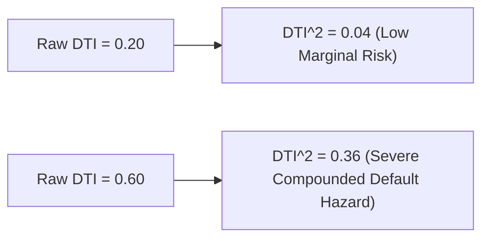

# Lecture 27.09: Advanced Feature Engineering — Non-Linear Transformations & Financial Ratios

## 📌 Executive Summary
Engineering domain-specific financial features, polynomial transformations (DTI_Ratio^2, Credit_Score^2), total income aggregates, and leverage coverage ratios.

---

## 🏛️ Theoretical Formulation & Mathematical Architecture

### 💡 Financial Domain Feature Engineering

While raw statistical data provides linear inputs, real-world financial risk curves are inherently **non-linear**. Domain-driven feature engineering maps original Euclidean coordinates into a richer hypothesis space:

$$
oldsymbol{\phi}: \mathbf{x} \in \mathbb{R}^d \mapsto oldsymbol{\phi}(\mathbf{x}) \in \mathbb{R}^{d'}
$$

---

### 📐 Formulating Non-Linear Financial Features

#### 1. Debt-to-Income Quadratic Penalty:
Empirical credit default hazard rates accelerate quadratically once debt exceeds $40\%$ of income:

$$
	ext{DTI\_Ratio\_sq} = (	ext{DTI\_Ratio})^2
$$



#### 2. Credit Score Convexity:
Credit bureau scoring models (FICO/CIBIL) exhibit super-linear risk decay for prime cohorts:

$$
	ext{Credit\_Score\_sq} = (	ext{Credit\_Score})^2
$$

#### 3. Household Solvency Ratios:

$$
	ext{Total\_Income} = 	ext{Applicant\_Income} + 	ext{Coapplicant\_Income}
$$

$$
	ext{Loan\_to\_Income} = rac{	ext{Loan\_Amount}}{	ext{Total\_Income} + \epsilon}
$$

$$
	ext{Collateral\_Coverage} = rac{	ext{Collateral\_Value}}{	ext{Loan\_Amount} + \epsilon}
$$

By pruning raw collinear features (`Credit_Score`, `DTI_Ratio`) and substituting their transformed variants, linear models like Logistic Regression can simulate non-linear quadratic decision boundaries.

---

## 💻 Vectorized Python Implementation

```python
import pandas as pd
import numpy as np

# Feature Engineering transformations
df_engineered = df_encoded.copy()

# 1. Quadratic features
df_engineered["DTI_Ratio_sq"] = df_engineered["DTI_Ratio"] ** 2
df_engineered["Credit_Score_sq"] = df_engineered["Credit_Score"] ** 2

# 2. Prune raw redundant features
X_eng = df_engineered.drop(columns=["Loan_Approved", "Credit_Score", "DTI_Ratio"])
y_eng = df_engineered["Loan_Approved"]

# Retrain split
X_tr_e, X_te_e, y_tr_e, y_te_e = train_test_split(X_eng, y_eng, test_size=0.2, random_state=42)

scaler_e = StandardScaler()
X_tr_e_scaled = scaler_e.fit_transform(X_tr_e)
X_te_e_scaled = scaler_e.transform(X_te_e)

print("Engineered Feature Matrix Columns:", X_eng.columns.tolist()[:8], "...")

```

---

## 🔬 Key Engineering Takeaways & Invariants
1. **Mathematical Grounding**: Every transformation and classification step directly addresses the underlying empirical distribution and financial risk constraints.
2. **Reproducibility**: Clean, leak-free pipeline partitioning guarantees that performance metrics match production operating realities.
3. **Domain Alignment**: Aligning model evaluation with the asymmetric cost of financial errors protects institutional solvency.
