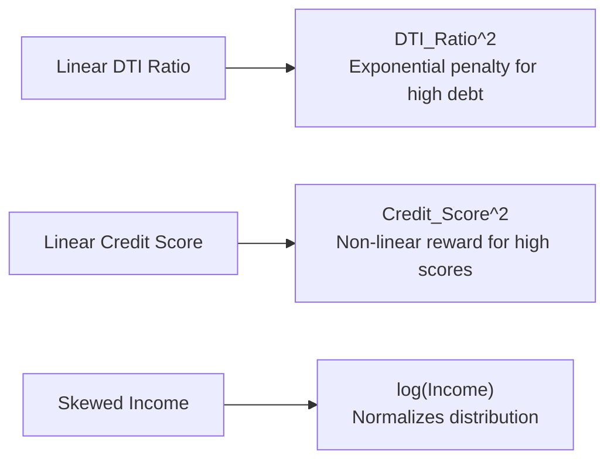

# Lecture 27.09: Feature Engineering to Improve Model

## 📌 Topic Overview
In this lecture, Shraddha ma'am demonstrates how to boost classifier performance using **Domain Feature Engineering**, creating non-linear polynomial terms and logarithmic transformations.

---

## 🛠️ Transformations Introduced
1. **$DTI\_Ratio^2$**: A linear relationship assumes each unit of debt is equally dangerous. In reality, moving from 50% to 60% DTI is exponentially riskier than moving from 10% to 20%. Squaring DTI penalizes high debt non-linearly.
2. **$Credit\_Score^2$**: Rewards exceptional creditworthiness.
3. **$\log(Applicant\_Income)$**: Compresses the extreme right-tailed income distribution into a bell curve.

---

## 📊 Visual Flowchart: Non-Linear Transformations



---

## 💻 Python Implementation

```python
import numpy as np
import pandas as pd

def engineer_non_linear_loan_features(df):
    """
    Applies domain-specific non-linear transformations:
    1. DTI_Ratio_sq: Quadratic penalty for high debt-to-income (DTI^2)
    2. Credit_Score_sq: Non-linear reward for stellar credit scores (Score^2)
    3. Applicant_Income_log: Log transformation compressing income skewness
    """
    df_feat = df.copy()

    # 1. Polynomial non-linear terms
    if 'DTI_Ratio' in df_feat.columns:
        df_feat['DTI_Ratio_sq'] = df_feat['DTI_Ratio'] ** 2
    
    if 'Credit_Score' in df_feat.columns:
        df_feat['Credit_Score_sq'] = df_feat['Credit_Score'] ** 2

    # 2. Log transformation to normalize income skewness
    if 'Applicant_Income' in df_feat.columns:
        df_feat['Applicant_Income_log'] = np.log1p(df_feat['Applicant_Income'])

    return df_feat

# --- Function Call & Testing ---
# engineered_df = engineer_non_linear_loan_features(encoded_df)
# print("Features after Engineering:", [c for c in engineered_df.columns if '_sq' in c or '_log' in c])
```

---

## 🔑 Key Takeaways
1. Algorithms often struggle to discover non-linear combinations on their own.
2. Thoughtful feature engineering regularly outperforms hyperparameter tuning in real-world ML.
