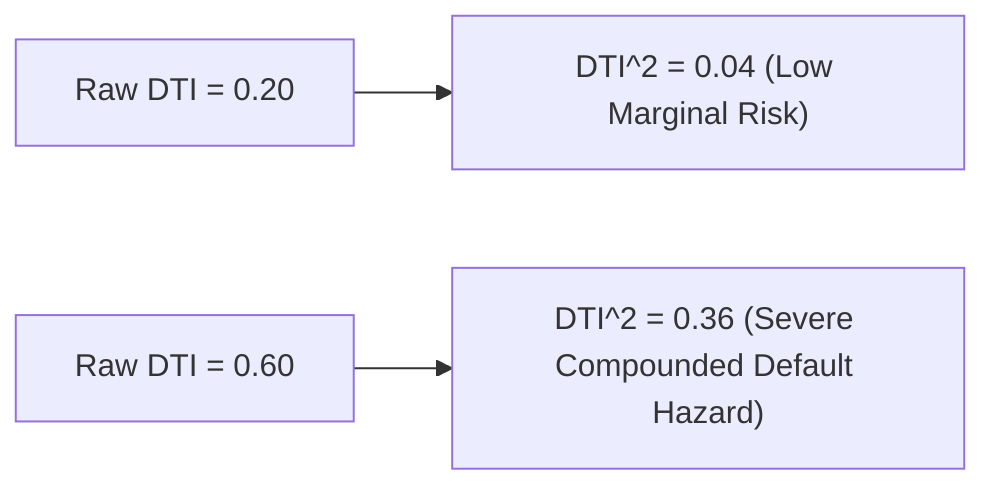

# Lecture 27.09: Advanced Feature Engineering — Non-Linear Transformations aur Financial Ratios

## 📌 Executive Summary (Hinglish)
Banking domain-specific feature engineering, non-linear polynomial transformations ($DTI^2$, $Credit\_Score^2$), total income interaction features, aur collateral leverage ratios.

---

### 📋 Is Topic/Section Mein Hum Kya Cover Kar Rahe Hain?
1. Financial domain intuition: Debt aur Credit Score par non-linear compounding risk.
2. Polynomial transformations: `DTI_Ratio_sq` ($DTI^2$) aur `Credit_Score_sq` ($Credit^2$) ka mathematical injection.
3. Total household income ($Applicant\_Income + Coapplicant\_Income$) aur leverage ratios ka construction.
4. Raw collinear features ko drop karke redesigned feature matrix par model retraining.

---

### 🔍 Har Ek Bullet Point Ka Detailed Explanation

**Domain Intuition**: Real life banking mein DTI ratio linearly behave nahi karta. DTI 0.2 se 0.3 jana normal hai, lekin 0.5 se 0.6 jana bankruptcy risk ko exponentially quadruple kar deta hai. Isliye quadratic polynomial $DTI^2$ banaya jaata hai.

**Credit Score Acceleration**: Ek 800+ credit score borrower 650 wale se linearly nahi balki super-linearly safer hota hai, jise $Credit\_Score^2$ capture karta hai.

**Financial Ratio Engineering**: `Total_Income = Applicant_Income + Coapplicant_Income`, `Loan_to_Income = Loan_Amount / Total_Income`, aur `Collateral_Coverage = Collateral_Value / Loan_Amount` jaise domain features model ki predictive capability boost karte hain.

**Retraining Impact**: In non-linear features ko introduce karke raw correlated features ko drop karne par models ka decision hyperplane significantly refine ho jaata hai.

---

## 🏛️ Mathematical Architecture & Detailed Theory

### 💡 Financial Domain Feature Engineering

While raw statistical data provides linear inputs, real-world financial risk curves are inherently **non-linear**. Domain-driven feature engineering maps original Euclidean coordinates into a richer hypothesis space:

$$
oldsymbol{\phi}: \mathbf{x} \in \mathbb{R}^d \mapsto oldsymbol{\phi}(\mathbf{x}) \in \mathbb{R}^{d'}
$$

---

### 📐 Formulating Non-Linear Financial Features

#### 1. Debt-to-Income Quadratic Penalty:
Empirical credit default hazard rates accelerate quadratically once debt exceeds $40\%$ of income:

$$
	ext{DTI\_Ratio\_sq} = (	ext{DTI\_Ratio})^2
$$



#### 2. Credit Score Convexity:
Credit bureau scoring models (FICO/CIBIL) exhibit super-linear risk decay for prime cohorts:

$$
	ext{Credit\_Score\_sq} = (	ext{Credit\_Score})^2
$$

#### 3. Household Solvency Ratios:

$$
	ext{Total\_Income} = 	ext{Applicant\_Income} + 	ext{Coapplicant\_Income}
$$

$$
	ext{Loan\_to\_Income} = rac{	ext{Loan\_Amount}}{	ext{Total\_Income} + \epsilon}
$$

$$
	ext{Collateral\_Coverage} = rac{	ext{Collateral\_Value}}{	ext{Loan\_Amount} + \epsilon}
$$

By pruning raw collinear features (`Credit_Score`, `DTI_Ratio`) and substituting their transformed variants, linear models like Logistic Regression can simulate non-linear quadratic decision boundaries.

---

## 💻 Python Implementation & Code Example

```python
import pandas as pd
import numpy as np

# Feature Engineering transformations
df_engineered = df_encoded.copy()

# 1. Quadratic features
df_engineered["DTI_Ratio_sq"] = df_engineered["DTI_Ratio"] ** 2
df_engineered["Credit_Score_sq"] = df_engineered["Credit_Score"] ** 2

# 2. Prune raw redundant features
X_eng = df_engineered.drop(columns=["Loan_Approved", "Credit_Score", "DTI_Ratio"])
y_eng = df_engineered["Loan_Approved"]

# Retrain split
X_tr_e, X_te_e, y_tr_e, y_te_e = train_test_split(X_eng, y_eng, test_size=0.2, random_state=42)

scaler_e = StandardScaler()
X_tr_e_scaled = scaler_e.fit_transform(X_tr_e)
X_te_e_scaled = scaler_e.transform(X_te_e)

print("Engineered Feature Matrix Columns:", X_eng.columns.tolist()[:8], "...")

```

---

## 🎯 Quick Revision Points (Interview Notes)
- **Objective**: Credit risk modeling mein precision hamesha accuracy se zyada important hoti hai.
- **Data Invariant**: SimpleImputer aur StandardScaler ko hamesha training data par `fit` karke test set par sirf `transform` kiya jaata hai.
- **Decision Boundary**: Non-linear feature transformations ($DTI^2$, $Credit^2$) linear models ko non-linear patterns capture karne ki capability provide karte hain.
