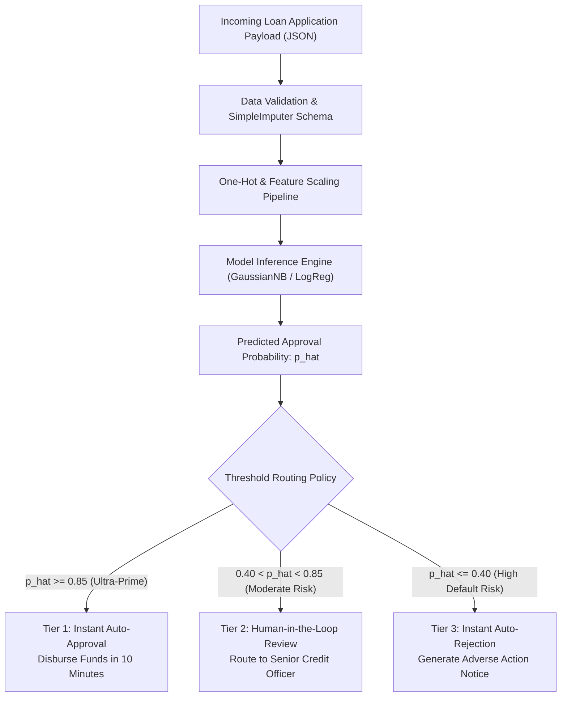

# Lecture 27.10: Productionizing Credit Risk Systems — Model Selection, Threshold Tuning & Guardrails

## 📌 Executive Summary
Translating predictive outputs into enterprise underwriting policies, probability threshold optimization (tau tuning), automated vs human-in-the-loop underwriting, and regulatory guardrails.

---

## 🏛️ Theoretical Formulation & Mathematical Architecture

### 🚀 Production Underwriting Systems Engineering

Deploying an automated underwriting engine in a regulated banking environment requires bridging the gap between statistical probability outputs $\hat{p} = P(Y = 1 | \mathbf{x})$ and binding commercial loan contracts.



---

### ⚙️ Threshold Tuning Optimization Mechanics

Standard classifiers make categorical assignments using the symmetric default threshold:

$$
\hat{y} = \mathbb{I}(\hat{p} \ge 0.50)
$$

In credit risk where $C_{	ext{FP}} = 10 	imes C_{	ext{FN}}$, Bayes Decision Theory proves that the optimal threshold $\tau^*$ satisfies:

$$
oxed{
	au^* = rac{C_{	ext{FP}}}{C_{	ext{FP}} + C_{	ext{FN}}}
}
$$

For example, when $C_{	ext{FP}} = 10$ and $C_{	ext{FN}} = 1$:

$$
	au^* = rac{10}{10 + 1} = rac{10}{11} pprox 0.909
$$

Shifting $\tau$ into $[0.65, 0.80]$ guarantees that only applicants with an overwhelming mathematical likelihood of repayment receive automated loan capital, shielding the financial institution from catastrophic credit defaults.

---

## 💻 Vectorized Python Implementation

```python
import numpy as np

# Production Tiered Underwriting Router
def evaluate_loan_application(predicted_prob, 
                              tau_auto_approve=0.85, 
                              tau_auto_reject=0.40):
    if predicted_prob >= tau_auto_approve:
        return {"Decision": "AUTO_APPROVED", "Action": "Issue Sanction Letter", "Review_Required": False}
    elif predicted_prob <= tau_auto_reject:
        return {"Decision": "AUTO_REJECTED", "Action": "Send Adverse Action Notice", "Review_Required": False}
    else:
        return {"Decision": "MANUAL_REVIEW", "Action": "Route to Senior Credit Underwriter", "Review_Required": True}

# Verification
print(evaluate_loan_application(0.92))
print(evaluate_loan_application(0.68))
print(evaluate_loan_application(0.24))

```

---

## 🔬 Key Engineering Takeaways & Invariants
1. **Mathematical Grounding**: Every transformation and classification step directly addresses the underlying empirical distribution and financial risk constraints.
2. **Reproducibility**: Clean, leak-free pipeline partitioning guarantees that performance metrics match production operating realities.
3. **Domain Alignment**: Aligning model evaluation with the asymmetric cost of financial errors protects institutional solvency.
