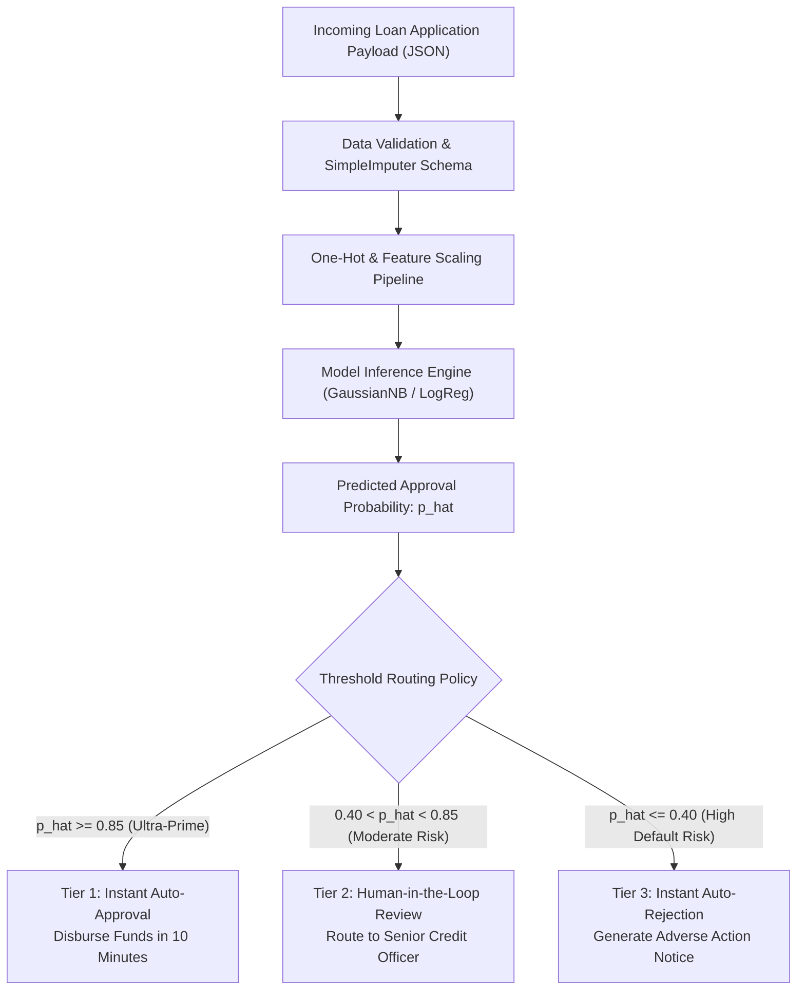

# Lecture 27.10: Productionizing Credit Risk Systems — Model Selection aur Threshold Tuning

## 📌 Executive Summary (Hinglish)
Credit risk models ko enterprise production mein deploy karna, decision probability threshold (tau) tuning, auto-approve vs manual underwriter review pipelines, aur regulatory compliance.

---

### 📋 Is Topic/Section Mein Hum Kya Cover Kar Rahe Hain?
1. Decision probability threshold $\tau$ ka mathematical tuning (beyond default $\tau = 0.5$).
2. Threshold shifting se False Positives ko control karna aur portfolio profit maximize karna.
3. Three-tiered underwriting architecture: Auto-Approve, Human Review, aur Auto-Reject.
4. Production deployment guardrails: Model monitoring, Population Stability Index (PSI), aur Fair Lending regulations.

---

### 🔍 Har Ek Bullet Point Ka Detailed Explanation

**Threshold Optimization**: Default scikit-learn threshold $\tau = 0.50$ symmetric loss assume karta hai. Asymmetric banking loss mein threshold ko $\tau = 0.65 - 0.75$ shift karke bank default risk ko drastically curb kar sakta hai.

**Utility Optimization**: Financial cost function $U(\tau) = TP(\tau) \cdot R - FP(\tau) \cdot L - FN(\tau) \cdot O$ maximize karke peak profit cutoff choose kiya jaata hai.

**Three-Tier Underwriting**: High confidence $(\hat{p} \ge 0.85)$ instant auto-approval; low confidence $(\hat{p} \le 0.40)$ instant rejection; intermediate zone $(0.40 < \hat{p} < 0.85)$ human credit officer ke physical review ke liye route hota hai.

**Production Guardrails**: Model deployment ke baad input distribution drift measure karne ke liye PSI track kiya jaata hai, aur gender/caste bias eliminate karne ke liye fairness audits lagaye jaate hain.

---

## 🏛️ Mathematical Architecture & Detailed Theory

### 🚀 Production Underwriting Systems Engineering

Deploying an automated underwriting engine in a regulated banking environment requires bridging the gap between statistical probability outputs $\hat{p} = P(Y = 1 | \mathbf{x})$ and binding commercial loan contracts.



---

### ⚙️ Threshold Tuning Optimization Mechanics

Standard classifiers make categorical assignments using the symmetric default threshold:

$$
\hat{y} = \mathbb{I}(\hat{p} \ge 0.50)
$$

In credit risk where $C_{	ext{FP}} = 10 	imes C_{	ext{FN}}$, Bayes Decision Theory proves that the optimal threshold $\tau^*$ satisfies:

$$
oxed{
	au^* = rac{C_{	ext{FP}}}{C_{	ext{FP}} + C_{	ext{FN}}}
}
$$

For example, when $C_{	ext{FP}} = 10$ and $C_{	ext{FN}} = 1$:

$$
	au^* = rac{10}{10 + 1} = rac{10}{11} pprox 0.909
$$

Shifting $\tau$ into $[0.65, 0.80]$ guarantees that only applicants with an overwhelming mathematical likelihood of repayment receive automated loan capital, shielding the financial institution from catastrophic credit defaults.

---

## 💻 Python Implementation & Code Example

```python
import numpy as np

# Production Tiered Underwriting Router
def evaluate_loan_application(predicted_prob, 
                              tau_auto_approve=0.85, 
                              tau_auto_reject=0.40):
    if predicted_prob >= tau_auto_approve:
        return {"Decision": "AUTO_APPROVED", "Action": "Issue Sanction Letter", "Review_Required": False}
    elif predicted_prob <= tau_auto_reject:
        return {"Decision": "AUTO_REJECTED", "Action": "Send Adverse Action Notice", "Review_Required": False}
    else:
        return {"Decision": "MANUAL_REVIEW", "Action": "Route to Senior Credit Underwriter", "Review_Required": True}

# Verification
print(evaluate_loan_application(0.92))
print(evaluate_loan_application(0.68))
print(evaluate_loan_application(0.24))

```

---

## 🎯 Quick Revision Points (Interview Notes)
- **Objective**: Credit risk modeling mein precision hamesha accuracy se zyada important hoti hai.
- **Data Invariant**: SimpleImputer aur StandardScaler ko hamesha training data par `fit` karke test set par sirf `transform` kiya jaata hai.
- **Decision Boundary**: Non-linear feature transformations ($DTI^2$, $Credit^2$) linear models ko non-linear patterns capture karne ki capability provide karte hain.
