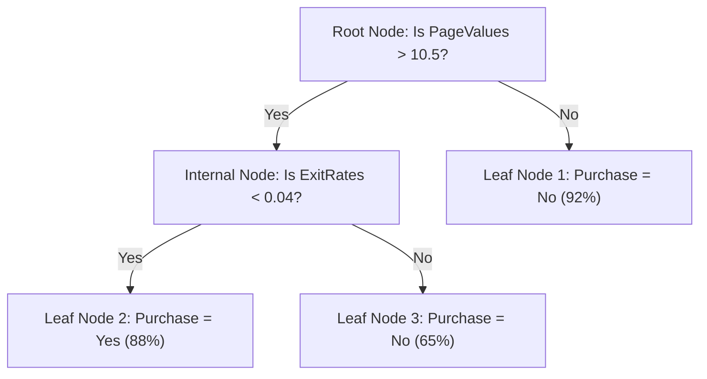

# Lecture 28.01: Introduction to Decision Trees & Non-Linear Partitioning

## 📌 Executive Summary
First-principles introduction to Decision Trees, recursive orthogonal feature space partitioning, tree structural anatomy, and comparison with linear models and metric space learners.

---

## 🏛️ Theoretical Formulation & Mathematical Architecture

### 🌲 The Inductive Bias of Decision Trees

In supervised machine learning, a **Decision Tree** is a non-parametric hierarchical model that solves classification and regression tasks by recursively partitioning the input feature space $\mathcal{X} \subseteq \mathbb{R}^d$ into a collection of mutually exclusive, axis-aligned hyper-rectangles (boxes).



---

### 🏛️ Tree Structural Anatomy

A decision tree directed acyclic graph (DAG) consists of four fundamental architectural elements:
1. **Root Node**: The origin node containing the entirety of the training distribution $\mathcal{D}$, which selects the globally most informative initial split $(x_j, \theta)$.
2. **Internal (Decision) Nodes**: Intermediate conditional splits testing a specific scalar inequality $x_j \le \theta$.
3. **Branches (Edges)**: Directed links representing the binary evaluation outcome (True or False / Left or Right).
4. **Leaf (Terminal) Nodes**: Absorbing endpoints containing homogeneous subsets $\mathcal{D}_m$ that output the final prediction.

---

### ⚖️ Architectural Comparison: Linear Models vs Decision Trees

| Property | Linear Models (Logistic / Ridge) | Decision Trees (CART) |
| :--- | :--- | :--- |
| **Decision Boundary** | Single global flat hyperplane $\mathbf{w}^T \mathbf{x} + b = 0$ | Piecewise orthogonal axis-aligned step boundaries |
| **Feature Scaling** | **Mandatory** (Gradient descent & distances depend on scaling) | **Completely Invariant** to monotonic scale transformations |
| **Feature Interactions**| Must be manually engineered ($x_1 \cdot x_2$) | Naturally captured via nested hierarchical splits |
| **Interpretability** | Global linear weight coefficients | Transparent IF-THEN decision path |

---

## 💻 Vectorized Python Implementation

```python
import numpy as np
from sklearn.tree import DecisionTreeClassifier

# Simple demonstration of scale invariance
X = np.array([[10, 50000], [15, 60000], [25, 120000], [30, 140000]])
y = np.array([0, 0, 1, 1])

# Scale feature 1 by 1000x
X_scaled = X.copy()
X_scaled[:, 1] = X_scaled[:, 1] * 1000

clf1 = DecisionTreeClassifier(random_state=42).fit(X, y)
clf2 = DecisionTreeClassifier(random_state=42).fit(X_scaled, y)

print("Predictions on unscaled:", clf1.predict(X))
print("Predictions on scaled:  ", clf2.predict(X_scaled))
assert np.array_equal(clf1.predict(X), clf2.predict(X_scaled)), "Trees must be scale-invariant!"

```

---

## 🔬 Key Engineering Takeaways & Invariants
1. **Axis-Aligned Partitioning**: Decision trees recursively split feature space along orthogonal boundaries without requiring feature scaling.
2. **Impurity Optimization**: Split selection deterministically maximizes impurity reduction (Information Gain for classification, Variance Reduction for regression).
3. **Generalization Safeguards**: Regularization via pre-pruning (`max_depth`, `min_samples_leaf`) and post-pruning (`ccp_alpha`) prevents noisy leaf memorization.
