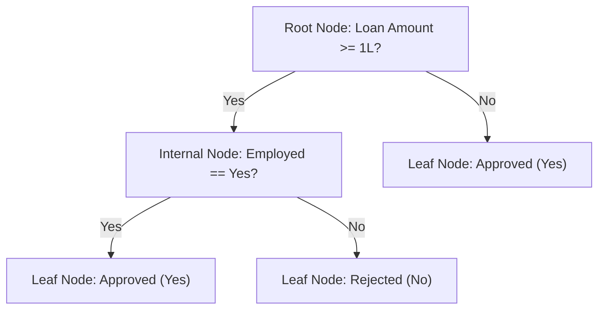

# Lecture 28.01: Introduction to Decision Trees

## 📌 Topic Overview
In this lecture, we understand what a **Decision Tree** is, why it is one of the most intuitive and widely used machine learning models, and how it makes predictions using a sequence of simple if-else decisions.

---

## 💡 Real-World Intuition: The Loan Approval Analogy
Imagine a bank loan officer evaluating whether an applicant should be granted a loan. The officer naturally follows a chain of questions:
1. *Is the applicant's loan amount $\ge 1$ Lakh?*
2. *If yes, is the applicant employed?*
3. *If employed, approve the loan; otherwise, reject.*

In Python code, this thinking looks exactly like simple conditional statements:
```python
def check_loan_approval(loan_amt, employed):
    """
    Simulates simple if-else decision rules for loan approval:
    - If loan amount >= 100,000 and applicant is employed -> Approved
    - If loan amount >= 100,000 and applicant is unemployed -> Rejected
    - If loan amount < 100,000 -> Approved directly
    """
    if loan_amt >= 100000:
        if employed == "Yes":
            return "Loan Approved"
        else:
            return "Loan Rejected"
    else:
        return "Loan Approved"

# --- Function Call & Testing ---
applicant_decision = check_loan_approval(loan_amt=150000, employed="Yes")
print("Loan Decision:", applicant_decision)
```

A **Decision Tree** is simply this nested `if-else` decision logic learned automatically from data!

---

## 🌲 Tree Structural Anatomy
When we draw this sequence of decisions as a flowchart, it forms an upside-down tree:



### 1. Root Node
- The very first node at the top where the decision process starts.
- It contains all the training samples before any split occurs.

### 2. Internal (Decision) Nodes
- Intermediate nodes where a feature is tested (e.g., `employed == 'Yes'?`).
- Each internal node splits the data further down two or more branches.

### 3. Branches (Edges)
- The connecting arrows representing the possible answers to the condition (e.g., `Yes` vs `No`).

### 4. Leaf (Terminal) Nodes
- The final endpoints where no further questions are asked.
- Each leaf provides the final predicted output (e.g., class label in classification or average value in regression).

---

## 🎯 Visualizing Data Partitioning: Blue Dots vs Orange Dots
Consider a mixed dataset with two classes:
- **Blue dots** = Positive class (e.g., Loan Approved = Yes)
- **Orange dots** = Negative class (e.g., Loan Approved = No)

At the root node, blue and orange dots are mixed together (**impure**). 
When the tree tests a feature (for example, `Gender` $\rightarrow$ Male vs Female):
- One branch receives a group that has mostly orange dots.
- The other branch receives a group that has mostly blue dots.

By continuing this splitting recursively, the tree isolates the samples into **pure leaf nodes** containing only blue or only orange dots.

---

## 🏛️ Famous Decision Tree Algorithms
Over the years, several algorithms have been developed to build decision trees:
1. **CART (Classification and Regression Trees)**: The standard algorithm used in Scikit-Learn. It produces binary splits (2 children per node).
2. **ID3 (Iterative Dichotomiser 3)**: Developed by Ross Quinlan; uses Information Gain (Entropy).
3. **C4.5**: Quinlan's successor to ID3 that supports continuous features and pruning.
4. **CHAID (Chi-square Automatic Interaction Detector)**: Uses Chi-square tests for categorical multi-way splits.

---

## 💻 Python Implementation

```python
import numpy as np
from sklearn.tree import DecisionTreeClassifier

def train_and_predict_loan_tree():
    """
    Trains a CART DecisionTreeClassifier on applicant data
    and predicts approval for a new applicant.
    """
    # Feature matrix: [Loan_Amount_in_Lakhs, Employed (1=Yes, 0=No)]
    X = np.array([
        [0.5, 0],
        [0.8, 1],
        [1.5, 1],
        [2.0, 0],
        [3.0, 1]
    ])
    # Target: 1 = Approved, 0 = Rejected
    y = np.array([1, 1, 1, 0, 1])

    # 1. Initialize and fit Decision Tree Classifier
    clf = DecisionTreeClassifier(random_state=42)
    clf.fit(X, y)

    # 2. Predict for a new applicant: Loan 2.5 Lakh, Unemployed (0)
    new_applicant = [[2.5, 0]]
    prediction = clf.predict(new_applicant)[0]
    decision = "Approved" if prediction == 1 else "Rejected"

    return clf, decision

# --- Function Call & Result ---
model, decision = train_and_predict_loan_tree()
print("Prediction for [2.5L, Unemployed]:", decision)
```

---

## 🔑 Key Takeaways
1. Decision Trees predict outcomes by asking a sequence of hierarchical if-then questions.
2. The tree consists of a **Root Node**, **Internal Decision Nodes**, **Branches**, and **Leaf Nodes**.
3. The goal of tree building is to partition mixed data points into clean, homogeneous (pure) groups.
4. Scikit-Learn implements the **CART** algorithm by default.
