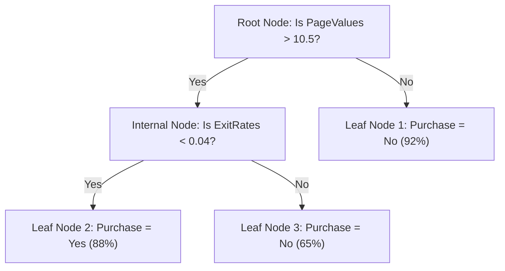

# Lecture 28.01: Decision Trees ka Introduction aur Non-Linear Feature Partitioning

## 📌 Executive Summary (Hinglish)
Decision Trees ka fundamental introduction, feature space ka recursive orthogonal partitioning, tree ke anatomical components (nodes, branches, leaves), aur linear models ke sath architectural comparison.

---

### 📋 Is Topic/Section Mein Hum Kya Cover Kar Rahe Hain?
1. Decision Trees ka core inductive bias: Feature space ko axis-aligned boxes mein partition karna.
2. Tree anatomy ke core components: Root Node, Internal Decision Nodes, Branches, aur Leaf / Terminal Nodes.
3. Linear Classifiers (hyperplanes) vs Decision Trees (non-linear step boundaries) ka structural comparison.
4. Interpretability advantage: White-box IF-THEN logic aur human decision-making alignment.

---

### 🔍 Har Ek Bullet Point Ka Detailed Explanation

**Core Inductive Bias**: Linear models feature space mein ek straight hyperplane draw karte hain, jabki Decision Trees feature coordinates ko axes ke parallel cut karke rectangular regions banate hain.

**Tree Anatomy**: Sabse pehla split Root Node par hota hai. Intermediate checkpoints Internal Nodes hote hain jo decisions banate hain. Jo nodes aage split nahi hote, unhe Leaf Nodes ya Terminal Nodes kehte hain jahan final prediction hoti hai.

**Non-Linear Boundaries**: Decision Trees bina kisi kernel ya manual feature engineering ke highly complex, non-linear step-function boundaries naturally fit kar sakte hain.

**White-Box Interpretability**: Neural networks ya ensembles ke opposite, ek single decision tree exact IF-THEN rules ke through explain kiya ja sakta hai.

---

## 🏛️ Mathematical Architecture & Detailed Theory

### 🌲 The Inductive Bias of Decision Trees

In supervised machine learning, a **Decision Tree** is a non-parametric hierarchical model that solves classification and regression tasks by recursively partitioning the input feature space $\mathcal{X} \subseteq \mathbb{R}^d$ into a collection of mutually exclusive, axis-aligned hyper-rectangles (boxes).



---

### 🏛️ Tree Structural Anatomy

A decision tree directed acyclic graph (DAG) consists of four fundamental architectural elements:
1. **Root Node**: The origin node containing the entirety of the training distribution $\mathcal{D}$, which selects the globally most informative initial split $(x_j, \theta)$.
2. **Internal (Decision) Nodes**: Intermediate conditional splits testing a specific scalar inequality $x_j \le \theta$.
3. **Branches (Edges)**: Directed links representing the binary evaluation outcome (True or False / Left or Right).
4. **Leaf (Terminal) Nodes**: Absorbing endpoints containing homogeneous subsets $\mathcal{D}_m$ that output the final prediction.

---

### ⚖️ Architectural Comparison: Linear Models vs Decision Trees

| Property | Linear Models (Logistic / Ridge) | Decision Trees (CART) |
| :--- | :--- | :--- |
| **Decision Boundary** | Single global flat hyperplane $\mathbf{w}^T \mathbf{x} + b = 0$ | Piecewise orthogonal axis-aligned step boundaries |
| **Feature Scaling** | **Mandatory** (Gradient descent & distances depend on scaling) | **Completely Invariant** to monotonic scale transformations |
| **Feature Interactions**| Must be manually engineered ($x_1 \cdot x_2$) | Naturally captured via nested hierarchical splits |
| **Interpretability** | Global linear weight coefficients | Transparent IF-THEN decision path |

---

## 💻 Python Implementation & Code Example

```python
import numpy as np
from sklearn.tree import DecisionTreeClassifier

# Simple demonstration of scale invariance
X = np.array([[10, 50000], [15, 60000], [25, 120000], [30, 140000]])
y = np.array([0, 0, 1, 1])

# Scale feature 1 by 1000x
X_scaled = X.copy()
X_scaled[:, 1] = X_scaled[:, 1] * 1000

clf1 = DecisionTreeClassifier(random_state=42).fit(X, y)
clf2 = DecisionTreeClassifier(random_state=42).fit(X_scaled, y)

print("Predictions on unscaled:", clf1.predict(X))
print("Predictions on scaled:  ", clf2.predict(X_scaled))
assert np.array_equal(clf1.predict(X), clf2.predict(X_scaled)), "Trees must be scale-invariant!"

```

---

## 🎯 Quick Revision Points (Interview Notes)
- **Scale Invariance**: Decision Trees monotonically invariant hote hain, isliye inme `StandardScaler` mandatory nahi hota.
- **Gini vs Entropy**: Gini speed mein 10x faster hota hai kyunki logarithm computation ki zaroorat nahi padti.
- **Pruning Necessity**: Unconstrained decision tree hamesha overfit karti hai; `min_samples_leaf` aur `ccp_alpha` sabse effective regularizers hain.
