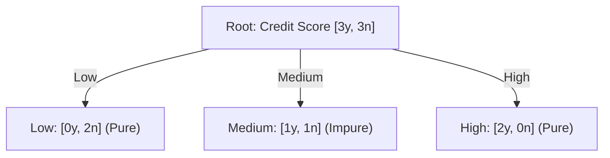
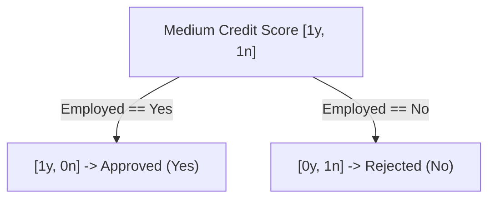

# Lecture 28.02: Decision Tree Classifier & Recursive Splitting

## 📌 Topic Overview
How does a Decision Tree Classifier actually decide which feature to test first? In this lecture, we examine the classroom applicant dataset, the concept of **node purity**, and the recursive splitting process.

---

## 📊 The Classroom Loan Applicant Dataset
In the lecture, the instructor presents the following 6-sample dataset on the blackboard:

| Credit Score | Employed | Loan Approved (Target) |
| :--- | :--- | :--- |
| Low | No | No |
| Low | Yes | No |
| Medium | Yes | Yes |
| High | Yes | Yes |
| Medium | No | No |
| High | No | Yes |

### Target Distribution at Root:
Total samples = 6:
- Yes = 3
- No = 3
- Notation: **$[3y, 3n]$** (completely mixed / 50-50 uncertainty).

---

## ❓ The Two Fundamental Questions of Tree Building
To build a decision tree classifier, the algorithm must answer two core questions at every step:
1. **Feature selection for split**: Which feature (`Credit Score` or `Employed`?) should be chosen at this node?
2. **Degree of purity of a split**: How do we measure whether a proposed split actually makes our subsets cleaner and more homogeneous?

---

## 🌳 Splitting on Feature 1: `Credit Score`
Let us test splitting the root $[3y, 3n]$ by `Credit Score` (Low, Medium, High):



### Observations:
- **Low branch**: Contains 2 samples, both are `No` $\rightarrow [0y, 2n]$. This is **100% Pure (Homogeneous)**! No further splitting needed; this becomes a Leaf Node predicting `No`.
- **High branch**: Contains 2 samples, both are `Yes` $\rightarrow [2y, 0n]$. This is **100% Pure (Homogeneous)**! This becomes a Leaf Node predicting `Yes`.
- **Medium branch**: Contains 2 samples, one `Yes` and one `No` $\rightarrow [1y, 1n]$. This is **Impure (Heterogeneous)**. We cannot make a confident prediction here!

---

## 🔄 Recursive Splitting: Handling the Impure Node
Since the `Medium` node is impure $[1y, 1n]$, we must split it further using the remaining unused feature: `Employed?`



Now:
- If `Employed == Yes` $\rightarrow [1y, 0n]$ (Pure $\rightarrow$ Approved).
- If `Employed == No` $\rightarrow [0y, 1n]$ (Pure $\rightarrow$ Rejected).

Every single branch now terminates in a completely pure leaf!

---

## 💻 Python Implementation

```python
import pandas as pd
from sklearn.tree import DecisionTreeClassifier, export_text

def build_credit_score_tree():
    """
    Builds a DecisionTreeClassifier on the exact 6-applicant classroom dataset
    and returns the learned recursive splitting rules.
    """
    # 1. Dataset: Credit_Score (0: Low, 1: Medium, 2: High), Employed (0: No, 1: Yes)
    data = {
        'Credit_Score': [0, 0, 1, 2, 1, 2],
        'Employed':     [0, 1, 1, 1, 0, 0],
        'Loan_Approved': [0, 0, 1, 1, 0, 1]
    }
    df = pd.DataFrame(data)

    X = df[['Credit_Score', 'Employed']]
    y = df['Loan_Approved']

    # 2. Train Decision Tree using Entropy criterion
    clf = DecisionTreeClassifier(criterion='entropy', random_state=42)
    clf.fit(X, y)

    # 3. Export text rules
    rules = export_text(clf, feature_names=['Credit_Score', 'Employed'])
    return clf, rules

# --- Function Call & Output ---
tree_model, decision_rules = build_credit_score_tree()
print("Learned Decision Rules:\n")
print(decision_rules)
```

---

## 🔑 Key Takeaways
1. A node is **pure (homogeneous)** when all its samples belong to the same class.
2. An **impure (heterogeneous)** node contains a mixture of classes and requires further splitting.
3. The decision tree repeats this splitting process recursively until all leaves are pure or a stopping condition is reached.
