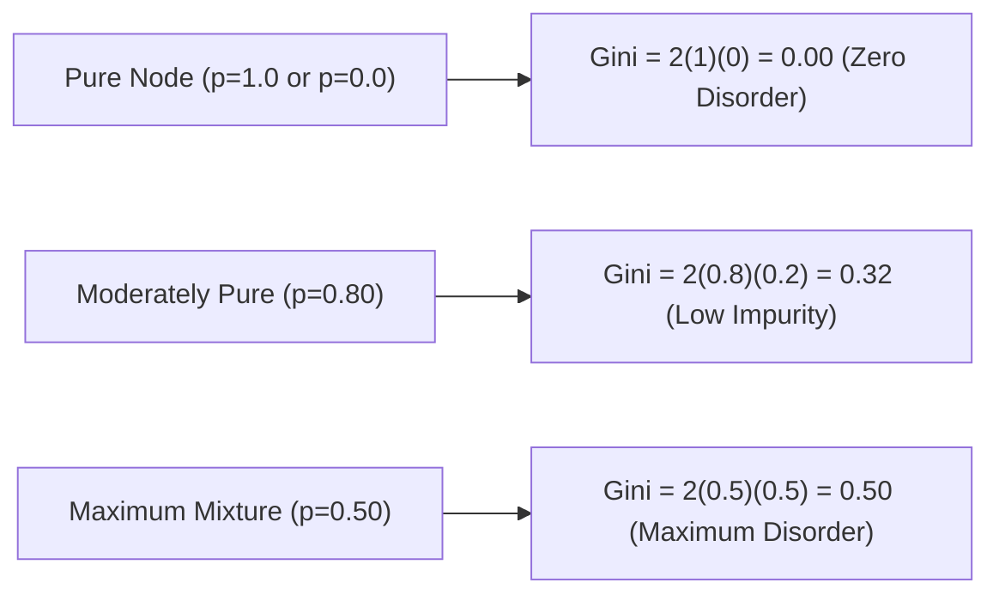

# Lecture 28.04: Gini Impurity — Formulation & Mathematical Mechanics

## 📌 Executive Summary
Mathematical derivation of Gini Impurity, probability of misclassification interpretation, computational efficiency without transcendental functions, and its role as the CART default.

---

## 🏛️ Theoretical Formulation & Mathematical Architecture

### 📊 The Probabilistic Meaning of Gini Impurity

Originally formulated by Italian statistician Corrado Gini, **Gini Impurity** measures the probability that a randomly chosen element from a set would be incorrectly labeled if it were randomly labeled according to the empirical distribution of class labels in the subset.

Let a node contain items from $K$ classes with empirical probabilities $p_1, p_2, \dots, p_K$.
- The probability that an item belongs to class $k$ is $p_k$.
- The probability that the item is assigned class $j \neq k$ is $(1 - p_k)$.

Summing across all $K$ classes:

$$
\boxed{
G(S) = \sum_{k=1}^K p_k (1 - p_k) = \sum_{k=1}^K (p_k - p_k^2) = \sum_{k=1}^K p_k - \sum_{k=1}^K p_k^2 = 1 - \sum_{k=1}^K p_k^2
}
$$

---

### 📐 Binary Classification Gini Dynamics

In a binary classification setting ($K=2$ with positive class proportion $p$):

$$
G(p) = 1 - \left( p^2 + (1-p)^2 \right) = 1 - (p^2 + 1 - 2p + p^2) = 2p - 2p^2 = 2p(1 - p)
$$



#### Multi-Class Bound:
For $K$ classes, maximum Gini impurity occurs at uniform distribution $p_k = 1/K$:

$$
G_{\max} = 1 - \sum_{k=1}^K \left(\frac{1}{K}\right)^2 = 1 - \frac{K}{K^2} = 1 - \frac{1}{K} = \frac{K-1}{K}
$$

As $K \to \infty$, $G_{\max} \to 1.0$.

---

## 💻 Vectorized Python Implementation

```python
import numpy as np

def calculate_gini(labels):
    _, counts = np.unique(labels, return_counts=True)
    probs = counts / counts.sum()
    return 1.0 - np.sum(probs ** 2)

# Test
pure = np.array([0, 0, 0, 0])
fifty_fifty = np.array([0, 1, 0, 1])

print("Pure Gini:        ", calculate_gini(pure))
print("50-50 Gini:       ", calculate_gini(fifty_fifty))
assert calculate_gini(pure) == 0.0
assert calculate_gini(fifty_fifty) == 0.5

```

---

## 🔬 Key Engineering Takeaways & Invariants
1. **Axis-Aligned Partitioning**: Decision trees recursively split feature space along orthogonal boundaries without requiring feature scaling.
2. **Impurity Optimization**: Split selection deterministically maximizes impurity reduction (Information Gain for classification, Variance Reduction for regression).
3. **Generalization Safeguards**: Regularization via pre-pruning (`max_depth`, `min_samples_leaf`) and post-pruning (`ccp_alpha`) prevents noisy leaf memorization.
