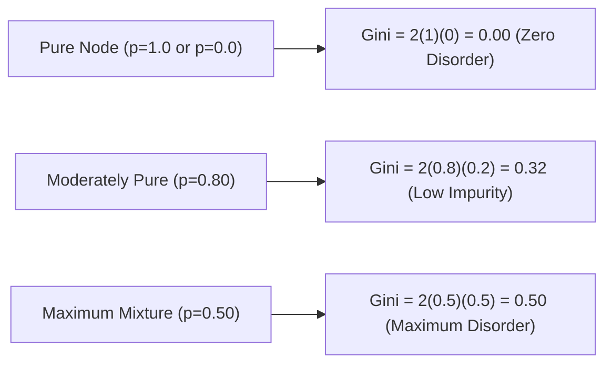

# Lecture 28.04: Gini Impurity — Formulation aur Mathematical Mechanics

## 📌 Executive Summary (Hinglish)
Gini Impurity ka mathematical derivation, random misclassification probability ka physical meaning, computational efficiency, aur CART algorithm mein default metric hone ki vajah.

---

### 📋 Is Topic/Section Mein Hum Kya Cover Kar Rahe Hain?
1. Gini Impurity ka probabilistic intuition: Randomly chosen element ko random label dene par galat classify hone ka risk.
2. Gini Impurity ka general formula: $G(S) = 1 - \sum_{k=1}^K p_k^2$.
3. Binary classification case mein Gini curve: $G(p) = 2p(1-p)$ jiska peak $0.5$ par hota hai.
4. Computational advantage: Logarithm na hone ki vajah se faster CPU execution.

---

### 🔍 Har Ek Bullet Point Ka Detailed Explanation

**Physical Meaning**: Agar hum kisi node se randomly ek sample uthayein aur use usi node ke class distribution ke according random label assign karein, toh uske galat hone ki probability hi Gini Impurity hoti hai.

**Formula**: $G(S) = \sum_k p_k (1 - p_k) = 1 - \sum_k p_k^2$. Pure node par $p_1 = 1$, toh $G = 1 - 1 = 0$.

**Binary Bounds**: Binary case mein $G(p) = 2p(1-p)$. Pure node par $G=0$, jabki 50-50 mix par $G = 2(0.5)(0.5) = 0.50$.

**Speed Advantage**: Entropy calculate karne ke liye `np.log2` call karna padta hai jo transcendental operation hai. Gini sirf basic multiplication aur addition use karta hai, isliye modern ML libraries ise prefer karti hain.

---

## 🏛️ Mathematical Architecture & Detailed Theory

### 📊 The Probabilistic Meaning of Gini Impurity

Originally formulated by Italian statistician Corrado Gini, **Gini Impurity** measures the probability that a randomly chosen element from a set would be incorrectly labeled if it were randomly labeled according to the empirical distribution of class labels in the subset.

Let a node contain items from $K$ classes with empirical probabilities $p_1, p_2, \dots, p_K$.
- The probability that an item belongs to class $k$ is $p_k$.
- The probability that the item is assigned class $j \neq k$ is $(1 - p_k)$.

Summing across all $K$ classes:

$$
\boxed{
G(S) = \sum_{k=1}^K p_k (1 - p_k) = \sum_{k=1}^K (p_k - p_k^2) = \sum_{k=1}^K p_k - \sum_{k=1}^K p_k^2 = 1 - \sum_{k=1}^K p_k^2
}
$$

---

### 📐 Binary Classification Gini Dynamics

In a binary classification setting ($K=2$ with positive class proportion $p$):

$$
G(p) = 1 - \left( p^2 + (1-p)^2 \right) = 1 - (p^2 + 1 - 2p + p^2) = 2p - 2p^2 = 2p(1 - p)
$$



#### Multi-Class Bound:
For $K$ classes, maximum Gini impurity occurs at uniform distribution $p_k = 1/K$:

$$
G_{\max} = 1 - \sum_{k=1}^K \left(\frac{1}{K}\right)^2 = 1 - \frac{K}{K^2} = 1 - \frac{1}{K} = \frac{K-1}{K}
$$

As $K \to \infty$, $G_{\max} \to 1.0$.

---

## 💻 Python Implementation & Code Example

```python
import numpy as np

def calculate_gini(labels):
    _, counts = np.unique(labels, return_counts=True)
    probs = counts / counts.sum()
    return 1.0 - np.sum(probs ** 2)

# Test
pure = np.array([0, 0, 0, 0])
fifty_fifty = np.array([0, 1, 0, 1])

print("Pure Gini:        ", calculate_gini(pure))
print("50-50 Gini:       ", calculate_gini(fifty_fifty))
assert calculate_gini(pure) == 0.0
assert calculate_gini(fifty_fifty) == 0.5

```

---

## 🎯 Quick Revision Points (Interview Notes)
- **Scale Invariance**: Decision Trees monotonically invariant hote hain, isliye inme `StandardScaler` mandatory nahi hota.
- **Gini vs Entropy**: Gini speed mein 10x faster hota hai kyunki logarithm computation ki zaroorat nahi padti.
- **Pruning Necessity**: Unconstrained decision tree hamesha overfit karti hai; `min_samples_leaf` aur `ccp_alpha` sabse effective regularizers hain.
