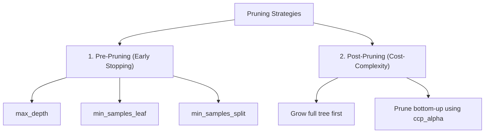

# Lecture 28.07: Pruning Decision Trees

## 📌 Topic Overview
Decision Trees have a natural tendency to overfit because they greedily keep splitting until every single training sample is memorized. In this lecture, we explore why overfitting happens, the visual outlier node example, and the concept of **Pruning**.

---

## ⚠️ Why Decision Trees Overfit
A Decision Tree will continue splitting until every leaf node is 100% pure, even if it has to create deeply nested branches for a single noise sample!

### The Blackboard Outlier Example
In the lecture, the instructor draws a node containing:
$$[14y, 1n]$$
- 14 samples are `Yes`.
- Only 1 sample is `No` (an outlier or data error).

Without restrictions, the tree splits this node into:
- Branch 1: $[14y, 0n]$ (Leaf node)
- Branch 2: $[0y, 1n]$ (Leaf node)

**Problem**: The tree created an entirely new depth level just to isolate a single outlier! 
When evaluated:
- **Training accuracy**: $100\%$
- **Testing accuracy**: Very poor!
This is the classic definition of **Overfitting**: $	ext{Training Accuracy} \gg 	ext{Testing Accuracy}$.

---

## ✂️ What is Pruning?
> **Pruning is a technique used in Decision Trees to remove parts of the tree that are unnecessary, in order to reduce overfitting and improve performance on unseen test data.**

Just as a gardener prunes overgrown branches to keep a plant healthy, we cut off noisy branches of a decision tree.

---

## 🌲 Two Main Pruning Approaches
On the blackboard, the instructor explains the two fundamental pruning paradigms:



### 1. Pre-Pruning (Early Stopping)
- We stop the tree from growing before it becomes too complex.
- We draw a horizontal cutoff line using constraints like:
- `max_depth = 4`
- `min_samples_leaf = 5`

### 2. Post-Pruning
- We let the tree grow completely until all leaves are pure.
- Then, we inspect the tree from the bottom up and trim away branches that do not provide significant predictive benefit.

---

## 💻 Python Implementation: Demonstrating Overfitting

```python
from sklearn.datasets import make_classification
from sklearn.model_selection import train_test_split
from sklearn.tree import DecisionTreeClassifier

def compare_unpruned_vs_pruned_trees():
    """
    Demonstrates tree overfitting in unconstrained trees vs generalization
    restored by pre-pruning (max_depth=3).
    """
    # 1. Generate dataset
    X, y = make_classification(n_samples=500, n_features=10, n_informative=5, random_state=42)
    X_train, X_test, y_train, y_test = train_test_split(X, y, test_size=0.3, random_state=42)

    # 2. Unpruned (Overfitting) Tree
    clf_unpruned = DecisionTreeClassifier(random_state=42)
    clf_unpruned.fit(X_train, y_train)

    # 3. Pruned Tree (max_depth=3)
    clf_pruned = DecisionTreeClassifier(max_depth=3, random_state=42)
    clf_pruned.fit(X_train, y_train)

    # 4. Compare performance
    results = {
        'unpruned_train': clf_unpruned.score(X_train, y_train),
        'unpruned_test':  clf_unpruned.score(X_test, y_test),
        'pruned_train':   clf_pruned.score(X_train, y_train),
        'pruned_test':    clf_pruned.score(X_test, y_test)
    }
    return results

# --- Run & Print Results ---
scores = compare_unpruned_vs_pruned_trees()
print(f"Unpruned Train: {scores['unpruned_train']*100:.1f}% | Test: {scores['unpruned_test']*100:.1f}% (Overfitting!)")
print(f"Pruned Train:   {scores['pruned_train']*100:.1f}% | Test: {scores['pruned_test']*100:.1f}% (Generalized!)")
```

---

## 🔑 Key Takeaways
1. Unconstrained decision trees memorize noise and outliers (e.g., splitting a $[14y, 1n]$ node).
2. Overfitting occurs when $	ext{Training Accuracy} \gg 	ext{Testing Accuracy}$.
3. **Pruning** trims unnecessary branches to restore generalization.
4. Pruning can be done during growth (**Pre-pruning**) or after full growth (**Post-pruning**).
