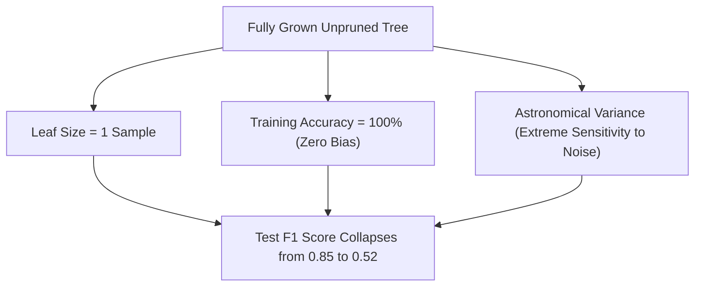

# Lecture 28.07: Pruning Decision Trees — Overfitting, Memorization & Generalization Gap

## 📌 Executive Summary
Why fully grown decision trees suffer from high variance and noise memorization, structural causes of the generalization gap, and the overarching framework of tree pruning.

---

## 🏛️ Theoretical Formulation & Mathematical Architecture

### 💥 The Pathology of Unconstrained Decision Trees

If a decision tree induction algorithm is permitted to execute without structural stopping constraints, it will continue recursive partitioning until every terminal leaf is **strictly pure** ($I(m) = 0$).



#### The Bias-Variance Tradeoff in Tree Depth:
- **Shallow Trees (Depth 1 to 2)**: Suffer from **High Bias** (underfitting). The model cannot capture non-linear feature interactions (a depth-1 tree is merely a single decision stump).
- **Deep Unconstrained Trees (Depth $\ge 15$)**: Suffer from **High Variance** (overfitting). The model memorizes training noise and outliers.

---

### ✂️ The Pruning Framework Taxonomy

To achieve optimal generalization on unseen test instances, we apply regularization via two distinct paradigms:

1. **Pre-Pruning (Early Stopping)**:
   Halts tree expansion during the recursive partitioning loop when heuristic stopping conditions are triggered:
   - `max_depth` attained.
   - Sample count in node drops below `min_samples_split`.
   - Impurity reduction $\Delta I$ falls below `min_impurity_decrease`.

2. **Post-Pruning (Subtree Pruning)**:
   Allows the tree to grow to its maximum unrestricted depth, then algorithmically traverses from the leaves upward, replacing subtrees with single leaf nodes if their presence does not significantly enhance generalization.

---

## 💻 Vectorized Python Implementation

```python
import numpy as np
from sklearn.tree import DecisionTreeClassifier

# Synthetic dataset with noisy labels
np.random.seed(42)
X_syn = np.random.randn(200, 5)
y_syn = (X_syn[:, 0] * 1.2 + np.random.randn(200) * 0.8 > 0).astype(int)

# Unconstrained Tree
unconstrained = DecisionTreeClassifier(random_state=42).fit(X_syn, y_syn)
print("Unconstrained Tree Depth:     ", unconstrained.get_depth())
print("Unconstrained Leaf Count:     ", unconstrained.get_n_leaves())
print("Unconstrained Train Accuracy: ", unconstrained.score(X_syn, y_syn))
assert unconstrained.score(X_syn, y_syn) > 0.98, "Unconstrained tree must overfit training data"

```

---

## 🔬 Key Engineering Takeaways & Invariants
1. **Axis-Aligned Partitioning**: Decision trees recursively split feature space along orthogonal boundaries without requiring feature scaling.
2. **Impurity Optimization**: Split selection deterministically maximizes impurity reduction (Information Gain for classification, Variance Reduction for regression).
3. **Generalization Safeguards**: Regularization via pre-pruning (`max_depth`, `min_samples_leaf`) and post-pruning (`ccp_alpha`) prevents noisy leaf memorization.
