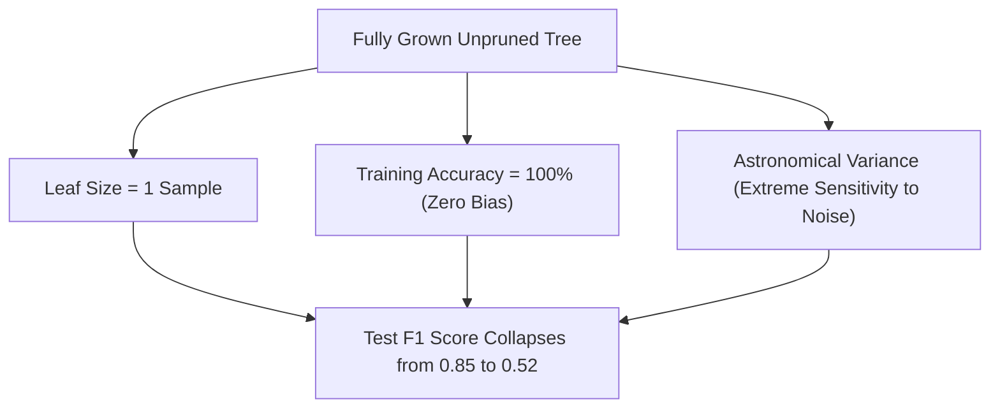

# Lecture 28.07: Pruning Decision Trees — Overfitting aur Generalization Gap

## 📌 Executive Summary (Hinglish)
Bina pruning ke decision trees kyun overfit karte hain, noise memorization aur high variance ka mathematical reason, generalization gap, aur tree pruning ka overarching framework.

---

### 📋 Is Topic/Section Mein Hum Kya Cover Kar Rahe Hain?
1. Fully grown decision trees ka memorization behavior: $100\%$ training accuracy par zero test generalization.
2. High Variance regime: Small sample noise ke basis par complex branch creation.
3. Generalization Gap: $\text{Gap} = \text{Error}_{\text{test}} - \text{Error}_{\text{train}}$ ka divergence.
4. Pruning strategies ka taxonomy: Pre-Pruning (Early Stopping) vs Post-Pruning (Prune after growth).

---

### 🔍 Har Ek Bullet Point Ka Detailed Explanation

**Overfitting Reality**: Agar decision tree ko bina kisi restriction ke grow kiya jaye, toh har leaf node mein sirf 1 sample reh jaata hai. Model training data ko 100% memorise kar leta hai.

**High Variance Pathology**: Training set ke 2 outliers ke liye tree 5 extra deep levels create kar leti hai, jo test set par aane wale normal samples ko galat predict karte hain.

**Generalization Gap**: Jaise-jaise tree depth badhti hai, Training Error girte-girte 0 ho jaati hai, lekin Test Error ek point ke baad skyrocket ho jaati hai.

**Pruning Taxonomy**: Pre-pruning tree growth ke dauran hi stopping rules lagati hai. Post-pruning poori tree grow karke statistically weak subtrees ko cut karti hai.

---

## 🏛️ Mathematical Architecture & Detailed Theory

### 💥 The Pathology of Unconstrained Decision Trees

If a decision tree induction algorithm is permitted to execute without structural stopping constraints, it will continue recursive partitioning until every terminal leaf is **strictly pure** ($I(m) = 0$).



#### The Bias-Variance Tradeoff in Tree Depth:
- **Shallow Trees (Depth 1 to 2)**: Suffer from **High Bias** (underfitting). The model cannot capture non-linear feature interactions (a depth-1 tree is merely a single decision stump).
- **Deep Unconstrained Trees (Depth $\ge 15$)**: Suffer from **High Variance** (overfitting). The model memorizes training noise and outliers.

---

### ✂️ The Pruning Framework Taxonomy

To achieve optimal generalization on unseen test instances, we apply regularization via two distinct paradigms:

1. **Pre-Pruning (Early Stopping)**:
   Halts tree expansion during the recursive partitioning loop when heuristic stopping conditions are triggered:
   - `max_depth` attained.
   - Sample count in node drops below `min_samples_split`.
   - Impurity reduction $\Delta I$ falls below `min_impurity_decrease`.

2. **Post-Pruning (Subtree Pruning)**:
   Allows the tree to grow to its maximum unrestricted depth, then algorithmically traverses from the leaves upward, replacing subtrees with single leaf nodes if their presence does not significantly enhance generalization.

---

## 💻 Python Implementation & Code Example

```python
import numpy as np
from sklearn.tree import DecisionTreeClassifier

# Synthetic dataset with noisy labels
np.random.seed(42)
X_syn = np.random.randn(200, 5)
y_syn = (X_syn[:, 0] * 1.2 + np.random.randn(200) * 0.8 > 0).astype(int)

# Unconstrained Tree
unconstrained = DecisionTreeClassifier(random_state=42).fit(X_syn, y_syn)
print("Unconstrained Tree Depth:     ", unconstrained.get_depth())
print("Unconstrained Leaf Count:     ", unconstrained.get_n_leaves())
print("Unconstrained Train Accuracy: ", unconstrained.score(X_syn, y_syn))
assert unconstrained.score(X_syn, y_syn) > 0.98, "Unconstrained tree must overfit training data"

```

---

## 🎯 Quick Revision Points (Interview Notes)
- **Scale Invariance**: Decision Trees monotonically invariant hote hain, isliye inme `StandardScaler` mandatory nahi hota.
- **Gini vs Entropy**: Gini speed mein 10x faster hota hai kyunki logarithm computation ki zaroorat nahi padti.
- **Pruning Necessity**: Unconstrained decision tree hamesha overfit karti hai; `min_samples_leaf` aur `ccp_alpha` sabse effective regularizers hain.
