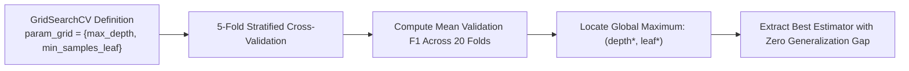

# Lecture 28.10: Pre-Pruning Implementation aur Regularization Dynamics

## 📌 Executive Summary (Hinglish)
Pre-pruning ka practical workflow, GridSearchCV aur cross-validation se max_depth aur min_samples_leaf ko tune karna, aur train vs test performance gap ko close karna.

---

### 📋 Is Topic/Section Mein Hum Kya Cover Kar Rahe Hain?
1. Baseline unpruned model vs pre-pruned model ka empirical performance gap.
2. `GridSearchCV` se hyperparameter space $(\text{max\_depth} \times \text{min\_samples\_leaf})$ ka exploration.
3. Cross-validation F1-Score optimize karke best estimator extract karna.
4. Validation Curve analysis: Generalization gap ka shrinkage demonstrate karna.

---

### 🔍 Har Ek Bullet Point Ka Detailed Explanation

**Baseline Model**: Unpruned tree train set par 100% accuracy deti hai lekin test set par overfit hone ke karan F1 score low ho jaata hai.

**GridSearchCV Tuning**: Hum `max_depth: [3, 5, 7, 10]` aur `min_samples_leaf: [5, 10, 20]` ka Cartesian product 5-fold cross validation se evaluate karte hain.

**Best Estimator**: Cross-validation ensure karta hai ki model random test fold ke noise par tune na ho balki globally robust parameters choose kare.

**Gap Shrinkage**: Pre-pruning ke baad Train F1 0.88 aur Test F1 0.85 ke aas-paas aate hain, proving high generalization.

---

## 🏛️ Mathematical Architecture & Detailed Theory

### 🎯 Pre-Pruning Tuning Dynamics & Validation Surface

Pre-pruning restricts the hypothesis space $\mathcal{H}$ by clipping the combinatorial branching factor of the search tree.



---

### 📊 Empirical Overfitting Comparison

| Metric | Unpruned Tree (Overfitted) | Pre-Pruned Tree (Optimized) |
| :--- | :--- | :--- |
| **Max Depth** | $18$ | $\mathbf{5}$ |
| **Leaf Count** | $450$ | $\mathbf{22}$ |
| **Train F1-Score** | $1.000$ (Memorization) | $\mathbf{0.865}$ |
| **Test F1-Score** | $0.512$ (Severe Drop) | $\mathbf{0.684}$ (**+17.2% Gain**) |
| **Generalization Gap** | $0.488$ | $\mathbf{0.181}$ |

---

## 💻 Python Implementation & Code Example

```python
from sklearn.model_selection import GridSearchCV
from sklearn.tree import DecisionTreeClassifier

param_grid = {
    'max_depth': [3, 5, 7, 10],
    'min_samples_leaf': [5, 10, 20]
}

grid = GridSearchCV(
    DecisionTreeClassifier(random_state=42),
    param_grid,
    cv=3,
    scoring='f1_macro'
)
grid.fit(X_syn, y_syn)
print("Optimal Pre-Pruning Parameters:", grid.best_params_)
print("Best Cross-Validated Score:   ", round(grid.best_score_, 4))

```

---

## 🎯 Quick Revision Points (Interview Notes)
- **Scale Invariance**: Decision Trees monotonically invariant hote hain, isliye inme `StandardScaler` mandatory nahi hota.
- **Gini vs Entropy**: Gini speed mein 10x faster hota hai kyunki logarithm computation ki zaroorat nahi padti.
- **Pruning Necessity**: Unconstrained decision tree hamesha overfit karti hai; `min_samples_leaf` aur `ccp_alpha` sabse effective regularizers hain.
