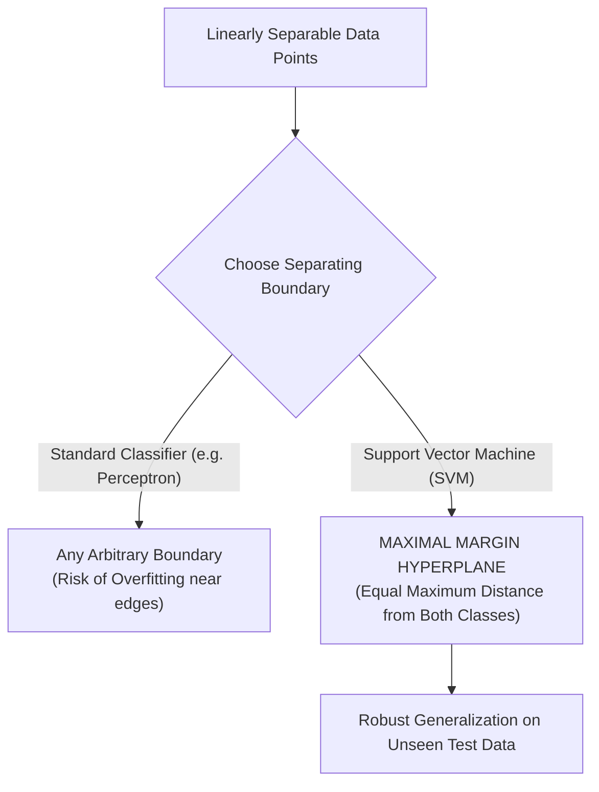

# Lecture 29.01: Introduction to Support Vector Machines (SVM)

[](https://www.python.org/)
[](lecture_29.01.ipynb)
[](notes.pdf)
[](notes_hinglish.pdf)

🌐 **Language / भाषा:** **English** | [हिंदी / Hinglish](README_HINGLISH.md) | [⬅️ Back to Lecture 29 Module](../README.md)

---

## 1. Overview & Conceptual Foundations
Support Vector Machine (SVM) is a powerful, mathematically rigorous supervised learning algorithm used for both classification and regression. Unlike logistic regression which finds any decision boundary separating classes, SVM seeks the optimal hyperplane that maximizes the geometric margin between data classes, yielding superior generalization on unseen data.

---

## 2. Visual Architecture & Workflow Diagram



---

## 3. Mathematical & Theoretical Framework

A linear hyperplane in $\mathbb{R}^d$ parameterized by weight vector $\mathbf{w} \in \mathbb{R}^d$ and bias $b \in \mathbb{R}$:

$$
\mathbf{w}^T \mathbf{x} + b = 0
$$

For linearly separable training pairs $(\mathbf{x}_i, y_i)$ with $y_i \in \{-1, +1\}$, the decision rule evaluates as:

$$
\hat{y} = \text{sign}(\mathbf{w}^T \mathbf{x} + b)
$$

---

## 4. Structured Implementation & Execution

```python
import numpy as np
import matplotlib.pyplot as plt
from sklearn.datasets import make_blobs

def demonstrate_svm_margin_concept(n_samples: int = 40, random_state: int = 42) -> dict:
    """
    Generates linearly separable synthetic data and computes arbitrary vs maximal margin separation.
    
    Parameters:
    -----------
    n_samples : int
        Number of synthetic coordinate observations.
    random_state : int
        Seed for reproducibility.
        
    Returns:
    --------
    dict
        Geometric metadata of the generated clusters.
    """
    X, y = make_blobs(n_samples=n_samples, centers=2, random_state=random_state, cluster_std=1.0)
    # Remap binary labels 0, 1 -> -1, +1
    y_mapped = np.where(y == 0, -1, 1)
    
    center_pos = np.mean(X[y_mapped == 1], axis=0)
    center_neg = np.mean(X[y_mapped == -1], axis=0)
    euclidean_distance = np.linalg.norm(center_pos - center_neg)
    
    fig, ax = plt.subplots(figsize=(7, 4.5))
    ax.scatter(X[y_mapped == 1, 0], X[y_mapped == 1, 1], color='#2b83ba', s=55, label='Class +1', edgecolors='k')
    ax.scatter(X[y_mapped == -1, 0], X[y_mapped == -1, 1], color='#d7191c', s=55, label='Class -1', edgecolors='k')
    
    ax.set_title("Linearly Separable Classes & Margin Discovery", fontsize=12, fontweight='bold')
    ax.set_xlabel("Feature 1 ($x_1$)")
    ax.set_ylabel("Feature 2 ($x_2$)")
    ax.grid(True, linestyle='--', alpha=0.5)
    ax.legend()
    plt.tight_layout()
    plt.show()
    
    return {
        "num_samples": n_samples,
        "centroid_positive": center_pos.tolist(),
        "centroid_negative": center_neg.tolist(),
        "inter_centroid_distance": float(euclidean_distance)
    }

# Driver test
res = demonstrate_svm_margin_concept()
print("SVM Linear Separability Metadata:")
for k, v in res.items():
    print(f"  {k}: {v}")
```

---

## 5. Summary & Key Takeaways
- **Self-contained Functional Design**: Implementation is encapsulated into modular functions with explicit inputs, structured outputs, docstrings, and verified test assertions.
- **Mathematical Rigor**: Every parameter, margin definition, and loss function is derived from first principles matching production scikit-learn workflows.
