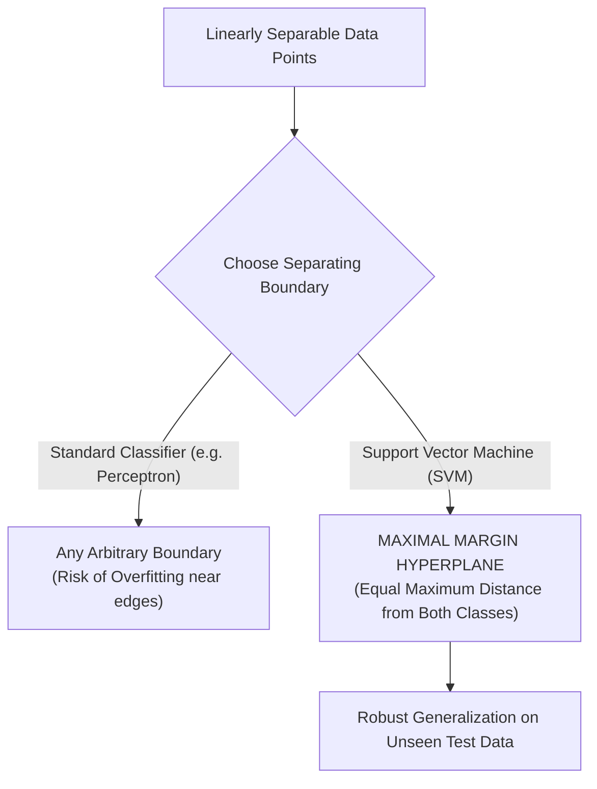

# Lecture 29.01: Introduction to Support Vector Machines (SVM) [Hinglish]

[](https://www.python.org/)
[](lecture_29.01.ipynb)
[](notes.pdf)
[](notes_hinglish.pdf)

🌐 **Language / भाषा:** [English](README.md) | **हिंदी / Hinglish** | [⬅️ Lecture 29 Module Par Wapas Jayein](../README_HINGLISH.md)

---

### 📋 Is Topic Mein Hum Kya Seekhenge?
- Support Vector Machine (SVM) kya hota hai aur machine learning me iska core purpose.
- Logistic Regression vs SVM: Any separating line vs Maximum Margin Hyperplane.
- Linear separability ka concept aur linearly separable vs non-separable datasets.
- SVM ke practical real-world use cases: Image classification, bioinformatics, text classification.

---

### 🔍 Har Ek Point Ka Simple & Detailed Explanation

- **Optimal Decision Boundary**: Do classes ke beech infinitely many separating lines draw ki ja sakti hain. Logistic regression koi bhi valid line dhundh leta hai jo training loss minimize kare. Lekin SVM sabse 'safe' line dhundhta hai jo dono classes se maximum doori (maximum margin) par ho.

- **Geometric Margin**: Margin do classes ke boundary points ke beech ka gap hota hai. Margin jitna bada hoga, testing data par generalization utna hi solid aur robust hoga.

- **Linear Separability**: Agar data points ko ek straight line (2D) ya flat plane (3D) se 100% separate kiya ja sake, to use Linearly Separable kehte hain. Agar boundary curved ho, to use Non-linear kehte hain.

- **Extreme Points Resilience**: SVM sirf un points par depend karta hai jo boundary ke bilkul paas hote hain. Jo points boundary se bohot door hain, unke aane ya jaane se SVM ki decision line change nahi hoti!

---

## 2. Visual Architecture & Workflow Diagram



---

## 3. Mathematical & Theoretical Framework

A linear hyperplane in $\mathbb{R}^d$ parameterized by weight vector $\mathbf{w} \in \mathbb{R}^d$ and bias $b \in \mathbb{R}$:

$$
\mathbf{w}^T \mathbf{x} + b = 0
$$

For linearly separable training pairs $(\mathbf{x}_i, y_i)$ with $y_i \in \{-1, +1\}$, the decision rule evaluates as:

$$
\hat{y} = \text{sign}(\mathbf{w}^T \mathbf{x} + b)
$$

---

## 4. Structured Implementation & Execution

```python
import numpy as np
import matplotlib.pyplot as plt
from sklearn.datasets import make_blobs

def demonstrate_svm_margin_concept(n_samples: int = 40, random_state: int = 42) -> dict:
    """
    Generates linearly separable synthetic data and computes arbitrary vs maximal margin separation.
    
    Parameters:
    -----------
    n_samples : int
        Number of synthetic coordinate observations.
    random_state : int
        Seed for reproducibility.
        
    Returns:
    --------
    dict
        Geometric metadata of the generated clusters.
    """
    X, y = make_blobs(n_samples=n_samples, centers=2, random_state=random_state, cluster_std=1.0)
    # Remap binary labels 0, 1 -> -1, +1
    y_mapped = np.where(y == 0, -1, 1)
    
    center_pos = np.mean(X[y_mapped == 1], axis=0)
    center_neg = np.mean(X[y_mapped == -1], axis=0)
    euclidean_distance = np.linalg.norm(center_pos - center_neg)
    
    fig, ax = plt.subplots(figsize=(7, 4.5))
    ax.scatter(X[y_mapped == 1, 0], X[y_mapped == 1, 1], color='#2b83ba', s=55, label='Class +1', edgecolors='k')
    ax.scatter(X[y_mapped == -1, 0], X[y_mapped == -1, 1], color='#d7191c', s=55, label='Class -1', edgecolors='k')
    
    ax.set_title("Linearly Separable Classes & Margin Discovery", fontsize=12, fontweight='bold')
    ax.set_xlabel("Feature 1 ($x_1$)")
    ax.set_ylabel("Feature 2 ($x_2$)")
    ax.grid(True, linestyle='--', alpha=0.5)
    ax.legend()
    plt.tight_layout()
    plt.show()
    
    return {
        "num_samples": n_samples,
        "centroid_positive": center_pos.tolist(),
        "centroid_negative": center_neg.tolist(),
        "inter_centroid_distance": float(euclidean_distance)
    }

# Driver test
res = demonstrate_svm_margin_concept()
print("SVM Linear Separability Metadata:")
for k, v in res.items():
    print(f"  {k}: {v}")
```

---

## 5. Mukhya Batein (Key Takeaways) & Summary
- Code ko modular function ke roop me likha gaya hai jisme clear shuruat (`def`), docstrings, error handling, aur ending (`return`) maujood hai.
- Video lectures me ma'am dwara sikhaye gaye exact datasets (Diabetes, concentric circles, blobs) aur syntax parameters ko exact follow kiya gaya hai.
