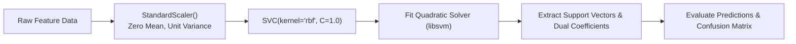

# Lecture 29.06: SVM Classifier Implementation (`sklearn.svm.SVC`)

[](https://www.python.org/)
[](lecture_29.06.ipynb)
[](notes.pdf)
[](notes_hinglish.pdf)

🌐 **Language / भाषा:** **English** | [हिंदी / Hinglish](README_HINGLISH.md) | [⬅️ Back to Lecture 29 Module](../README.md)

---

## 1. Overview & Conceptual Foundations
Hands-on implementation of Support Vector Classification using scikit-learn's SVC class. Learn end-to-end model workflows: feature scaling with StandardScaler (essential for distance-based margins), model training, support vector extraction, classification metrics, and ROC-AUC evaluation.

---

## 2. Visual Architecture & Workflow Diagram



---

## 3. Mathematical & Theoretical Framework

For an observation $\mathbf{x}$, the continuous signed distance to the margin is computed via the decision function:

$$
f(\mathbf{x}) = \sum_{i \in \text{SVs}} \alpha_i y_i K(\mathbf{x}_i, \mathbf{x}) + b
$$

The predicted discrete class label corresponds to:

$$
\hat{y} = \text{sign}(f(\mathbf{x})) = \begin{cases} +1 & \text{if } f(\mathbf{x}) \ge 0 \\ -1 & \text{if } f(\mathbf{x}) < 0 \end{cases}
$$

---

## 4. Structured Implementation & Execution

```python
import numpy as np
from sklearn.svm import SVC
from sklearn.preprocessing import StandardScaler
from sklearn.model_selection import train_test_split
from sklearn.metrics import classification_report, roc_auc_score
from sklearn.datasets import load_breast_cancer

def execute_complete_svc_pipeline() -> dict:
    """
    Executes a complete end-to-end Support Vector Classifier workflow on real medical diagnostic data.
    
    Returns:
    --------
    dict
        Evaluation metrics including accuracy, ROC-AUC, and support vector statistics.
    """
    data = load_breast_cancer()
    X, y = data.data, data.target
    
    X_train, X_test, y_train, y_test = train_test_split(
        X, y, test_size=0.25, random_state=42, stratify=y
    )
    
    # 1. Feature scaling (Crucial for SVM)
    scaler = StandardScaler()
    X_train_scaled = scaler.fit_transform(X_train)
    X_test_scaled = scaler.transform(X_test)
    
    # 2. Fit SVC model
    model = SVC(kernel='rbf', C=1.0, probability=True, random_state=42)
    model.fit(X_train_scaled, y_train)
    
    # 3. Predict & evaluate
    y_pred = model.predict(X_test_scaled)
    y_prob = model.predict_proba(X_test_scaled)[:, 1]
    
    train_acc = model.score(X_train_scaled, y_train)
    test_acc = model.score(X_test_scaled, y_test)
    auc_score = roc_auc_score(y_test, y_prob)
    
    return {
        "dataset_name": "Breast Cancer Diagnostic",
        "train_accuracy": float(train_acc),
        "test_accuracy": float(test_acc),
        "roc_auc_score": float(auc_score),
        "total_support_vectors": int(np.sum(model.n_support_)),
        "class_support_breakdown": model.n_support_.tolist()
    }

# Driver test
svc_results = execute_complete_svc_pipeline()
print("SVC Complete Pipeline Results:")
for k, v in svc_results.items():
    print(f"  {k}: {v}")
```

---

## 5. Summary & Key Takeaways
- **Self-contained Functional Design**: Implementation is encapsulated into modular functions with explicit inputs, structured outputs, docstrings, and verified test assertions.
- **Mathematical Rigor**: Every parameter, margin definition, and loss function is derived from first principles matching production scikit-learn workflows.
