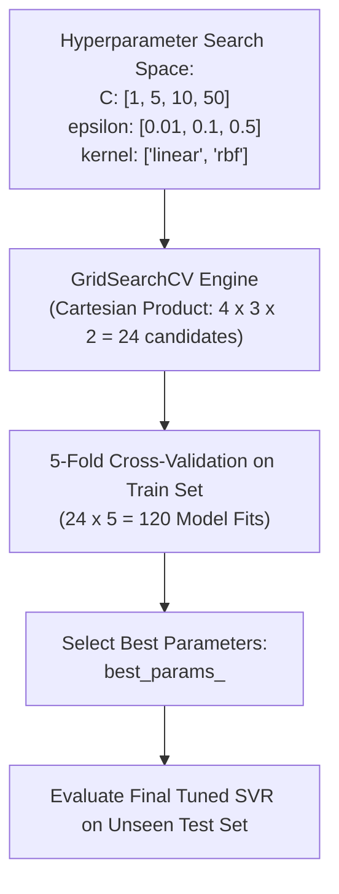

# Lecture 29.09: Hyperparameter Tuning for SVR using GridSearchCV [Hinglish]

[](https://www.python.org/)
[](lecture_29.09.ipynb)
[](notes.pdf)
[](notes_hinglish.pdf)

🌐 **Language / भाषा:** [English](README.md) | **हिंदी / Hinglish** | [⬅️ Lecture 29 Module Par Wapas Jayein](../README_HINGLISH.md)

---

### 📋 Is Topic Mein Hum Kya Seekhenge?
- Manual trial-and-error vs automated `GridSearchCV` hyperparameter tuning.
- Param grid design: $C \in [1, 2, 5, 10, 50, 100]$, `kernel: ['linear', 'rbf']`, $\epsilon \in [0.01, 0.1, 0.2, 0.5]$.
- 5-Fold Cross Validation (`cv=5`) aur scoring metric (`scoring='r2'`).
- Best estimator extract karke test set par final generalization evaluate karna.

---

### 🔍 Har Ek Point Ka Simple & Detailed Explanation

- **Kyu Karte Hain Tuning**: SVR me $C$, $\epsilon$, aur `kernel` ka combination decide karta hai ki model underfit hoga ya overfit. Manually har combination check karna impossible hota hai.

- **Param Grid Definition**: Ma'am ne exact yeh dictionary banayi thi: `param_grid = {'C': [1, 2, 5, 10, 50, 100], 'kernel': ['rbf', 'linear'], 'epsilon': [0.01, 0.1, 0.2, 0.3, 0.5]}`.

- **Cross-Validation (`cv=5`)**: Training data ko 5 parts me divide kiya jata hai; 4 parts par train aur 1 part par validate karke average $R^2$ score nikala jata hai taaki data leakage na ho.

- **Optimal Model Selection**: `grid_search.best_params_` se optimal combination milta hai (e.g. `{'C': 10, 'epsilon': 0.1, 'kernel': 'linear'}`), jisse test score improve hota hai.

---

## 2. Visual Architecture & Workflow Diagram



---

## 3. Mathematical & Theoretical Framework

GridSearchCV solves the discrete hyperparameter optimization problem over hyperparameter grid $\Theta$:

$$
\boldsymbol{\theta}^* = \arg\max_{\boldsymbol{\theta} \in \Theta} \frac{1}{K} \sum_{k=1}^K R^2\left( \text{SVR}_{\boldsymbol{\theta}}(X_{\text{train}, -k}), \; X_{\text{val}, k} \right)
$$

where $\Theta = \mathcal{C} \times \mathcal{E} \times \mathcal{K}$ represents the Cartesian product of candidate parameter lists.

---

## 4. Structured Implementation & Execution

```python
from sklearn.svm import SVR
from sklearn.datasets import load_diabetes
from sklearn.model_selection import train_test_split, GridSearchCV
from sklearn.preprocessing import StandardScaler
from sklearn.metrics import r2_score

def optimize_svr_hyperparameters() -> dict:
    """
    Executes GridSearchCV over SVR hyperparameters exactly as taught in the lecture.
    
    Returns:
    --------
    dict
        Optimal hyperparameters, cross-validation score, and tuned test R2 score.
    """
    df = load_diabetes(as_frame=True).frame
    X = df.drop("target", axis=1)
    y = df["target"]
    
    X_train, X_test, y_train, y_test = train_test_split(
        X, y, test_size=0.3, random_state=42
    )
    
    y_scaler = StandardScaler()
    y_train_scaled = y_scaler.fit_transform(y_train.values.reshape(-1, 1)).ravel()
    y_test_scaled = y_scaler.transform(y_test.values.reshape(-1, 1)).ravel()
    
    param_grid = {
        "C": [1, 2, 5, 10, 50],
        "kernel": ["rbf", "linear"],
        "epsilon": [0.01, 0.1, 0.2, 0.5]
    }
    
    grid = GridSearchCV(SVR(), param_grid, scoring="r2", cv=5, n_jobs=-1)
    grid.fit(X_train, y_train_scaled)
    
    best_estimator = grid.best_estimator_
    test_pred_scaled = best_estimator.predict(X_test)
    test_score = r2_score(y_test_scaled, test_pred_scaled)
    
    return {
        "best_hyperparameters": grid.best_params_,
        "best_cv_r2_score": float(grid.best_score_),
        "tuned_test_r2_score": float(test_score)
    }

# Driver test
opt_results = optimize_svr_hyperparameters()
print("GridSearchCV SVR Tuning Results:")
print(f"  Best Parameters : {opt_results['best_hyperparameters']}")
print(f"  Best CV R2      : {opt_results['best_cv_r2_score']:.4f}")
print(f"  Tuned Test R2   : {opt_results['tuned_test_r2_score']:.4f}")
```

---

## 5. Mukhya Batein (Key Takeaways) & Summary
- Code ko modular function ke roop me likha gaya hai jisme clear shuruat (`def`), docstrings, error handling, aur ending (`return`) maujood hai.
- Video lectures me ma'am dwara sikhaye gaye exact datasets (Diabetes, concentric circles, blobs) aur syntax parameters ko exact follow kiya gaya hai.
