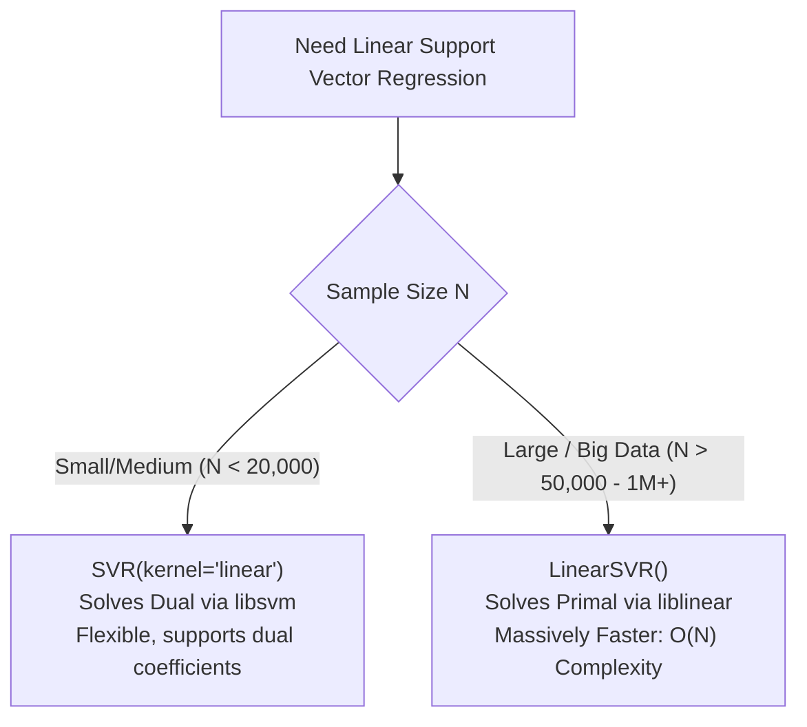

# Lecture 29.10: LinearSVR vs SVR — Optimization Solvers & Scalability [Hinglish]

[](https://www.python.org/)
[](lecture_29.10.ipynb)
[](notes.pdf)
[](notes_hinglish.pdf)

🌐 **Language / भाषा:** [English](README.md) | **हिंदी / Hinglish** | [⬅️ Lecture 29 Module Par Wapas Jayein](../README_HINGLISH.md)

---

### 📋 Is Topic Mein Hum Kya Seekhenge?
- `LinearSVR` vs `SVR(kernel='linear')`: Dono linear hain to do alag classes kyu?
- Underlying libraries: `liblinear` (LinearSVR) vs `libsvm` (SVR).
- Primal vs Dual formulation ka farq aur sample scalability ($N > 100,000$).
- Time complexity comparison: Linear $\mathcal{O}(N)$ vs Cubic $\mathcal{O}(N^3)$.

---

### 🔍 Har Ek Point Ka Simple & Detailed Explanation

- **The Big Question**: Jab `SVR(kernel='linear')` pehle se linear regression kar sakta hai, to scikit-learn ne alag se `LinearSVR` kyu banaya? Answer: Scalability!

- **`libsvm` vs `liblinear`**: `SVR` background me Chih-Chung Chang ki `libsvm` library use karta hai jo dual quadratic programming solve karti hai. Yeh non-linear kernels ke liye best hai lekin $\mathcal{O}(N^2)$ se $\mathcal{O}(N^3)$ time leti hai. `LinearSVR` background me `liblinear` library use karta hai jo seedhe primal problem solve karti hai aur $\mathcal{O}(N)$ linear time leti hai!

- **Sample Size Threshold**: Agar dataset me 1,000 se 10,000 samples hon, to dono ek jaisa time lete hain. Lekin agar dataset me 100,000+ ya 1 million samples hon, to `SVR` ghanton tak freeze ho jayega, jabki `LinearSVR` seconds me train ho jayega!

- **Lecture Code Reference**: Ma'am ne dono ko compare karke dikhaya: `from sklearn.svm import LinearSVR; model = LinearSVR(C=10, epsilon=0.1, max_iter=5000)`.

---

## 2. Visual Architecture & Workflow Diagram



---

## 3. Mathematical & Theoretical Framework

Computational time complexity scaling comparison:

$$
\text{Time}(\text{SVR with libsvm}) = \mathcal{O}\left(d \cdot N^2\right) \text{ to } \mathcal{O}\left(d \cdot N^3\right)
$$

$$
\text{Time}(\text{LinearSVR with liblinear}) = \mathcal{O}\left(d \cdot N\right)
$$

Where $N$ is the number of training observations and $d$ is the feature dimensionality.

---

## 4. Structured Implementation & Execution

```python
from sklearn.svm import SVR, LinearSVR
from sklearn.datasets import load_diabetes
from sklearn.model_selection import train_test_split
from sklearn.preprocessing import StandardScaler
from sklearn.metrics import r2_score
import time

def compare_linearsvr_vs_svr_performance() -> dict:
    """
    Compares the execution speed, parameters, and R2 performance between LinearSVR and SVR(kernel='linear').
    
    Returns:
    --------
    dict
        Training latency and test R2 metrics for both implementations.
    """
    df = load_diabetes(as_frame=True).frame
    X = df.drop("target", axis=1)
    y = df["target"]
    
    X_train, X_test, y_train, y_test = train_test_split(
        X, y, test_size=0.3, random_state=42
    )
    
    y_scaler = StandardScaler()
    y_train_scaled = y_scaler.fit_transform(y_train.values.reshape(-1, 1)).ravel()
    y_test_scaled = y_scaler.transform(y_test.values.reshape(-1, 1)).ravel()
    
    # 1. Benchmark SVR(kernel='linear')
    t0 = time.perf_counter()
    svr_linear = SVR(kernel="linear", C=10.0, epsilon=0.1)
    svr_linear.fit(X_train, y_train_scaled)
    svr_time = time.perf_counter() - t0
    svr_r2 = r2_score(y_test_scaled, svr_linear.predict(X_test))
    
    # 2. Benchmark LinearSVR (liblinear solver)
    t0 = time.perf_counter()
    linear_svr = LinearSVR(C=10.0, epsilon=0.1, max_iter=5000, random_state=42)
    linear_svr.fit(X_train, y_train_scaled)
    lsvr_time = time.perf_counter() - t0
    lsvr_r2 = r2_score(y_test_scaled, linear_svr.predict(X_test))
    
    return {
        "SVR_linear": {
            "solver": "libsvm (dual)",
            "fit_time_seconds": float(svr_time),
            "test_r2": float(svr_r2)
        },
        "LinearSVR": {
            "solver": "liblinear (primal)",
            "fit_time_seconds": float(lsvr_time),
            "test_r2": float(lsvr_r2)
        }
    }

# Driver test
comp_res = compare_linearsvr_vs_svr_performance()
print("LinearSVR vs SVR Performance Comparison:")
for model_name, info in comp_res.items():
    print(f"  {model_name}: Solver={info['solver']}, FitTime={info['fit_time_seconds']*1000:.2f}ms, Test R2={info['test_r2']:.4f}")
```

---

## 5. Mukhya Batein (Key Takeaways) & Summary
- Code ko modular function ke roop me likha gaya hai jisme clear shuruat (`def`), docstrings, error handling, aur ending (`return`) maujood hai.
- Video lectures me ma'am dwara sikhaye gaye exact datasets (Diabetes, concentric circles, blobs) aur syntax parameters ko exact follow kiya gaya hai.
