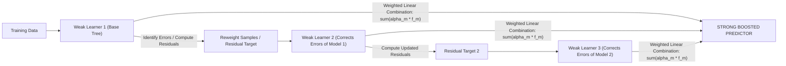

# Lecture 29.13: What is Boosting? (Sequential Learning Intuition) [Hinglish]

[](https://www.python.org/)
[](lecture_29.13.ipynb)
[](notes.pdf)
[](notes_hinglish.pdf)

🌐 **Language / भाषा:** [English](README.md) | **हिंदी / Hinglish** | [⬅️ Lecture 29 Module Par Wapas Jayein](../README_HINGLISH.md)

---

### 📋 Is Topic Mein Hum Kya Seekhenge?
- Boosting kya hota hai aur Bagging vs Boosting ka fundamental difference.
- Sequential dependency: Model 2 Model 1 ki galtiyon se kaise seekhta hai.
- Adaptive instance re-weighting (AdaBoost) vs Residual fitting (Gradient Boosting).
- Bias reduction: Kaise weak learners (shallow stumps) milkar ek super-accurate predictor banate hain.

---

### 🔍 Har Ek Point Ka Simple & Detailed Explanation

- **Parallel vs Sequential**: Bagging me sabhi models ek sath parallel me train hote hain (independent). Boosting me models ek ke baad ek line me (sequentially) train hote hain jahan har agla model pichhle model ki galtiyon ko correct karta hai.

- **Galtiyon par Focus**: Pehle model ne jin data points ko galat classify kiya, agla model unhi points par zyada dhyan (higher weight ya residual loss) deta hai.

- "**AdaBoost vs Gradient Boosting**:
               - AdaBoost: Hard samples ke weights badha deta hai.
               - Gradient Boosting: Agle tree ko target $y$ par nahi balki pichhle tree ke residuals $(y - \hat{y})$ par train karta hai.

- **Bias vs Variance Goal**: Bagging ka primary goal 'High Variance' (overfitting) kam karna hota hai. Boosting ka primary goal 'High Bias' (underfitting) kam karna hota hai.

---

## 2. Visual Architecture & Workflow Diagram



---

## 3. Mathematical & Theoretical Framework

Boosting constructs an additive model as a linear expansion of $M$ basis weak learners:

$$
F_M(\mathbf{x}) = \sum_{m=1}^M \alpha_m h_m(\mathbf{x})
$$

Trained iteratively in stage-wise fashion:

$$
F_m(\mathbf{x}) = F_{m-1}(\mathbf{x}) + \alpha_m h_m(\mathbf{x})
$$

where each new weak learner $h_m$ minimizes the empirical risk under the chosen loss function $L$:

$$
(h_m, \alpha_m) = \arg\min_{h, \alpha} \sum_{i=1}^N L\left( y_i, \; F_{m-1}(\mathbf{x}_i) + \alpha h(\mathbf{x}_i) \right)
$$

---

## 4. Structured Implementation & Execution

```python
from sklearn.ensemble import AdaBoostClassifier
from sklearn.tree import DecisionTreeClassifier
from sklearn.datasets import make_classification
from sklearn.model_selection import train_test_split
from sklearn.metrics import accuracy_score

def demonstrate_boosting_sequential_learning() -> dict:
    """
    Demonstrates sequential accuracy escalation using AdaBoost with decision stumps.
    
    Returns:
    --------
    dict
        Stump baseline accuracy vs Boosted ensemble accuracy.
    """
    X, y = make_classification(n_samples=600, n_features=20, n_informative=12, random_state=42)
    X_train, X_test, y_train, y_test = train_test_split(X, y, test_size=0.3, random_state=42)
    
    # Single weak decision stump (depth 1)
    stump = DecisionTreeClassifier(max_depth=1, random_state=42)
    stump.fit(X_train, y_train)
    stump_acc = accuracy_score(y_test, stump.predict(X_test))
    
    # Sequential AdaBoost ensemble of 50 stumps
    adaboost = AdaBoostClassifier(
        estimator=DecisionTreeClassifier(max_depth=1),
        n_estimators=50,
        random_state=42
    )
    adaboost.fit(X_train, y_train)
    boosted_acc = accuracy_score(y_test, adaboost.predict(X_test))
    
    return {
        "weak_learner_depth": 1,
        "single_stump_accuracy": float(stump_acc),
        "boosted_50_stumps_accuracy": float(boosted_acc),
        "performance_gain_percentage": float((boosted_acc - stump_acc) * 100)
    }

# Driver test
boost_stats = demonstrate_boosting_sequential_learning()
print("Boosting Sequential Performance:")
print(f"  Single Weak Stump Acc : {boost_stats['single_stump_accuracy']*100:.2f}%")
print(f"  Boosted Ensemble Acc  : {boost_stats['boosted_50_stumps_accuracy']*100:.2f}%")
print(f"  Net Gain              : +{boost_stats['performance_gain_percentage']:.2f}%")
```

---

## 5. Mukhya Batein (Key Takeaways) & Summary
- Code ko modular function ke roop me likha gaya hai jisme clear shuruat (`def`), docstrings, error handling, aur ending (`return`) maujood hai.
- Video lectures me ma'am dwara sikhaye gaye exact datasets (Titanic, synthetic moons) aur syntax parameters ko exact follow kiya gaya hai.
