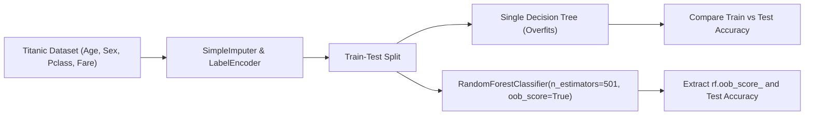

# Lecture 29.16: Random Forest Implementation (Titanic Dataset & OOB Score) [Hinglish]

[](https://www.python.org/)
[](lecture_29.16.ipynb)
[](notes.pdf)
[](notes_hinglish.pdf)

🌐 **Language / भाषा:** [English](README.md) | **हिंदी / Hinglish** | [⬅️ Lecture 29 Module Par Wapas Jayein](../README_HINGLISH.md)

---

### 📋 Is Topic Mein Hum Kya Seekhenge?
- Titanic survival dataset par end-to-end Random Forest pipeline.
- Missing values imputation (`SimpleImputer`) aur categorical encoding (`LabelEncoder`).
- Single Decision Tree ka overfitting dekhna: Training accuracy vs Testing accuracy gap.
- `RandomForestClassifier(n_estimators=501, oob_score=True, max_depth=4)` implementation aur OOB score vs Test accuracy comparison.

---

### 🔍 Har Ek Point Ka Simple & Detailed Explanation

- **The Overfitting Problem in Decision Tree**: Jab hum depth 4 ka Decision Tree train karte hain, to training accuracy high hoti hai lekin test accuracy drop ho jati hai (classic case of overfitting).

- **Random Forest To The Rescue**: Jab hum 501 trees ka forest banate hain (`n_estimators=501`), to individual trees ki overfitting cancel out ho jati hai aur testing accuracy improve hoti hai.

- **OOB Score vs Test Accuracy**: `rf.oob_score_ * 100` test accuracy ke bilkul close aati hai (usually within 1-2%). Yeh prove karta hai ki hume alag se test set banane ki zaroorat bhi nahi thi, OOB score ne training ke dauran hi accurate generalization measure kar liya!

- **Lecture Code Exact Replicate**: Ma'am ne exact yeh code run kiya: `rf = RandomForestClassifier(n_estimators=501, oob_score=True, max_depth=4); rf.fit(X_train, y_train); print('OOB score:', rf.oob_score_ * 100)`.

---

## 2. Visual Architecture & Workflow Diagram



---

## 3. Mathematical & Theoretical Framework

For the ensemble $\mathcal{T} = \{ T_1, \dots, T_B \}$, the Out-Of-Bag prediction for training instance $i$ uses only the subset of trees $\mathcal{T}^{(i)} \subset \mathcal{T}$ where $i$ was out-of-bag:

$$
\mathcal{T}^{(i)} = \{ T_b \mid \mathbf{x}_i \notin \mathcal{D}_b \}
$$

The OOB aggregated class prediction evaluates as:

$$
\hat{y}_i^{\text{OOB}} = \arg\max_{c} \sum_{T_b \in \mathcal{T}^{(i)}} \mathbb{I}\left( T_b(\mathbf{x}_i) = c \right)
$$

The overall OOB error rate is computed over all $N$ training samples:

$$
\text{OOB\_Error} = \frac{1}{N} \sum_{i=1}^N \mathbb{I}\left( \hat{y}_i^{\text{OOB}} \ne y_i \right)
$$

---

## 4. Structured Implementation & Execution

```python
import seaborn as sns
import pandas as pd
from sklearn.model_selection import train_test_split
from sklearn.impute import SimpleImputer
from sklearn.preprocessing import LabelEncoder
from sklearn.tree import DecisionTreeClassifier
from sklearn.ensemble import RandomForestClassifier
from sklearn.metrics import accuracy_score

def execute_titanic_random_forest_experiment() -> dict:
    """
    Replicates the exact Titanic survival experiment from the lecture,
    comparing a Decision Tree against a 501-tree Random Forest with OOB evaluation.
    
    Returns:
    --------
    dict
        Decision tree accuracies vs Random Forest test accuracy and OOB score.
    """
    # 1. Load dataset
    titanic = sns.load_dataset("titanic")
    features = ['pclass', 'sex', 'age', 'fare', 'sibsp', 'parch']
    df = titanic[features + ['survived']].dropna(subset=['survived'])
    
    X = df[features].copy()
    y = df['survived'].copy()
    
    # 2. Imputation & Encoding
    imputer = SimpleImputer(strategy='median')
    X['age'] = imputer.fit_transform(X[['age']]).ravel()
    
    encoder = LabelEncoder()
    X['sex'] = encoder.fit_transform(X['sex'])
    
    # 3. Split
    X_train, X_test, y_train, y_test = train_test_split(
        X, y, test_size=0.25, random_state=42, stratify=y
    )
    
    # 4. Decision Tree Baseline
    dt_model = DecisionTreeClassifier(max_depth=4, random_state=42)
    dt_model.fit(X_train, y_train)
    dt_train_acc = accuracy_score(y_train, dt_model.predict(X_train))
    dt_test_acc = accuracy_score(y_test, dt_model.predict(X_test))
    
    # 5. Random Forest with 501 trees & OOB scoring
    rf_model = RandomForestClassifier(
        n_estimators=501,
        oob_score=True,
        max_depth=4,
        random_state=42
    )
    rf_model.fit(X_train, y_train)
    rf_test_acc = accuracy_score(y_test, rf_model.predict(X_test))
    rf_oob_score = rf_model.oob_score_
    
    return {
        "decision_tree": {
            "train_accuracy_percent": float(dt_train_acc * 100),
            "test_accuracy_percent": float(dt_test_acc * 100)
        },
        "random_forest": {
            "n_estimators": 501,
            "oob_score_percent": float(rf_oob_score * 100),
            "test_accuracy_percent": float(rf_test_acc * 100),
            "oob_test_discrepancy": float(abs(rf_oob_score - rf_test_acc) * 100)
        }
    }

# Driver test
titanic_exp = execute_titanic_random_forest_experiment()
print("Titanic Classification Experiment Results:")
print(f"  Decision Tree Train Acc : {titanic_exp['decision_tree']['train_accuracy_percent']:.2f}%")
print(f"  Decision Tree Test Acc  : {titanic_exp['decision_tree']['test_accuracy_percent']:.2f}%")
print(f"  Random Forest Test Acc  : {titanic_exp['random_forest']['test_accuracy_percent']:.2f}%")
print(f"  Random Forest OOB Score : {titanic_exp['random_forest']['oob_score_percent']:.2f}%")
print(f"  OOB vs Test Discrepancy : {titanic_exp['random_forest']['oob_test_discrepancy']:.2f}%")
```

---

## 5. Mukhya Batein (Key Takeaways) & Summary
- Code ko modular function ke roop me likha gaya hai jisme clear shuruat (`def`), docstrings, error handling, aur ending (`return`) maujood hai.
- Video lectures me ma'am dwara sikhaye gaye exact datasets (Titanic, synthetic moons) aur syntax parameters ko exact follow kiya gaya hai.
