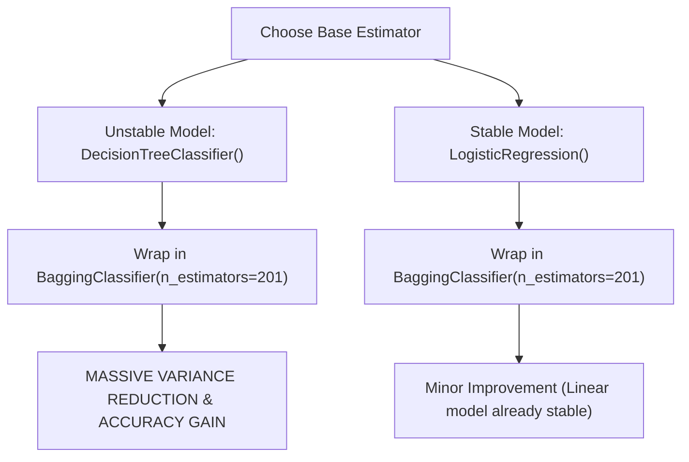

# Lecture 29.18: Bagging Classifier & Regressor (`BaggingClassifier`) [Hinglish]

[](https://www.python.org/)
[](lecture_29.18.ipynb)
[](notes.pdf)
[](notes_hinglish.pdf)

🌐 **Language / भाषा:** [English](README.md) | **हिंदी / Hinglish** | [⬅️ Lecture 29 Module Par Wapas Jayein](../README_HINGLISH.md)

---

### 📋 Is Topic Mein Hum Kya Seekhenge?
- `sklearn.ensemble.BaggingClassifier` aur `BaggingRegressor` ka architecture.
- Arbitrary base estimators plug karna: `estimator=DecisionTreeClassifier()` vs `estimator=LogisticRegression()`.
- Hyperparameters: `n_estimators=201`, `max_samples`, `max_features`, `bootstrap=True`.
- Kaunse models bagging se sabse zyada benefit hote hain (unstable vs stable estimators).

---

### 🔍 Har Ek Point Ka Simple & Detailed Explanation

- **Generic Bagging Wrapper**: Random Forest sirf Decision Trees ka bagging hota hai. Lekin `BaggingClassifier` ek generic wrapper hai jisme hum KISI BHI algorithm ko base model bana kar bag kar sakte hain (jaise KNN, SVM, Logistic Regression, ya Trees).

- **Code Flow from Lecture**: Ma'am ne exact do models ko bag karke compare kiya:
               1. `BaggingClassifier(base_model=DecisionTreeClassifier(), n_estimators=201)`
               2. `BaggingClassifier(base_model=LogisticRegression(max_iter=1000), n_estimators=201)`.

- **Stable vs Unstable Models**: Bagging unstable high-variance models (jaise Decision Trees) par magic ki tarah kaam karta hai aur accuracy bohot badha deta hai. Lekin already stable low-variance models (jaise Logistic Regression) par bagging lagane se zyada gain nahi hota kyunki linear models noise par zyada hilte nahi hain.

- **Regression Equivalent**: Continuous targets ke liye `BaggingRegressor(estimator=...)` use hota hai jisme sabhi models ke predictions ka mean average nikala jata hai.

---

## 2. Visual Architecture & Workflow Diagram



---

## 3. Mathematical & Theoretical Framework

For a base hypothesis class $\mathcal{H}$ with estimator $h(\mathbf{x}) \in \mathcal{H}$, the BaggingClassifier aggregates predictions:

$$
\hat{y} = \arg\max_{c \in \mathcal{Y}} \sum_{b=1}^B \mathbb{I}\left( h_b(\mathbf{x}) = c \right), \quad h_b = \text{train}(h, \mathcal{D}_b)
$$

The bias of the bagged ensemble equals the bias of individual base estimators, while variance is reduced:

$$
\text{Bias}(\hat{f}_{\text{bag}}) \approx \text{Bias}(h), \qquad \text{Var}(\hat{f}_{\text{bag}}) \le \text{Var}(h)
$$

---

## 4. Structured Implementation & Execution

```python
import seaborn as sns
import pandas as pd
from sklearn.model_selection import train_test_split
from sklearn.impute import SimpleImputer
from sklearn.preprocessing import LabelEncoder
from sklearn.ensemble import BaggingClassifier
from sklearn.tree import DecisionTreeClassifier
from sklearn.linear_model import LogisticRegression
from sklearn.metrics import accuracy_score

def execute_bagging_estimator_benchmark() -> dict:
    """
    Replicates the exact lecture comparison of Bagging with DecisionTree vs LogisticRegression.
    
    Returns:
    --------
    dict
        Comparative accuracies of standalone base models vs their bagged ensembles.
    """
    titanic = sns.load_dataset("titanic")
    features = ['pclass', 'sex', 'age', 'fare']
    df = titanic[features + ['survived']].dropna(subset=['survived'])
    
    X = df[features].copy()
    y = df['survived'].copy()
    
    X['age'] = SimpleImputer(strategy='median').fit_transform(X[['age']]).ravel()
    X['sex'] = LabelEncoder().fit_transform(X['sex'])
    
    X_train, X_test, y_train, y_test = train_test_split(
        X, y, test_size=0.25, random_state=42, stratify=y
    )
    
    # 1. Standalone Models
    dt_single = DecisionTreeClassifier(random_state=42)
    dt_single.fit(X_train, y_train)
    dt_single_acc = accuracy_score(y_test, dt_single.predict(X_test))
    
    lr_single = LogisticRegression(max_iter=1000, random_state=42)
    lr_single.fit(X_train, y_train)
    lr_single_acc = accuracy_score(y_test, lr_single.predict(X_test))
    
    # 2. Bagged Models (201 estimators as in lecture)
    bag_dt = BaggingClassifier(
        estimator=DecisionTreeClassifier(random_state=42),
        n_estimators=201,
        random_state=42
    )
    bag_dt.fit(X_train, y_train)
    bag_dt_acc = accuracy_score(y_test, bag_dt.predict(X_test))
    
    bag_lr = BaggingClassifier(
        estimator=LogisticRegression(max_iter=1000, random_state=42),
        n_estimators=201,
        random_state=42
    )
    bag_lr.fit(X_train, y_train)
    bag_lr_acc = accuracy_score(y_test, bag_lr.predict(X_test))
    
    return {
        "decision_tree": {
            "standalone_accuracy": float(dt_single_acc),
            "bagged_accuracy": float(bag_dt_acc),
            "delta_gain": float(bag_dt_acc - dt_single_acc)
        },
        "logistic_regression": {
            "standalone_accuracy": float(lr_single_acc),
            "bagged_accuracy": float(bag_lr_acc),
            "delta_gain": float(bag_lr_acc - lr_single_acc)
        }
    }

# Driver test
bag_res = execute_bagging_estimator_benchmark()
print("Bagging Wrapper Comparative Results:")
print(f"  Decision Tree  -> Single: {bag_res['decision_tree']['standalone_accuracy']*100:.2f}%, Bagged: {bag_res['decision_tree']['bagged_accuracy']*100:.2f}% (Gain: {bag_res['decision_tree']['delta_gain']*100:+.2f}%)")
print(f"  Logistic Reg   -> Single: {bag_res['logistic_regression']['standalone_accuracy']*100:.2f}%, Bagged: {bag_res['logistic_regression']['bagged_accuracy']*100:.2f}% (Gain: {bag_res['logistic_regression']['delta_gain']*100:+.2f}%)")
```

---

## 5. Mukhya Batein (Key Takeaways) & Summary
- Code ko modular function ke roop me likha gaya hai jisme clear shuruat (`def`), docstrings, error handling, aur ending (`return`) maujood hai.
- Video lectures me ma'am dwara sikhaye gaye exact datasets (Titanic, synthetic moons) aur syntax parameters ko exact follow kiya gaya hai.
