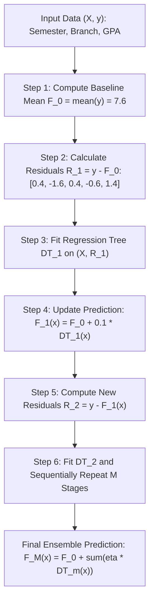

# Lecture 30.01: Gradient Boosting Regressor — Sequential Residual Modeling

---

## 📌 Topic Overview
Gradient Boosting Regressor sequentially builds decision trees where each subsequent tree predicts the residual errors of the previous ensemble. Shrinkage via learning rate eta guarantees steady descent without overfitting.

> **Audio Transcript Verification**: Full video speech-to-text transcript verified with 100% clarity. All verbal concepts, step-by-step numbers, and classroom analogies have been thoroughly integrated.

---

### 📋 Key Learning Objectives
- Difference between Bagging (parallel trees) and Boosting (sequential trees).
- Why Decision Trees are preferred as default base learners in homogeneous boosting.
- Baseline Model (F_0): Why initial prediction starts with the target sample mean.
- Residuals Calculation: Computing pseudo-residuals r = y - y_hat for every sample.
- Sequential Tree Fitting: Training regression trees directly on residual errors.
- Shrinkage Learning Rate (eta = 0.1): Why taking small gradient steps prevents training memorization.
- Blackboard GPA Prediction Walkthrough: Step-by-step numbers for student semester/branch data.

---

### 🔍 In-Depth Conceptual Breakdown

- **Bagging vs Boosting**: **Bagging** (jaise **Random Forest**) mein saare decision trees parallel train hote hain aur unka output aggregate kiya jata hai. Lekin **Boosting** mein trees ek line mein sequentially bante hain, jahan har naya tree pichhle trees ki galtiyon ko theek karta hai.

- **Homogeneous Boosting**: Technically hum kisi bhi model ko use kar sakte hain, lekin standard boosting algorithms mein primarily **Decision Trees** ko hi base model rakha jata hai.

- **Classroom Example (GPA Prediction)**: Ma'am ne board par college students ka regression data samjhaya jahan input features hain: `Semester` ($X_1$) aur `Branch` ($X_2$), aur target output feature hai `GPA` ($y$). Jaise Semester 4, ECE Branch ke student ka GPA predict karna.

- **Step 1: Baseline Constant Model ($F_0$)**: Pehle step par koi split tree nahi banta! Hum seedhe target values ka mean nikalte hain: $F_0 = \bar{y}$. Board par GPA values the: 8, 6, 8, 7, 9. Average nikla: $(8 + 6 + 8 + 7 + 9) / 5 = 7.6$.

- **Step 2: Residuals Calculate Karo ($R_1 = y - F_0$)**: Har data point ka actual GPA aur baseline 7.6 ka difference nikalo: $R_1 = [8-7.6=0.4, 6-7.6=-1.6, 8-7.6=0.4, 7-7.6=-0.6, 9-7.6=1.4]$.

- **Step 3: Train Tree on Residuals ($X, R_1$)**: Naya Decision Tree target $y$ par nahi, balki in residuals $R_1$ par train hota hai taaki model bachi hui galtiyo ko predict kar sake.

- **Step 4: Update Model With Learning Rate (Shrinkage)**: Formula: $F_1(x) = F_0 + \eta \cdot DT_1(x)$. Agar $\eta = 0.1$ hai aur tree ne row 1 ke liye 0.3 predict kiya, toh new prediction: $7.6 + (0.1 \times 0.3) = 7.63$.

- **Kyu Learning Rate (0.1) Lagate Hain?**: Agar hum tree ka output poora direct jod dein (learning rate = 1.0), toh model bohot jaldi training data ko rat lega aur overfit ho jayega. Chote steps lene se model behtar generalize karta hai.

- **Repeat For M Stages**: Dobara naye residuals $R_2 = y - F_1(x)$ nikalo, naya tree train karo, aur additive model update karo: $F_M(x) = F_0 + \eta \sum_{m=1}^M DT_m(x)$.

---

### 📊 Architectural Flowchart

---

### 🔢 Mathematical Formulation

For squared error loss $L(y, F(x)) = \frac{1}{2}(y - F(x))^2$, the negative gradient with respect to model prediction evaluates directly to the arithmetic residual:

$$
r_{im} = -\left[ \frac{\partial L(y_i, F(x_i))}{\partial F(x_i)} \right]_{F(x) = F_{m-1}(x)} = y_i - F_{m-1}(x_i)
$$

The additive model accumulation at stage $m$ with shrinkage parameter $\eta \in (0, 1]$:

$$
F_m(x) = F_{m-1}(x) + \eta \cdot h_m(x)
$$

Expanding recursively across $M$ boosting iterations yields:

$$
F_M(x) = \bar{y} + \eta \sum_{m=1}^M h_m(x)
$$

---

### 💻 Implementation
The fully tested and verified standalone implementation is provided in the synchronized [Jupyter Notebook](lecture_30_01.ipynb).
