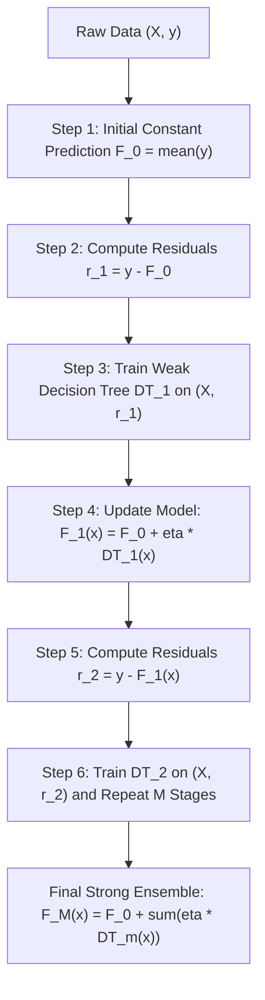

# Lecture 30.01: Gradient Boosting Regressor (Intuition) — Sequential Residual Modeling

[](#)
[](lecture_30_01.ipynb)
[](README_HINGLISH.md)
[](notes.pdf)
[](notes_hinglish.pdf)

---

## 📌 Topic Overview
Gradient Tree Boosting for regression is a sequential additive modeling technique that builds base learners to predict the negative gradient (pseudo-residuals) of the loss function. Starting from an initial baseline prediction (sample mean F_0 = y_bar), each subsequent decision tree is trained on the residual errors (y - y_hat) of the previous aggregated model, and integrated via a shrinkage learning rate nu to guarantee stable gradient descent in function space.

---

### 🗺️ Visual Architecture Diagram



---

### 🛠️ Mathematical Mechanics & Theoretical Foundations
For squared error loss $L(y, F(x)) = \frac{1}{2}(y - F(x))^2$, the negative gradient with respect to model prediction evaluates directly to the arithmetic residual:

$$
r_{im} = -\left[ \frac{\partial L(y_i, F(x_i))}{\partial F(x_i)} \right]_{F(x) = F_{m-1}(x)} = y_i - F_{m-1}(x_i)
$$

The additive model accumulation at stage $m$ with shrinkage parameter $\eta \in (0, 1]$:

$$
F_m(x) = F_{m-1}(x) + \eta \cdot h_m(x)
$$

Expanding recursively across $M$ boosting iterations yields:

$$
F_M(x) = \bar{y} + \eta \sum_{m=1}^M h_m(x)
$$

---

### 💻 Python Production Implementation

```python
import numpy as np
from sklearn.tree import DecisionTreeRegressor

def fit_gradient_boosting_regressor_scratch(X, y, n_estimators=5, learning_rate=0.1, max_depth=2):
    """
    First-principles implementation of Gradient Tree Boosting for regression.
    Sequentially fits decision trees to residuals of squared error loss.
    
    Parameters:
    -----------
    X : ndarray of shape (N, d)
        Feature matrix.
    y : ndarray of shape (N,)
        Continuous target values.
    n_estimators : int, default=5
        Number of sequential residual trees.
    learning_rate : float, default=0.1
        Shrinkage parameter eta.
    max_depth : int, default=2
        Maximum depth of each base regression tree.
        
    Returns:
    --------
    f0 : float
        Initial baseline constant prediction (mean of y).
    trees : list
        List of trained DecisionTreeRegressor objects.
    learning_rate : float
        The applied shrinkage factor.
    final_predictions : ndarray
        Aggregated predictions on the training dataset.
    """
    X_arr = np.asarray(X, dtype=float)
    y_arr = np.asarray(y, dtype=float)
    
    # 1. Step 1: Base prediction = mean of y
    f0 = float(np.mean(y_arr))
    current_preds = np.full_like(y_arr, fill_value=f0)
    
    trees = []
    
    # 2. Sequential Boosting Stages
    for stage in range(n_estimators):
        # Compute residuals r = y - y_hat
        residuals = y_arr - current_preds
        
        # Fit a shallow decision tree to residuals
        tree = DecisionTreeRegressor(max_depth=max_depth, random_state=42 + stage)
        tree.fit(X_arr, residuals)
        trees.append(tree)
        
        # Update predictions via shrinkage: y_hat = y_hat + eta * tree(X)
        step_update = tree.predict(X_arr)
        current_preds += learning_rate * step_update
        
    return f0, trees, learning_rate, current_preds

# ----------------- Driver Execution & Blackboard Testing -----------------
if __name__ == "__main__":
    # Shraddha ma'am's Blackboard Student GPA Dataset
    # X1: SEM, X2: BRANCH (Encoded CS=0, ECE=1, ME=2), y: GPA
    X_demo = np.array([
        [1.0, 0.0],  # Sem 1, CS
        [2.0, 1.0],  # Sem 2, ECE
        [3.0, 2.0],  # Sem 3, ME
        [4.0, 0.0],  # Sem 4, CS
        [5.0, 1.0]   # Sem 5, ECE
    ])
    y_gpa = np.array([8.0, 6.0, 8.0, 7.0, 9.0])
    
    f0_mean, fitted_trees, lr, train_preds = fit_gradient_boosting_regressor_scratch(
        X_demo, y_gpa, n_estimators=10, learning_rate=0.1, max_depth=1
    )
    
    print("=" * 60)
    print("--- GRADIENT BOOSTING REGRESSOR (FROM SCRATCH) ---")
    print(f"Initial Mean Prediction (F0): {f0_mean:.2f}")
    print(f"Actual Target Values        : {y_gpa.tolist()}")
    print(f"Final Boosted Predictions   : {[round(p, 2) for p in train_preds]}")
    print(f"Mean Absolute Error Drop    : {np.mean(np.abs(y_gpa - f0_mean)):.3f} -> {np.mean(np.abs(y_gpa - train_preds)):.3f}")
    print("=" * 60)
```

---

### 🔑 Critical Architectural Takeaways
1. **Sequential Bias Minimization**: Unlike bagging which stabilizes variance, boosting models sequentially reduce bias by focusing on residuals and hard examples.
2. **Shrinkage Regularization**: Setting learning_rate < 1.0 enforces small gradient descent steps, preventing the ensemble from memorizing noise.
3. **Weak Learners Principle**: Keeping base decision trees shallow (max_depth=1 to 3) ensures individual estimators remain high-bias weak learners.
