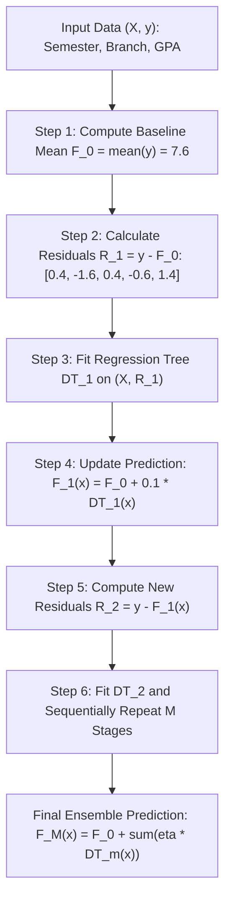
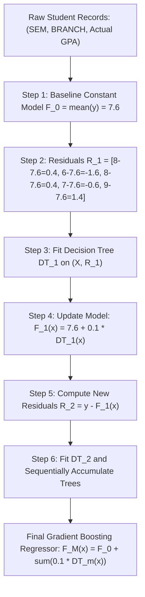

# Lecture 30.01: Gradient Boosting Regressor — Pseudo-Residuals Aur Sequential Learning [Hinglish]

---

## 📌 Topic Overview
Gradient Boosting Regressor sequentially builds decision trees where each subsequent tree predicts the residual errors of the previous ensemble. Shrinkage via learning rate eta guarantees steady descent without overfitting.

---

### 📋 Is Topic Mein Hum Kya Seekhenge?
- Bagging (Parallel) aur Boosting (Sequential) ke beech ka fundamental farak.
- Homogeneous boosting mein Decision Trees ko hi base model kyu chuna jata hai.
- Initial Baseline Model (F_0): Target variable ke average/mean se shuruat kyu hoti hai.
- Pseudo-Residuals ($r = y - \hat{y}$) calculate karne ka exact formula aur logic.
- Residual Tree Fitting: Agle Decision Tree ko target $y$ ke bajay residuals par train karna.
- Learning Rate ($\eta = 0.1$) ka role: Overfitting rokne ke liye chote kadam lena kyu zaroori hai.
- Ma'am ka Blackboard GPA Example: Semester 4, ECE branch ke student ka step-by-step numerical calculation.

---

### 🔍 Har Ek Point Ka Simple & Detailed Explanation
- **Bagging vs Boosting**: **Bagging** (jaise **Random Forest**) mein saare decision trees parallel train hote hain aur unka output aggregate kiya jata hai. Lekin **Boosting** mein trees ek line mein sequentially bante hain, jahan har naya tree pichhle trees ki galtiyon ko theek karta hai.

- **Homogeneous Boosting**: Technically hum kisi bhi model ko use kar sakte hain, lekin standard boosting algorithms mein primarily **Decision Trees** ko hi base model rakha jata hai.

- **Classroom Example (GPA Prediction)**: Ma'am ne board par college students ka regression data samjhaya jahan input features hain: `Semester` ($X_1$) aur `Branch` ($X_2$), aur target output feature hai `GPA` ($y$). Jaise Semester 4, ECE Branch ke student ka GPA predict karna.

- **Step 1: Baseline Constant Model ($F_0$)**: Pehle step par koi split tree nahi banta! Hum seedhe target values ka mean nikalte hain: $F_0 = \bar{y}$. Board par GPA values the: 8, 6, 8, 7, 9. Average nikla: $(8 + 6 + 8 + 7 + 9) / 5 = 7.6$.

- **Step 2: Residuals Calculate Karo ($R_1 = y - F_0$)**: Har data point ka actual GPA aur baseline 7.6 ka difference nikalo: $R_1 = [8-7.6=0.4, 6-7.6=-1.6, 8-7.6=0.4, 7-7.6=-0.6, 9-7.6=1.4]$.

- **Step 3: Train Tree on Residuals ($X, R_1$)**: Naya Decision Tree target $y$ par nahi, balki in residuals $R_1$ par train hota hai taaki model bachi hui galtiyo ko predict kar sake.

- **Step 4: Update Model With Learning Rate (Shrinkage)**: Formula: $F_1(x) = F_0 + \eta \cdot DT_1(x)$. Agar $\eta = 0.1$ hai aur tree ne row 1 ke liye 0.3 predict kiya, toh new prediction: $7.6 + (0.1 \times 0.3) = 7.63$.

- **Kyu Learning Rate (0.1) Lagate Hain?**: Agar hum tree ka output poora direct jod dein (learning rate = 1.0), toh model bohot jaldi training data ko rat lega aur overfit ho jayega. Chote steps lene se model behtar generalize karta hai.

- **Repeat For M Stages**: Dobara naye residuals $R_2 = y - F_1(x)$ nikalo, naya tree train karo, aur additive model update karo: $F_M(x) = F_0 + \eta \sum_{m=1}^M DT_m(x)$.

---

### 📊 Visual Flowchart / Diagram

---

---

### 📋 Ma'am Ka Classroom Blackboard GPA Example Table

| Student ID | SEM ($X_1$) | BRANCH ($X_2$) | Actual GPA ($y$) | Baseline $F_0$ (Mean = 7.6) | Residual $R_1 = y - F_0$ | Tree 1 Pred ($DT_1$) | Updated $F_1 = F_0 + 0.1 \cdot DT_1$ | Residual $R_2 = y - F_1$ |
| :---: | :---: | :---: | :---: | :---: | :---: | :---: | :---: | :---: |
| **1** | 4 | ECE | **8.0** | 7.6 | **+0.4** | +0.3 | **7.63** | +0.37 |
| **2** | 6 | CSE | **6.0** | 7.6 | **-1.6** | -1.2 | **7.48** | -1.48 |
| **3** | 4 | CSE | **8.0** | 7.6 | **+0.4** | +0.3 | **7.63** | +0.37 |
| **4** | 8 | MECH | **7.0** | 7.6 | **-0.6** | -0.5 | **7.55** | -0.55 |
| **5** | 6 | ECE | **9.0** | 7.6 | **+1.4** | +1.1 | **7.71** | +1.29 |

---

### 📊 Ma'am Ka Blackboard Step-by-Step Architecture

### 🔢 Mathematical Derivation

For squared error loss $L(y, F(x)) = \frac{1}{2}(y - F(x))^2$, the negative gradient with respect to model prediction evaluates directly to the arithmetic residual:

$$
r_{im} = -\left[ \frac{\partial L(y_i, F(x_i))}{\partial F(x_i)} \right]_{F(x) = F_{m-1}(x)} = y_i - F_{m-1}(x_i)
$$

The additive model accumulation at stage $m$ with shrinkage parameter $\eta \in (0, 1]$:

$$
F_m(x) = F_{m-1}(x) + \eta \cdot h_m(x)
$$

Expanding recursively across $M$ boosting iterations yields:

$$
F_M(x) = \bar{y} + \eta \sum_{m=1}^M h_m(x)
$$

---

### 📌 Note on Code
Yeh pure conceptual, mathematical, aur blackboard theory lecture hai. Ma'am ne is lecture mein code nahi likha hai, isliye rule ke mutabiq isme koi extra synthetic code add nahi kiya gaya hai.

