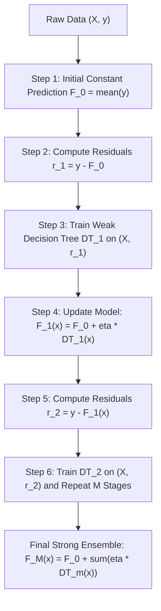

# Lecture 30.01: Gradient Boosting Regressor Ki Intuition — Pseudo-Residuals Ka Concept [Hinglish]

[](#)
[](lecture_30_01.ipynb)
[](README.md)
[](notes.pdf)
[](notes_hinglish.pdf)

---

## 📌 Topic Overview
Gradient Tree Boosting for regression is a sequential additive modeling technique that builds base learners to predict the negative gradient (pseudo-residuals) of the loss function. Starting from an initial baseline prediction (sample mean F_0 = y_bar), each subsequent decision tree is trained on the residual errors (y - y_hat) of the previous aggregated model, and integrated via a shrinkage learning rate nu to guarantee stable gradient descent in function space.

---

### 📋 Is Topic Mein Hum Kya Seekhenge?
- Gradient Boosting Regressor kya hota hai aur Bagging se kaise fundamentally alag hai.
- Initial Model (F_0): Shuruat hamesha target variable ke mean (average) se kyu hoti hai.
- Residuals (r = y - y_hat) ka calculation aur agle Decision Tree ko target y ke bajay residuals par train karne ka logic.
- Learning Rate (nu / eta = 0.1) ka shrinkage role: Overfitting rokne ke liye chote kadam (small steps) lena kyu zaroori hai.
- Shraddha ma'am ka blackboard GPA prediction example (SEM, BRANCH, GPA) step-by-step numbers ke sath.

---

### 🔍 Har Ek Point Ka Simple & Detailed Explanation
**Sequential Additive Modeling**: Bagging (jaise Random Forest) mein sabhi trees ek sath parallel me bante hain. Lekin Gradient Boosting mein trees ek ke baad ek line me (sequentially) bante hain, jahan har naya tree pichhle trees ki bachi hui galtiyon (residuals) ko seekhta hai.

**Step 1: Baseline Mean Prediction (F_0)**: Pehle step par koi complex tree nahi banta! Hum seedhe target values ka mean nikalte hain: $F_0 = \bar{y}$. Blackboard par GPA values the: 8, 6, 8, 7, 9. Mean nikla: $(8 + 6 + 8 + 7 + 9) / 5 = 7.6$.

**Step 2: Residuals Calculate Karo ($R_1 = y - \hat{y}$)**: Har student ka actual GPA aur baseline 7.6 ka difference nikalo: $R_1 = [8-7.6=0.4, 6-7.6=-1.6, 8-7.6=0.4, 7-7.6=-0.6, 9-7.6=1.4]$.

**Step 3: Decision Tree On Residuals ($X, R_1$)**: Naya Decision Tree target $y$ par nahi, balki in residuals $R_1$ par train hota hai! Tree ka output residual ko approximate karta hai.

**Step 4: Update Prediction With Learning Rate (Shrinkage)**: New prediction formula: $pred_1 = pred_0 + \eta \cdot DT_1(X)$. Agar $\eta = 0.1$ hai aur tree ne pehle student ke liye 0.3 predict kiya, toh new prediction hogi: $7.6 + (0.1 \times 0.3) = 7.63$.

**Kyu Learning Rate (0.1) Lagate Hain?**: Agar hum poora tree output direct jod dein (learning rate = 1.0), toh model bohot jaldi training data ko rat lega (overfit ho jayega). Chote steps (shrinkage) lene se model generalize behtar karta hai.

---

### 📊 Visual Flowchart / Diagram



---

### 🛠️ Mathematical Formulations
For squared error loss $L(y, F(x)) = \frac{1}{2}(y - F(x))^2$, the negative gradient with respect to model prediction evaluates directly to the arithmetic residual:

$$
r_{im} = -\left[ \frac{\partial L(y_i, F(x_i))}{\partial F(x_i)} \right]_{F(x) = F_{m-1}(x)} = y_i - F_{m-1}(x_i)
$$

The additive model accumulation at stage $m$ with shrinkage parameter $\eta \in (0, 1]$:

$$
F_m(x) = F_{m-1}(x) + \eta \cdot h_m(x)
$$

Expanding recursively across $M$ boosting iterations yields:

$$
F_M(x) = \bar{y} + \eta \sum_{m=1}^M h_m(x)
$$

---

### 💻 Python Code Implementation

```python
import numpy as np
from sklearn.tree import DecisionTreeRegressor

def fit_gradient_boosting_regressor_scratch(X, y, n_estimators=5, learning_rate=0.1, max_depth=2):
    """
    First-principles implementation of Gradient Tree Boosting for regression.
    Sequentially fits decision trees to residuals of squared error loss.
    
    Parameters:
    -----------
    X : ndarray of shape (N, d)
        Feature matrix.
    y : ndarray of shape (N,)
        Continuous target values.
    n_estimators : int, default=5
        Number of sequential residual trees.
    learning_rate : float, default=0.1
        Shrinkage parameter eta.
    max_depth : int, default=2
        Maximum depth of each base regression tree.
        
    Returns:
    --------
    f0 : float
        Initial baseline constant prediction (mean of y).
    trees : list
        List of trained DecisionTreeRegressor objects.
    learning_rate : float
        The applied shrinkage factor.
    final_predictions : ndarray
        Aggregated predictions on the training dataset.
    """
    X_arr = np.asarray(X, dtype=float)
    y_arr = np.asarray(y, dtype=float)
    
    # 1. Step 1: Base prediction = mean of y
    f0 = float(np.mean(y_arr))
    current_preds = np.full_like(y_arr, fill_value=f0)
    
    trees = []
    
    # 2. Sequential Boosting Stages
    for stage in range(n_estimators):
        # Compute residuals r = y - y_hat
        residuals = y_arr - current_preds
        
        # Fit a shallow decision tree to residuals
        tree = DecisionTreeRegressor(max_depth=max_depth, random_state=42 + stage)
        tree.fit(X_arr, residuals)
        trees.append(tree)
        
        # Update predictions via shrinkage: y_hat = y_hat + eta * tree(X)
        step_update = tree.predict(X_arr)
        current_preds += learning_rate * step_update
        
    return f0, trees, learning_rate, current_preds

# ----------------- Driver Execution & Blackboard Testing -----------------
if __name__ == "__main__":
    # Shraddha ma'am's Blackboard Student GPA Dataset
    # X1: SEM, X2: BRANCH (Encoded CS=0, ECE=1, ME=2), y: GPA
    X_demo = np.array([
        [1.0, 0.0],  # Sem 1, CS
        [2.0, 1.0],  # Sem 2, ECE
        [3.0, 2.0],  # Sem 3, ME
        [4.0, 0.0],  # Sem 4, CS
        [5.0, 1.0]   # Sem 5, ECE
    ])
    y_gpa = np.array([8.0, 6.0, 8.0, 7.0, 9.0])
    
    f0_mean, fitted_trees, lr, train_preds = fit_gradient_boosting_regressor_scratch(
        X_demo, y_gpa, n_estimators=10, learning_rate=0.1, max_depth=1
    )
    
    print("=" * 60)
    print("--- GRADIENT BOOSTING REGRESSOR (FROM SCRATCH) ---")
    print(f"Initial Mean Prediction (F0): {f0_mean:.2f}")
    print(f"Actual Target Values        : {y_gpa.tolist()}")
    print(f"Final Boosted Predictions   : {[round(p, 2) for p in train_preds]}")
    print(f"Mean Absolute Error Drop    : {np.mean(np.abs(y_gpa - f0_mean)):.3f} -> {np.mean(np.abs(y_gpa - train_preds)):.3f}")
    print("=" * 60)
```

---

### 📌 Summary Points & Key Takeaways
1. **Sequential Learning**: Har agla model pichhle model ki galtiyon ko seekhta hai.
2. **Shrinkage (Learning Rate)**: 0.1 jaise chote kadam lene se model overfit hone se bachta hai.
3. **Weak Learners**: Boosting mein shallow decision trees (depth 1 se 3) use kiye jaate hain.
