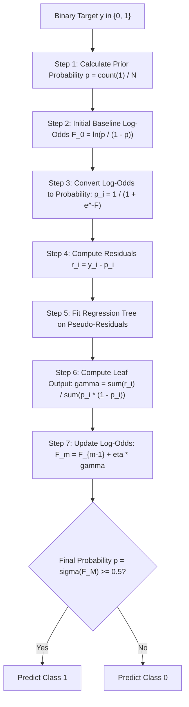
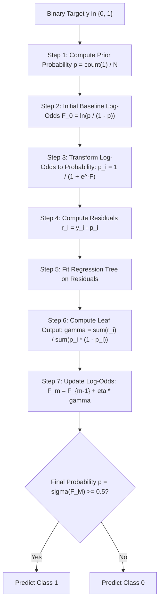

# Lecture 30.02: Gradient Boosting Classifier — Log-Odds Aur Sigmoid Ka Complete Concept [Hinglish]

---

## 📌 Topic Overview
Gradient Boosting for classification operates in Log-Odds space. The initial baseline prediction is log(p / (1 - p)), transformed via Sigmoid into probability. Trees are fitted on pseudo-residuals (y - p) and updated sequentially.

---

### 📋 Is Topic Mein Hum Kya Seekhenge?
- Gradient Boosting regression se binary classification mein kaise adapt hota hai.
- Initial Model ($F_0$): Classification mein direct 0 ya 1 ke bajay **Log-Odds** kyu calculate karte hain.
- Sigmoid Function: Log-Odds ko wapas probability ($p$) mein convert karne ka formula.
- Pseudo-Residuals ($r_i = y_i - p_i$): Actual class label ($0$ ya $1$) aur predicted probability ka difference.
- Leaf Output Math: Tree ke leaves ke liye output value calculate karna.
- Log-Odds Space Update: Naye tree ke output ko learning rate ke sath add karna.

---

### 🔍 Har Ek Point Ka Simple & Detailed Explanation
- **Binary Classification Setup**: Target variable mein do classes hoti hain: $0$ aur $1$ (jahan $1$ ko success consider karte hain, jaise Email Spam vs Ham).

- **Step 1: Baseline Model ($F_0$) via Log-Odds**: Direct majority class predict karne ke bajay model training data ki probability $p$ nikalta hai: $p = \text{count}(1) / N$. Fir **Log-Odds** calculate karta hai: $F_0 = \ln\left(\frac{p}{1 - p}\right)$.

- **Step 2: Convert to Probability (Sigmoid)**: Is log-odds value ko probability mein convert karne ke liye **Sigmoid function** use hota hai: $p = \sigma(F) = \frac{1}{1 + e^{-F}}$.

- **Step 3: Residuals Calculate Karo ($r_i = y_i - p_i$)**: Har sample ka actual label ($y_i \in \{0, 1\}$) aur predicted probability ($p_i$) ka difference nikalo. Jaise agar actual $y=1$ hai aur $p=0.7$ hai, toh residual $r = 1 - 0.7 = 0.3$.

- **Step 4: Train Regression Tree on Residuals**: Ek regression tree in residuals $r_i$ par train hota hai.

- **Step 5: Leaf Output Value Calculation**: Classification ke liye leaf ka output direct residual mean nahi hota, balki formula hota hai: $\gamma = \frac{\sum r_i}{\sum p_i(1 - p_i)}$.

- **Step 6: Update In Log-Odds Space**: Prediction log-odds space mein update hoti hai: $F_1(x) = F_0 + \eta \cdot \gamma$.

- **Final Class Prediction**: Final log-odds ko sigmoid se pass karo. Agar $p \ge 0.5$ hai toh **Class 1**, warna **Class 0** predict hota hai!

---

### 📊 Visual Flowchart / Diagram

---

---

### 📋 Ma'am Ka Classroom Binary Classification Matrix

| Sample Index | Features ($X$) | Actual Label ($y \in \{0, 1\}$) | Initial Baseline Log-Odds ($F_0$) | Probability ($p_0 = \sigma(F_0)$) | Pseudo-Residual ($r_1 = y - p_0$) |
| :---: | :---: | :---: | :---: | :---: | :---: |
| **1** | $x_1$ | **1 (Success)** | $\ln(p / (1 - p))$ | $p_0$ | **$1 - p_0$** |
| **2** | $x_2$ | **0 (Failure)** | $\ln(p / (1 - p))$ | $p_0$ | **$0 - p_0$** |
| **3** | $x_3$ | **1 (Success)** | $\ln(p / (1 - p))$ | $p_0$ | **$1 - p_0$** |
| **4** | $x_4$ | **0 (Failure)** | $\ln(p / (1 - p))$ | $p_0$ | **$0 - p_0$** |

---

### 📊 Ma'am Ka Blackboard Classification Workflow

### 🔢 Mathematical Derivation

For binary cross-entropy (log-loss) $L(y, F) = -y \ln(p) - (1 - y) \ln(1 - p)$ where $p = \sigma(F) = \frac{1}{1 + e^{-F}}$:

The negative gradient with respect to log-odds $F$ simplifies elegantly to:

$$
r_{im} = -\left[ \frac{\partial L(y_i, F(x_i))}{\partial F(x_i)} \right] = y_i - p_i
$$

The initial baseline log-odds $F_0$ from training class prior $p$:

$$
F_0 = \ln\left( \frac{p}{1 - p} \right) = \ln\left( \frac{\sum_{i=1}^N y_i}{N - \sum_{i=1}^N y_i} \right)
$$

The terminal leaf output $\gamma_{jm}$ for region $R_{jm}$ in a tree maximizing the second-order Taylor expansion:

$$
\gamma_{jm} = \frac{\sum_{x_i \in R_{jm}} r_{im}}{\sum_{x_i \in R_{jm}} p_{im}(1 - p_{im})}
$$

---

### 📌 Note on Code
Yeh pure conceptual, mathematical, aur blackboard theory lecture hai. Ma'am ne is lecture mein code nahi likha hai, isliye rule ke mutabiq isme koi extra synthetic code add nahi kiya gaya hai.

