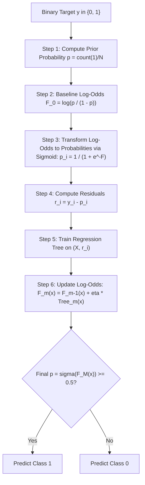

# Lecture 30.02: Gradient Boosting Classifier Ki Intuition — Log-Odds Aur Sigmoid Residuals [Hinglish]

[](#)
[](lecture_30_02.ipynb)
[](README.md)
[](notes.pdf)
[](notes_hinglish.pdf)

---

## 📌 Topic Overview
Gradient Boosting for binary classification maps targets y in {0, 1} into continuous log-odds space. The initial prediction F_0 represents the prior log-odds of the positive class. Probabilities are derived via the logistic sigmoid transform p = sigma(F), yielding pseudo-residuals r_i = y_i - p_i. Shallow decision trees model these residuals, updating log-odds iteratively before final probability thresholding.

---

### 📋 Is Topic Mein Hum Kya Seekhenge?
- Classification mein seedhe probability kyu nahi jodi ja sakti aur Log-Odds space kyu zaroori hai.
- Initial Model (F_0): Positive class ki prior probability se log-odds nikalna: F_0 = log(p / (1 - p)).
- Sigmoid Function: Log-odds ko wapas 0 se 1 ke beech probability mein convert karna: p = 1 / (1 + e^(-F)).
- Classification Pseudo-Residuals ($r = y - p$): Actual label (0 ya 1) aur predicted probability ($p$) ka difference.
- Leaf Output value aur log-odds accumulation workflow.

---

### 🔍 Har Ek Point Ka Simple & Detailed Explanation
**Direct Probability Addition Ki Problem**: Regression mein $y$ continuous number hota hai, isliye $7.6 + (0.1 \times 0.3) = 7.63$ seedhe add ho jata hai. Lekin probability $0$ aur $1$ ke beech bounded hoti hai. Agar hum trees ko seedhe add karenge, toh probability $1.2$ ya $-0.3$ ho sakti hai jo mathematically galat hai!

**Log-Odds Space Ka Magic**: Hum raw prediction ko **Log-Odds** (real number line $(-\infty, +\infty)$) mein rakhte hain, aur jab bhi probability chahiye hoti hai, **Sigmoid Function** $\sigma(F)$ lagakar $0$ se $1$ mein convert kar lete hain.

**Step 1: Baseline Log-Odds ($F_0$)**: Maan lijiye dataset mein 60% positive samples ($y=1$) hain aur 40% negative ($y=0$). Shuruat mein $p = 0.6$. Baseline log-odds: $F_0 = \log(\frac{0.6}{0.4}) = \log(1.5) \approx 0.405$.

**Step 2: Residuals Calculate ($r_i = y_i - p_i$)**: Har sample ke liye actual label $y_i \in \{0, 1\}$ se current probability $p_i$ minus karo. Agar sample $y=1$ hai aur $p=0.6$, residual $r = 1 - 0.6 = +0.4$. Agar sample $y=0$ hai aur $p=0.6$, residual $r = 0 - 0.6 = -0.6$.

**Step 3 & 4: Residuals Par Tree & Update**: Decision tree in continuous residuals par fit hota hai aur leaves ke output se log-odds update hoti hai: $F_1(x) = F_0(x) + \eta \cdot \text{Tree}_1(x)$.

**Final Class Prediction**: Agar final probability $p = \sigma(F_M) \ge 0.5$ aati hai, toh Class 1 predict hota hai, warna Class 0!

---

### 📊 Visual Flowchart / Diagram



---

### 🛠️ Mathematical Formulations
For binary cross-entropy (log-loss) $L(y, F) = -y \ln(p) - (1 - y) \ln(1 - p)$ where $p = \sigma(F) = \frac{1}{1 + e^{-F}}$:

The negative gradient with respect to log-odds $F$ simplifies elegantly to:

$$
r_{im} = -\left[ \frac{\partial L(y_i, F(x_i))}{\partial F(x_i)} \right] = y_i - p_i
$$

The initial baseline log-odds $F_0$ from training class prior $p$:

$$
F_0 = \ln\left( \frac{p}{1 - p} \right) = \ln\left( \frac{\sum_{i=1}^N y_i}{N - \sum_{i=1}^N y_i} \right)
$$

The terminal leaf output $\gamma_{jm}$ for region $R_{jm}$ in a tree maximizing the second-order Taylor expansion:

$$
\gamma_{jm} = \frac{\sum_{x_i \in R_{jm}} r_{im}}{\sum_{x_i \in R_{jm}} p_{im}(1 - p_{im})}
$$

---

### 💻 Python Code Implementation

```python
import numpy as np

def sigmoid(z):
    """Numerically stable logistic sigmoid function."""
    return np.where(z >= 0, 1.0 / (1.0 + np.exp(-z)), np.exp(z) / (1.0 + np.exp(z)))

def gradient_boosting_binary_classifier_scratch(X, y, n_estimators=5, learning_rate=0.2):
    """
    First-principles demonstration of Gradient Tree Boosting for Binary Classification.
    Operates in Log-Odds space using the logistic sigmoid loss.
    """
    X_arr = np.asarray(X, dtype=float)
    y_arr = np.asarray(y, dtype=float)
    
    # 1. Baseline prior probability and log-odds F0
    p_prior = np.mean(y_arr)
    # Clip to avoid division by zero
    p_prior = np.clip(p_prior, 1e-6, 1.0 - 1e-6)
    f0 = float(np.log(p_prior / (1.0 - p_prior)))
    
    current_log_odds = np.full_like(y_arr, fill_value=f0)
    
    # 2. Sequential Boosting Stages
    from sklearn.tree import DecisionTreeRegressor
    trees = []
    
    for stage in range(n_estimators):
        # Convert current log-odds to probability
        current_probs = sigmoid(current_log_odds)
        
        # Residuals = y - p
        residuals = y_arr - current_probs
        
        # Fit regression tree on pseudo-residuals
        tree = DecisionTreeRegressor(max_depth=1, random_state=42 + stage)
        tree.fit(X_arr, residuals)
        trees.append(tree)
        
        # Update log-odds via shrinkage
        current_log_odds += learning_rate * tree.predict(X_arr)
        
    final_probs = sigmoid(current_log_odds)
    predicted_classes = (final_probs >= 0.5).astype(int)
    
    return f0, trees, final_probs, predicted_classes

# ----------------- Driver Execution & Testing -----------------
if __name__ == "__main__":
    X_sample = np.array([
        [22.0, 25.0], [45.0, 55.0], [52.0, 70.0],
        [20.0, 22.0], [38.0, 48.0], [60.0, 85.0]
    ])
    y_sample = np.array([0, 1, 1, 0, 0, 1])  # 0 = Low Risk, 1 = High Risk
    
    f0_init, trained_trees, probas, preds = gradient_boosting_binary_classifier_scratch(
        X_sample, y_sample, n_estimators=6, learning_rate=0.3
    )
    
    print("=" * 60)
    print("--- GRADIENT BOOSTING CLASSIFIER (LOG-ODDS SCRATCH) ---")
    print(f"Initial Baseline Log-Odds (F0) : {f0_init:.4f}")
    print(f"Actual Target Classes          : {y_sample.tolist()}")
    print(f"Final Model Probabilities      : {[round(p, 3) for p in probas]}")
    print(f"Predicted Discrete Classes     : {preds.tolist()}")
    print(f"Classification Accuracy        : {np.mean(preds == y_sample) * 100:.1f}%")
    print("=" * 60)
```

---

### 📌 Summary Points & Key Takeaways
1. **Sequential Learning**: Har agla model pichhle model ki galtiyon ko seekhta hai.
2. **Shrinkage (Learning Rate)**: 0.1 jaise chote kadam lene se model overfit hone se bachta hai.
3. **Weak Learners**: Boosting mein shallow decision trees (depth 1 se 3) use kiye jaate hain.
