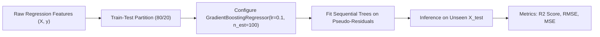

# Lecture 30.03: Gradient Boosting Regressor (Implementation) — Scikit-Learn Workflow

[](#)
[](lecture_30_03.ipynb)
[](README_HINGLISH.md)
[](notes.pdf)
[](notes_hinglish.pdf)

---

## 📌 Topic Overview
Production implementation of GradientBoostingRegressor in Scikit-Learn. Covers dataset synthesis via make_regression, hyperparameter calibration (n_estimators, learning_rate, max_depth, subsample, loss='squared_error'), model fitting, and multi-metric regression evaluation (MSE, RMSE, R^2 score).

---

### 🗺️ Visual Architecture Diagram



---

### 🛠️ Mathematical Mechanics & Theoretical Foundations
The mean squared error loss and coefficient of determination $R^2$ are evaluated as:

$$
\text{MSE} = \frac{1}{N} \sum_{i=1}^N (y_i - \hat{y}_i)^2, \quad \text{RMSE} = \sqrt{\text{MSE}}
$$

$$
R^2 = 1 - \frac{\sum_{i=1}^N (y_i - \hat{y}_i)^2}{\sum_{i=1}^N (y_i - \bar{y})^2}
$$

---

### 💻 Python Production Implementation

```python
import numpy as np
from sklearn.datasets import make_regression
from sklearn.model_selection import train_test_split
from sklearn.ensemble import GradientBoostingRegressor
from sklearn.metrics import mean_squared_error, r2_score

def train_gradient_boosting_regressor(n_samples=500, n_features=6, n_estimators=100, learning_rate=0.1, max_depth=3):
    """
    Builds, trains, and evaluates a Scikit-Learn GradientBoostingRegressor pipeline.
    
    Returns:
    --------
    model : GradientBoostingRegressor
        Trained gradient boosting model.
    metrics : dict
        Evaluation metrics on test partition (MSE, RMSE, R2).
    """
    # 1. Generate synthetic regression dataset
    X, y = make_regression(
        n_samples=n_samples, n_features=n_features, noise=10.0, random_state=42
    )
    X_train, X_test, y_train, y_test = train_test_split(
        X, y, test_size=0.2, random_state=42
    )
    
    # 2. Instantiate and fit GradientBoostingRegressor
    gbr = GradientBoostingRegressor(
        loss='squared_error',
        learning_rate=learning_rate,
        n_estimators=n_estimators,
        max_depth=max_depth,
        subsample=0.8,
        random_state=42
    )
    gbr.fit(X_train, y_train)
    
    # 3. Predict on unseen test partition
    y_pred = gbr.predict(X_test)
    
    mse = mean_squared_error(y_test, y_pred)
    rmse = np.sqrt(mse)
    r2 = r2_score(y_test, y_pred)
    
    metrics = {
        "mse": float(mse),
        "rmse": float(rmse),
        "r2_score": float(r2)
    }
    
    return gbr, metrics

# ----------------- Driver Execution & Testing -----------------
if __name__ == "__main__":
    trained_gbr, perf_metrics = train_gradient_boosting_regressor(
        n_estimators=100, learning_rate=0.1, max_depth=3
    )
    
    print("=" * 60)
    print("--- SCIKIT-LEARN GRADIENT BOOSTING REGRESSOR PIPELINE ---")
    print(f"Trained Estimators (Trees) : {len(trained_gbr.estimators_)}")
    print(f"Test Mean Squared Error (MSE): {perf_metrics['mse']:.3f}")
    print(f"Test Root MSE (RMSE)         : {perf_metrics['rmse']:.3f}")
    print(f"Test R^2 Determination Score : {perf_metrics['r2_score']:.4f}")
    print("=" * 60)
```

---

### 🔑 Critical Architectural Takeaways
1. **Sequential Bias Minimization**: Unlike bagging which stabilizes variance, boosting models sequentially reduce bias by focusing on residuals and hard examples.
2. **Shrinkage Regularization**: Setting learning_rate < 1.0 enforces small gradient descent steps, preventing the ensemble from memorizing noise.
3. **Weak Learners Principle**: Keeping base decision trees shallow (max_depth=1 to 3) ensures individual estimators remain high-bias weak learners.
