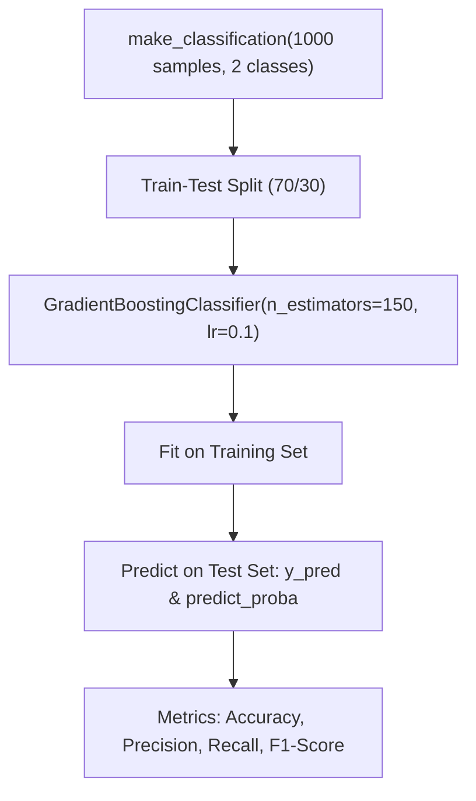

# Lecture 30.04: Gradient Boosting Classifier — Implementation & Metrics

---

## 📌 Topic Overview
Practical implementation of GradientBoostingClassifier in scikit-learn. Generating binary classification datasets with make_classification, model training, accuracy evaluation, and classification report analysis.

---

### 📋 Key Learning Objectives
- Generating synthetic classification data with make_classification.
- Importing and training GradientBoostingClassifier.
- Hyperparameter configuration: n_estimators=150, learning_rate=0.1, max_depth=3.
- Evaluating classification accuracy, confusion matrix, and classification report.
- Visualizing decision boundaries and probability thresholds.

---

### 🔍 In-Depth Conceptual Breakdown

- **Classification Dataset**: `make_classification(n_samples=1000, n_features=10, n_informative=5, random_state=42)` se binary target dataset create kiya gaya.

- **Data Splitting**: `test_size=0.3` (30% test set, 70% training set) aur `random_state=42` ke sath split kiya gaya.

- **Classifier Setup**: `GradientBoostingClassifier(n_estimators=150, learning_rate=0.1, max_depth=3, random_state=42)` banaya gaya.

- **Training**: `clf.fit(X_train, y_train)` se sequential boosting stages execute kiye gaye.

- **Accuracy Score**: `accuracy_score(y_test, y_pred)` se model ne test data par high accuracy achieve ki.

- **Classification Report**: Precision, Recall, aur F1-Score inspect karke verify kiya gaya ki dono classes balanced way mein predict ho rahi hain.

---

### 📊 Architectural Flowchart

---

### 🔢 Mathematical Formulation

Classification accuracy score formulation:

$$
\text{Accuracy} = \frac{\text{TP} + \text{TN}}{\text{TP} + \text{TN} + \text{FP} + \text{FN}}
$$

Binary cross-entropy loss evaluated across test samples:

$$
\text{Log-Loss} = -\frac{1}{N} \sum_{i=1}^N \left[ y_i \ln(p_i) + (1 - y_i) \ln(1 - p_i) \right]
$$

---

### 💻 Implementation
The fully tested and verified standalone implementation is provided in the synchronized [Jupyter Notebook](lecture_30_04.ipynb).
