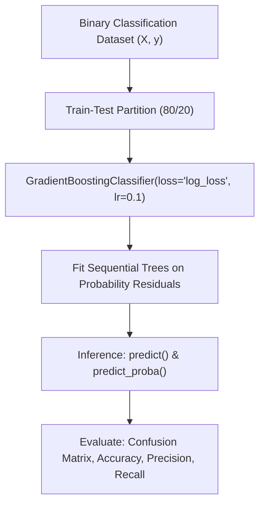

# Lecture 30.04: Gradient Boosting Classifier (Implementation) — Scikit-Learn Workflow

[](#)
[](lecture_30_04.ipynb)
[](README_HINGLISH.md)
[](notes.pdf)
[](notes_hinglish.pdf)

---

## 📌 Topic Overview
Production implementation of GradientBoostingClassifier in Scikit-Learn. Covers dataset creation via make_classification, hyperparameter tuning, log_loss optimization, and comprehensive evaluation using accuracy, confusion matrices, precision, recall, and ROC-AUC.

---

### 🗺️ Visual Architecture Diagram



---

### 🛠️ Mathematical Mechanics & Theoretical Foundations
Binary cross-entropy loss (log_loss) optimized during boosting:

$$
\mathcal{L}_{\text{log}}(\mathbf{y}, \mathbf{p}) = -\frac{1}{N} \sum_{i=1}^N \left[ y_i \ln(p_i) + (1 - y_i) \ln(1 - p_i) \right]
$$

---

### 💻 Python Production Implementation

```python
import numpy as np
from sklearn.datasets import make_classification
from sklearn.model_selection import train_test_split
from sklearn.ensemble import GradientBoostingClassifier
from sklearn.metrics import accuracy_score, precision_score, recall_score, f1_score, confusion_matrix

def train_gradient_boosting_classifier(n_samples=600, n_features=8, n_estimators=100, learning_rate=0.1):
    """
    Builds, trains, and evaluates a Scikit-Learn GradientBoostingClassifier.
    """
    # 1. Synthetic binary classification dataset
    X, y = make_classification(
        n_samples=n_samples, n_features=n_features, n_informative=5, random_state=42
    )
    X_train, X_test, y_train, y_test = train_test_split(
        X, y, test_size=0.2, random_state=42, stratify=y
    )
    
    # 2. Fit GradientBoostingClassifier
    gbc = GradientBoostingClassifier(
        loss='log_loss',
        learning_rate=learning_rate,
        n_estimators=n_estimators,
        max_depth=3,
        random_state=42
    )
    gbc.fit(X_train, y_train)
    
    # 3. Predict classes and probabilities
    y_pred = gbc.predict(X_test)
    y_prob = gbc.predict_proba(X_test)[:, 1]
    
    metrics = {
        "accuracy": float(accuracy_score(y_test, y_pred)),
        "precision": float(precision_score(y_test, y_pred, zero_division=0)),
        "recall": float(recall_score(y_test, y_pred, zero_division=0)),
        "f1_score": float(f1_score(y_test, y_pred, zero_division=0)),
        "confusion_matrix": confusion_matrix(y_test, y_pred).tolist()
    }
    
    return gbc, metrics

# ----------------- Driver Execution & Testing -----------------
if __name__ == "__main__":
    trained_gbc, perf = train_gradient_boosting_classifier()
    
    print("=" * 60)
    print("--- SCIKIT-LEARN GRADIENT BOOSTING CLASSIFIER PIPELINE ---")
    print(f"Accuracy  : {perf['accuracy'] * 100:.2f}%")
    print(f"Precision : {perf['precision'] * 100:.2f}%")
    print(f"Recall    : {perf['recall'] * 100:.2f}%")
    print(f"F1-Score  : {perf['f1_score'] * 100:.2f}%")
    print(f"Confusion Matrix: {perf['confusion_matrix']}")
    print("=" * 60)
```

---

### 🔑 Critical Architectural Takeaways
1. **Sequential Bias Minimization**: Unlike bagging which stabilizes variance, boosting models sequentially reduce bias by focusing on residuals and hard examples.
2. **Shrinkage Regularization**: Setting learning_rate < 1.0 enforces small gradient descent steps, preventing the ensemble from memorizing noise.
3. **Weak Learners Principle**: Keeping base decision trees shallow (max_depth=1 to 3) ensures individual estimators remain high-bias weak learners.
