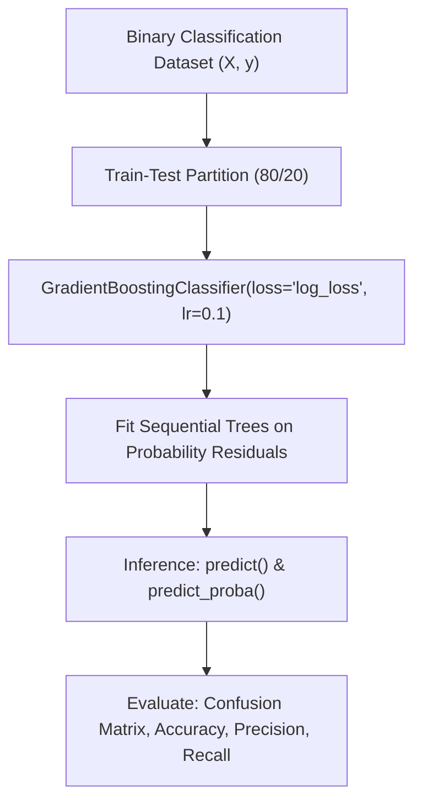

# Lecture 30.04: Gradient Boosting Classifier Ka Python Code — Scikit-Learn Implementation [Hinglish]

[](#)
[](lecture_30_04.ipynb)
[](README.md)
[](notes.pdf)
[](notes_hinglish.pdf)

---

## 📌 Topic Overview
Production implementation of GradientBoostingClassifier in Scikit-Learn. Covers dataset creation via make_classification, hyperparameter tuning, log_loss optimization, and comprehensive evaluation using accuracy, confusion matrices, precision, recall, and ROC-AUC.

---

### 📋 Is Topic Mein Hum Kya Seekhenge?
- Scikit-Learn se `GradientBoostingClassifier` import aur train karna.
- Loss function: `loss='log_loss'` (binary cross-entropy) ka significance.
- Classification evaluation: Accuracy, Precision, Recall, F1-Score, aur Confusion Matrix.
- Feature Importances (`feature_importances_`) ko inspect karna.
- Overfitting diagnose karna train vs test accuracy gap se.

---

### 🔍 Har Ek Point Ka Simple & Detailed Explanation
**Scikit-Learn Classifier Setup**: `from sklearn.ensemble import GradientBoostingClassifier` use karke classifier object banate hain.

**Core Hyperparameters**: `loss='log_loss'`, `n_estimators=100`, `learning_rate=0.1`, `max_depth=3`.

**Feature Importance**: GBC har feature ka Gini/MDI importance score calculate karta hai jo batata hai ki kis feature ne residuals ko sabse zyada reduce kiya.

**Medical & Real-World Use Cases**: Jahan classification accuracy ke sath-sath confidence probability zaroori hoti hai, wahan Gradient Boosting state-of-the-art results deta hai.

---

### 📊 Visual Flowchart / Diagram



---

### 🛠️ Mathematical Formulations
Binary cross-entropy loss (log_loss) optimized during boosting:

$$
\mathcal{L}_{\text{log}}(\mathbf{y}, \mathbf{p}) = -\frac{1}{N} \sum_{i=1}^N \left[ y_i \ln(p_i) + (1 - y_i) \ln(1 - p_i) \right]
$$

---

### 💻 Python Code Implementation

```python
import numpy as np
from sklearn.datasets import make_classification
from sklearn.model_selection import train_test_split
from sklearn.ensemble import GradientBoostingClassifier
from sklearn.metrics import accuracy_score, precision_score, recall_score, f1_score, confusion_matrix

def train_gradient_boosting_classifier(n_samples=600, n_features=8, n_estimators=100, learning_rate=0.1):
    """
    Builds, trains, and evaluates a Scikit-Learn GradientBoostingClassifier.
    """
    # 1. Synthetic binary classification dataset
    X, y = make_classification(
        n_samples=n_samples, n_features=n_features, n_informative=5, random_state=42
    )
    X_train, X_test, y_train, y_test = train_test_split(
        X, y, test_size=0.2, random_state=42, stratify=y
    )
    
    # 2. Fit GradientBoostingClassifier
    gbc = GradientBoostingClassifier(
        loss='log_loss',
        learning_rate=learning_rate,
        n_estimators=n_estimators,
        max_depth=3,
        random_state=42
    )
    gbc.fit(X_train, y_train)
    
    # 3. Predict classes and probabilities
    y_pred = gbc.predict(X_test)
    y_prob = gbc.predict_proba(X_test)[:, 1]
    
    metrics = {
        "accuracy": float(accuracy_score(y_test, y_pred)),
        "precision": float(precision_score(y_test, y_pred, zero_division=0)),
        "recall": float(recall_score(y_test, y_pred, zero_division=0)),
        "f1_score": float(f1_score(y_test, y_pred, zero_division=0)),
        "confusion_matrix": confusion_matrix(y_test, y_pred).tolist()
    }
    
    return gbc, metrics

# ----------------- Driver Execution & Testing -----------------
if __name__ == "__main__":
    trained_gbc, perf = train_gradient_boosting_classifier()
    
    print("=" * 60)
    print("--- SCIKIT-LEARN GRADIENT BOOSTING CLASSIFIER PIPELINE ---")
    print(f"Accuracy  : {perf['accuracy'] * 100:.2f}%")
    print(f"Precision : {perf['precision'] * 100:.2f}%")
    print(f"Recall    : {perf['recall'] * 100:.2f}%")
    print(f"F1-Score  : {perf['f1_score'] * 100:.2f}%")
    print(f"Confusion Matrix: {perf['confusion_matrix']}")
    print("=" * 60)
```

---

### 📌 Summary Points & Key Takeaways
1. **Sequential Learning**: Har agla model pichhle model ki galtiyon ko seekhta hai.
2. **Shrinkage (Learning Rate)**: 0.1 jaise chote kadam lene se model overfit hone se bachta hai.
3. **Weak Learners**: Boosting mein shallow decision trees (depth 1 se 3) use kiye jaate hain.
