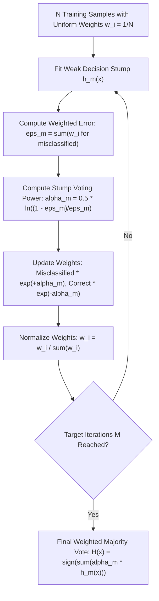

# Lecture 30.05: AdaBoost (Adaptive Boosting) — Intuition, Decision Stumps & Sample Reweighting

[](#)
[](lecture_30_05.ipynb)
[](README_HINGLISH.md)
[](notes.pdf)
[](notes_hinglish.pdf)

---

## 📌 Topic Overview
AdaBoost (Adaptive Boosting) by Freund & Schapire sequentially chains weak learners (typically Decision Stumps with max_depth=1). It starts with uniform sample weights w_i = 1/N. Each learner's voting power alpha_m is derived from its weighted error epsilon_m via alpha_m = 0.5 * ln((1 - epsilon_m)/epsilon_m). Sample weights are dynamically multiplied by exp(+alpha_m) for misclassified instances and exp(-alpha_m) for correctly classified instances, forcing subsequent stumps to concentrate strictly on hard boundary cases.

---

### 🗺️ Visual Architecture Diagram



---

### 🛠️ Mathematical Mechanics & Theoretical Foundations
The weighted classification error $\epsilon_m$ for stump $m$ across sample weights $\mathbf{w}^{(m)}$:

$$
\epsilon_m = \sum_{i=1}^N w_i^{(m)} \cdot \mathbb{I}(y_i \ne h_m(\mathbf{x}_i))
$$

The stump importance weight $\alpha_m$:

$$
\alpha_m = \frac{1}{2} \ln\left( \frac{1 - \epsilon_m}{\epsilon_m} \right)
$$

The multiplicative exponential weight update rule:

$$
w_i^{(m+1)} = \frac{w_i^{(m)} \exp\left( -\alpha_m y_i h_m(\mathbf{x}_i) \right)}{Z_m}
$$

where $Z_m = \sum_{i=1}^N w_i^{(m)} \exp(-\alpha_m y_i h_m(\mathbf{x}_i))$ is the normalization factor ensuring $\sum w_i^{(m+1)} = 1$. The final ensemble prediction for binary labels $y \in \{-1, +1\}$:

$$
H(\mathbf{x}) = \text{sign}\left( \sum_{m=1}^M \alpha_m h_m(\mathbf{x}) \right)
$$

---

### 💻 Python Production Implementation

```python
import numpy as np
from sklearn.tree import DecisionTreeClassifier

def fit_adaboost_classifier_scratch(X, y, n_estimators=4):
    """
    First-principles implementation of Discrete AdaBoost (SAMME) binary classifier.
    Labels must be encoded as {-1, +1}.
    
    Returns:
    --------
    stumps : list
        Trained DecisionTreeClassifier instances of depth 1.
    stump_weights : list
        Calculated alpha_m voting powers.
    final_preds : ndarray
        Ensemble predictions on training set.
    """
    X_arr = np.asarray(X, dtype=float)
    y_arr = np.asarray(y, dtype=float)  # Expected: -1 or +1
    N = len(y_arr)
    
    # 1. Initialize sample weights uniformly: w_i = 1/N
    weights = np.ones(N) / N
    
    stumps = []
    stump_weights = []
    
    for stage in range(n_estimators):
        # Fit decision stump using current sample weights
        stump = DecisionTreeClassifier(max_depth=1, random_state=42 + stage)
        stump.fit(X_arr, y_arr, sample_weight=weights)
        
        preds = stump.predict(X_arr)
        
        # Weighted error eps = sum(w_i * I(y != pred))
        misclassified = (y_arr != preds)
        error = np.sum(weights[misclassified])
        
        # Guard against zero or perfect error
        error = np.clip(error, 1e-10, 1.0 - 1e-10)
        
        # Stump importance alpha = 0.5 * ln((1 - error) / error)
        alpha = 0.5 * np.log((1.0 - error) / error)
        
        # Exponential weight updates
        weights *= np.exp(-alpha * y_arr * preds)
        
        # Normalization
        weights /= np.sum(weights)
        
        stumps.append(stump)
        stump_weights.append(alpha)
        
    # Aggregate predictions across stumps: sign(sum(alpha * h(x)))
    stump_preds = np.array([stump.predict(X_arr) for stump in stumps])
    final_raw = np.dot(np.array(stump_weights), stump_preds)
    final_preds = np.sign(final_raw)
    
    return stumps, stump_weights, final_preds

# ----------------- Driver Execution & Testing -----------------
if __name__ == "__main__":
    # Shraddha ma'am's Blackboard Email Spam Dataset (6 samples)
    # X1: Length, X2: Links, y: Spam (+1) or Not Spam (-1)
    X_emails = np.array([
        [1200.0, 10.0],
        [800.0,  0.0],
        [200.0,  2.0],
        [300.0,  1.0],
        [400.0,  2.0],
        [900.0,  8.0]
    ])
    y_emails = np.array([+1, -1, +1, -1, -1, +1])  # 3 Spam (+1), 3 Ham (-1)
    
    stumps, alphas, preds = fit_adaboost_classifier_scratch(X_emails, y_emails, n_estimators=3)
    
    print("=" * 60)
    print("--- ADABOOST CLASSIFIER (BLACKBOARD SCRATCH DEMO) ---")
    print(f"Stump Importance Weights (Alphas) : {[round(a, 4) for a in alphas]}")
    print(f"Actual Labels                     : {y_emails.tolist()}")
    print(f"AdaBoost Aggregated Predictions   : {[int(p) for p in preds]}")
    print(f"Accuracy                          : {np.mean(preds == y_emails) * 100:.1f}%")
    print("=" * 60)
```

---

### 🔑 Critical Architectural Takeaways
1. **Sequential Bias Minimization**: Unlike bagging which stabilizes variance, boosting models sequentially reduce bias by focusing on residuals and hard examples.
2. **Shrinkage Regularization**: Setting learning_rate < 1.0 enforces small gradient descent steps, preventing the ensemble from memorizing noise.
3. **Weak Learners Principle**: Keeping base decision trees shallow (max_depth=1 to 3) ensures individual estimators remain high-bias weak learners.
