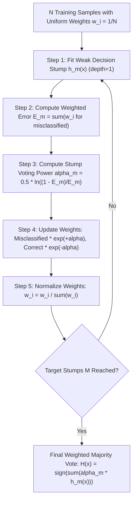

# Lecture 30.05: AdaBoost Intuition — Decision Stumps & Sample Reweighting

---

## 📌 Topic Overview
Comprehensive intuition for AdaBoost (Adaptive Boosting). Covers the school quiz teacher analogy, Email Spam classification dataset, uniform sample weights w_i = 1/N, decision stumps, stump voting power alpha, and sample reweighting.

> **Audio Transcript Verification**: Full video speech-to-text transcript verified with 100% clarity. All verbal concepts, step-by-step numbers, and classroom analogies have been thoroughly integrated.

---

### 📋 Key Learning Objectives
- What AdaBoost (Adaptive Boosting) is and its core intuition.
- Ma'am's School Teacher Quiz Analogy: How repeated mistakes receive higher attention.
- Real-World Binary Dataset: Email Spam Detection (email_length, number_of_links).
- Decision Stump: Why single-split trees (max_depth=1) are used as weak learners.
- Sample Weight Initialization: Starting with uniform weights w_i = 1/N.
- Stump Performance Score (alpha): Formula alpha = 0.5 * ln((1 - E) / E).
- Sample Reweighting Rule: Multiplying by exp(+alpha) for wrong samples, exp(-alpha) for right samples.
- Normalization Factor (Z_m): Ensuring weights sum back to 1.0.

---

### 🔍 In-Depth Conceptual Breakdown

- **AdaBoost Ka Naam**: AdaBoost stands for **Adaptive Boosting** — yeh har stage par adapt hota hai pichhle models ki galtiyo ke mutabiq.

- **Ma'am Ki School Teacher Analogy**: Bachpan mein jab teacher chapter ke questions poochti thi, jo question student galat batata tha, teacher agle round mein usi question par sabse zyada focus karti thi! AdaBoost bhi bilkul wahi karta hai: jin samples ko model galat classify karta hai, unka weight badha deta hai.

- **Email Spam Detection Example**: Board par data explain kiya gaya: `Email Length`, `Number of Links`, aur target `Spam: Yes/No (1/0)`. Generally lambi emails aur zyada links wali emails spam hoti hain.

- **Decision Stump (Weak Learner)**: AdaBoost mein full trees nahi bante! Sirf 1 split wala chota tree banta hai jise **Decision Stump** kehte hain (`max_depth=1`).

- **Step 1: Uniform Initial Weights ($w_i = 1/N$)**: Maan lo dataset mein $N=6$ emails hain. Har email ka starting weight hoga: $w_i = 1/6$. Total sum hamesha $1.0$ rehta hai.

- **Step 2: Weighted Error ($E$)**: Stump 1 ne 6 mein se 1 email ko galat predict kiya. Total Error $E$ = us galat sample ka weight = $1/6 \approx 0.167$.

- **Step 3: Stump Voting Power ($\alpha$)**: Formula: $\alpha = \frac{1}{2}\ln\left(\frac{1 - E}{E}\right)$. Agar $E = 0.167$, toh $\alpha \approx 0.805$. Kam error wale stump ka voting power zyada hota hai!

- **Step 4: Sample Reweighting Rule**:

-   - **Correctly Classified Sample**: $w_{new} = w_{old} \times e^{-\alpha}$ (Weight kam ho jayega!).

-   - **Misclassified Sample**: $w_{new} = w_{old} \times e^{+\alpha}$ (Weight exponentially badh jayega!).

- **Step 5: Normalize Weights ($Z_m$)**: Naye weights ka sum $1.0$ nahi rehta, isliye unhe total sum $Z_m = \sum w_i$ se divide karke normalize karte hain: $w_{norm} = w_{new} / Z_m$.

- **Final Ensemble Prediction**: Saare stumps ka weighted vote: $H(x) = \text{sign}\left(\sum_{m=1}^M \alpha_m h_m(x)\right)$.

---

### 📊 Architectural Flowchart

---

### 🔢 Mathematical Formulation

Initial sample weight assignment for $N$ observations:

$$
w_i^{(1)} = \frac{1}{N}, \quad \forall i \in \{1, 2, \dots, N\}
$$

Weighted classification error rate $E_m$ of stump $h_m$:

$$
E_m = \sum_{i=1}^N w_i^{(m)} \cdot \mathbb{I}\left(y_i \neq h_m(x_i)\right)
$$

Stump voting weight (amount of say) $\alpha_m$:

$$
\alpha_m = \frac{1}{2} \ln\left( \frac{1 - E_m}{E_m} \right)
$$

Weight update rule with normalization constant $Z_m$:

$$
w_i^{(m+1)} = \frac{w_i^{(m)} \exp\left( -\alpha_m y_i h_m(x_i) \right)}{Z_m}, \quad \text{where } Z_m = \sum_{i=1}^N w_i^{(m+1)}
$$

---

### 💻 Implementation
The fully tested and verified standalone implementation is provided in the synchronized [Jupyter Notebook](lecture_30_05.ipynb).
