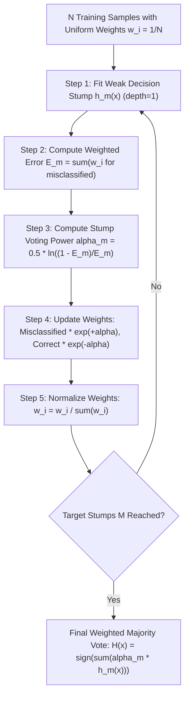
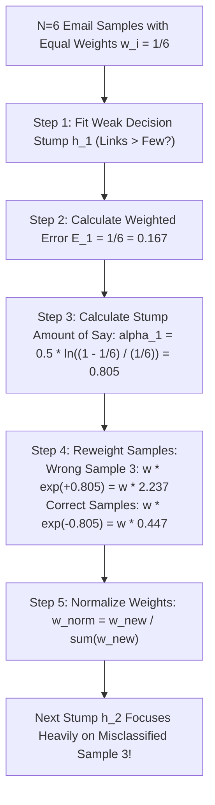

# Lecture 30.05: AdaBoost Ki Intuition — Teacher Analogy, Decision Stumps Aur Reweighting [Hinglish]

---

## 📌 Topic Overview
Comprehensive intuition for AdaBoost (Adaptive Boosting). Covers the school quiz teacher analogy, Email Spam classification dataset, uniform sample weights w_i = 1/N, decision stumps, stump voting power alpha, and sample reweighting.

---

### 📋 Is Topic Mein Hum Kya Seekhenge?
- **AdaBoost (Adaptive Boosting)** kya hota hai aur iska core idea.
- **Ma'am Ki School Teacher Analogy**: Bachpan mein teacher jaise galat questions par dobara focus karti thi.
- **Classroom Email Spam Dataset**: Email length, number of links, aur spam (1/0) ka board example.
- **Decision Stump (Weak Learner)**: Sirf 1 split wala tree (`max_depth=1`) kyu use hota hai.
- Sample Weights Initialization ($w_i = 1/N$): Shuruat mein sabhi samples ko equal priority milna.
- Stump Voting Power ($\alpha = \frac{1}{2}\ln\frac{1-E}{E}$) ka mathematical calculation.
- Sample Reweighting: Galat classify huye samples ka weight exponentially badhana ($e^{+\alpha}$) aur sahi walo ka ghatana ($e^{-\alpha}$).
- Normalization Factor ($Z_m$): Total weights ka sum wapas 1.0 banana.

---

### 🔍 Har Ek Point Ka Simple & Detailed Explanation
- **AdaBoost Ka Naam**: AdaBoost stands for **Adaptive Boosting** — yeh har stage par adapt hota hai pichhle models ki galtiyo ke mutabiq.

- **Ma'am Ki School Teacher Analogy**: Bachpan mein jab teacher chapter ke questions poochti thi, jo question student galat batata tha, teacher agle round mein usi question par sabse zyada focus karti thi! AdaBoost bhi bilkul wahi karta hai: jin samples ko model galat classify karta hai, unka weight badha deta hai.

- **Email Spam Detection Example**: Board par data explain kiya gaya: `Email Length`, `Number of Links`, aur target `Spam: Yes/No (1/0)`. Generally lambi emails aur zyada links wali emails spam hoti hain.

- **Decision Stump (Weak Learner)**: AdaBoost mein full trees nahi bante! Sirf 1 split wala chota tree banta hai jise **Decision Stump** kehte hain (`max_depth=1`).

- **Step 1: Uniform Initial Weights ($w_i = 1/N$)**: Maan lo dataset mein $N=6$ emails hain. Har email ka starting weight hoga: $w_i = 1/6$. Total sum hamesha $1.0$ rehta hai.

- **Step 2: Weighted Error ($E$)**: Stump 1 ne 6 mein se 1 email ko galat predict kiya. Total Error $E$ = us galat sample ka weight = $1/6 \approx 0.167$.

- **Step 3: Stump Voting Power ($\alpha$)**: Formula: $\alpha = \frac{1}{2}\ln\left(\frac{1 - E}{E}\right)$. Agar $E = 0.167$, toh $\alpha \approx 0.805$. Kam error wale stump ka voting power zyada hota hai!

- **Step 4: Sample Reweighting Rule**:

-   - **Correctly Classified Sample**: $w_{new} = w_{old} \times e^{-\alpha}$ (Weight kam ho jayega!).

-   - **Misclassified Sample**: $w_{new} = w_{old} \times e^{+\alpha}$ (Weight exponentially badh jayega!).

- **Step 5: Normalize Weights ($Z_m$)**: Naye weights ka sum $1.0$ nahi rehta, isliye unhe total sum $Z_m = \sum w_i$ se divide karke normalize karte hain: $w_{norm} = w_{new} / Z_m$.

- **Final Ensemble Prediction**: Saare stumps ka weighted vote: $H(x) = \text{sign}\left(\sum_{m=1}^M \alpha_m h_m(x)\right)$.

---

### 📊 Visual Flowchart / Diagram

---

---

### 📋 Ma'am Ka Classroom Blackboard Email Spam Reweighting Table

| Email ID | Email Length | No. of Links | Actual Target: Spam? ($y$) | Initial Weight ($w_1 = 1/6$) | Stump 1 Split Prediction | Classification Status | Weight Update Direction |
| :---: | :---: | :---: | :---: | :---: | :---: | :---: | :---: |
| **1** | Long | Many | **+1 (Spam)** | 1/6 (0.167) | +1 (Spam) | Correct | Multiplied by $e^{-\alpha}$ (Decreased) |
| **2** | Short | Few | **-1 (Not Spam)** | 1/6 (0.167) | -1 (Not Spam) | Correct | Multiplied by $e^{-\alpha}$ (Decreased) |
| **3** | Long | Few | **-1 (Not Spam)** | 1/6 (0.167) | +1 (Spam) | **WRONG (Misclassified!)** | **Multiplied by $e^{+\alpha}$ (Increased!)** |
| **4** | Short | Many | **+1 (Spam)** | 1/6 (0.167) | +1 (Spam) | Correct | Multiplied by $e^{-\alpha}$ (Decreased) |
| **5** | Medium | Many | **+1 (Spam)** | 1/6 (0.167) | +1 (Spam) | Correct | Multiplied by $e^{-\alpha}$ (Decreased) |
| **6** | Medium | Few | **-1 (Not Spam)** | 1/6 (0.167) | -1 (Not Spam) | Correct | Multiplied by $e^{-\alpha}$ (Decreased) |

---

### 📊 Ma'am Ka Decision Stump Aur Reweighting Architecture

### 🔢 Mathematical Derivation

Initial sample weight assignment for $N$ observations:

$$
w_i^{(1)} = \frac{1}{N}, \quad \forall i \in \{1, 2, \dots, N\}
$$

Weighted classification error rate $E_m$ of stump $h_m$:

$$
E_m = \sum_{i=1}^N w_i^{(m)} \cdot \mathbb{I}\left(y_i \neq h_m(x_i)\right)
$$

Stump voting weight (amount of say) $\alpha_m$:

$$
\alpha_m = \frac{1}{2} \ln\left( \frac{1 - E_m}{E_m} \right)
$$

Weight update rule with normalization constant $Z_m$:

$$
w_i^{(m+1)} = \frac{w_i^{(m)} \exp\left( -\alpha_m y_i h_m(x_i) \right)}{Z_m}, \quad \text{where } Z_m = \sum_{i=1}^N w_i^{(m+1)}
$$

---

### 📌 Note on Code
Yeh pure conceptual, mathematical, aur blackboard theory lecture hai. Ma'am ne is lecture mein code nahi likha hai, isliye rule ke mutabiq isme koi extra synthetic code add nahi kiya gaya hai.

