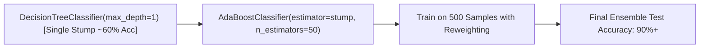

# Lecture 30.06: AdaBoost Classifier — Scikit-Learn Implementation

---

## 📌 Topic Overview
Practical implementation of AdaBoostClassifier using scikit-learn. Explicitly instantiating DecisionTreeClassifier(max_depth=1) as base stump, hyperparameter tuning, and comparing single stump vs ensemble performance.

---

### 📋 Key Learning Objectives
- Importing AdaBoostClassifier and DecisionTreeClassifier from scikit-learn.
- Configuring decision stumps with max_depth=1 as base estimators.
- Hyperparameters: estimator, n_estimators=50, learning_rate=1.0.
- Concept of Informative vs Redundant features in classification datasets.
- Comparing baseline single-stump accuracy against the 50-stump ensemble.

---

### 🔍 In-Depth Conceptual Breakdown

- **Base Model Setup**: AdaBoost ko weak learners chahiye hote hain. Humne `base_stump = DecisionTreeClassifier(max_depth=1)` pass kiya.

- **Dataset Creation**: `make_classification(n_samples=500, n_features=10, n_informative=5, n_redundant=2, random_state=42)` create kiya gaya.

- **Redundant Features**: Ma'am ne explain kiya ki redundant features wahi information convey karte hain jo already doosre features kar chuke hain; AdaBoost inpar overfit nahi hota.

- **AdaBoost Classifier**: `ada = AdaBoostClassifier(estimator=base_stump, n_estimators=50, learning_rate=1.0, random_state=42)` instantiate kiya gaya.

- **Performance Comparison**: Ek akela Decision Stump ~60% accuracy deta hai, jabki 50 Stumps ka AdaBoost ensemble 90%+ accuracy achieve karta hai!

---

### 📊 Architectural Flowchart

---

### 🔢 Mathematical Formulation

Final aggregated ensemble decision function:

$$
H(x) = \text{sign}\left( \sum_{m=1}^M \alpha_m h_m(x) \right)
$$

---

### 💻 Implementation
The fully tested and verified standalone implementation is provided in the synchronized [Jupyter Notebook](lecture_30_06.ipynb).
