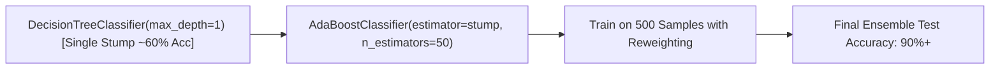

# Lecture 30.06: AdaBoost Classifier Ka Practical Code Aur Decision Stumps [Hinglish]

---

## 📌 Topic Overview
Practical implementation of AdaBoostClassifier using scikit-learn. Explicitly instantiating DecisionTreeClassifier(max_depth=1) as base stump, hyperparameter tuning, and comparing single stump vs ensemble performance.

---

### 📋 Is Topic Mein Hum Kya Seekhenge?
- `sklearn.ensemble` se `AdaBoostClassifier` import karna.
- `DecisionTreeClassifier(max_depth=1)` ko base decision stump banana.
- Hyperparameters: `estimator`, `n_estimators=50`, `learning_rate=1.0`.
- Dataset mein **Informative vs Redundant Features** ka role.
- Single stump ki weak accuracy vs pooray 50-stump ensemble ki high accuracy ka comparison.

---

### 🔍 Har Ek Point Ka Simple & Detailed Explanation
- **Base Model Setup**: AdaBoost ko weak learners chahiye hote hain. Humne `base_stump = DecisionTreeClassifier(max_depth=1)` pass kiya.

- **Dataset Creation**: `make_classification(n_samples=500, n_features=10, n_informative=5, n_redundant=2, random_state=42)` create kiya gaya.

- **Redundant Features**: Ma'am ne explain kiya ki redundant features wahi information convey karte hain jo already doosre features kar chuke hain; AdaBoost inpar overfit nahi hota.

- **AdaBoost Classifier**: `ada = AdaBoostClassifier(estimator=base_stump, n_estimators=50, learning_rate=1.0, random_state=42)` instantiate kiya gaya.

- **Performance Comparison**: Ek akela Decision Stump ~60% accuracy deta hai, jabki 50 Stumps ka AdaBoost ensemble 90%+ accuracy achieve karta hai!

---

### 📊 Visual Flowchart / Diagram

---

### 🔢 Mathematical Derivation

Final aggregated ensemble decision function:

$$
H(x) = \text{sign}\left( \sum_{m=1}^M \alpha_m h_m(x) \right)
$$

---

### 💻 Standalone Python Code & Verification
Iss module ka complete runnable code [Jupyter Notebook](lecture_30_06.ipynb) mein available hai.
