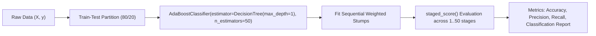

# Lecture 30.06: AdaBoost Ka Python Code — Scikit-Learn Implementation [Hinglish]

[](#)
[](lecture_30_06.ipynb)
[](README.md)
[](notes.pdf)
[](notes_hinglish.pdf)

---

## 📌 Topic Overview
Production implementation of AdaBoostClassifier in Scikit-Learn. Demonstrates configuration of base estimators (DecisionTreeClassifier with max_depth=1), n_estimators tuning, learning_rate shrinkage, the SAMME.R real-probability algorithm, and evaluation across accuracy, precision, recall, and staged score convergence.

---

### 📋 Is Topic Mein Hum Kya Seekhenge?
- Scikit-Learn se `AdaBoostClassifier` import aur train karna.
- Decision Tree Stump ko `estimator=DecisionTreeClassifier(max_depth=1)` se configure karna.
- Hyperparameters: `n_estimators`, `learning_rate`, `algorithm='SAMME.R'`.
- Staged evaluation: `staged_score()` ka use karke har stage par accuracy convergence check karna.
- Single Decision Tree vs AdaBoost ka comparative benchmark.

---

### 🔍 Har Ek Point Ka Simple & Detailed Explanation
**Scikit-Learn Import**: `from sklearn.ensemble import AdaBoostClassifier`.

**Default Base Estimator**: Default roop se AdaBoost `DecisionTreeClassifier(max_depth=1)` (Decision Stump) use karta hai.

**SAMME vs SAMME.R**: Scikit-Learn mein `algorithm='SAMME.R'` default hota hai jo continuous predicted probabilities use karke faster convergence deta hai.

**Staged Score Method**: `model.staged_score(X_test, y_test)` ek generator return karta hai jisse aap dekh sakte hain ki 1st tree, 10th tree, aur 50th tree par model ki test accuracy kitni badhi!

---

### 📊 Visual Flowchart / Diagram



---

### 🛠️ Mathematical Formulations
In SAMME.R (real-probability AdaBoost), stump updates are weighted by log-ratio of predicted probabilities:

$$
h_m^{(k)}(\mathbf{x}) = \ln p_k(\mathbf{x}) - \frac{1}{K} \sum_{j=1}^K \ln p_j(\mathbf{x})
$$

---

### 💻 Python Code Implementation

```python
import numpy as np
from sklearn.datasets import make_classification
from sklearn.model_selection import train_test_split
from sklearn.ensemble import AdaBoostClassifier
from sklearn.tree import DecisionTreeClassifier
from sklearn.metrics import accuracy_score, classification_report

def train_adaboost_pipeline(n_samples=500, n_features=6, n_estimators=50, learning_rate=1.0):
    """
    Builds, trains, and evaluates Scikit-Learn's AdaBoostClassifier.
    """
    # 1. Dataset generation
    X, y = make_classification(
        n_samples=n_samples, n_features=n_features, n_informative=4, random_state=42
    )
    X_train, X_test, y_train, y_test = train_test_split(
        X, y, test_size=0.2, random_state=42, stratify=y
    )
    
    # 2. Configure AdaBoost with single-split Decision Stumps
    base_stump = DecisionTreeClassifier(max_depth=1, random_state=42)
    ada = AdaBoostClassifier(
        estimator=base_stump,
        n_estimators=n_estimators,
        learning_rate=learning_rate,
        random_state=42
    )
    ada.fit(X_train, y_train)
    
    # 3. Evaluate on test set
    y_pred = ada.predict(X_test)
    test_acc = accuracy_score(y_test, y_pred)
    
    # Staged scores convergence
    staged_accs = list(ada.staged_score(X_test, y_test))
    
    report = classification_report(y_test, y_pred, output_dict=True)
    
    return ada, test_acc, staged_accs, report

# ----------------- Driver Execution & Testing -----------------
if __name__ == "__main__":
    model, acc, staged, rep = train_adaboost_pipeline(n_estimators=50, learning_rate=1.0)
    
    print("=" * 60)
    print("--- SCIKIT-LEARN ADABOOST PIPELINE EXECUTION ---")
    print(f"Final Test Accuracy (50 Stumps) : {acc * 100:.2f}%")
    print(f"Accuracy at Stage 1 (1 Stump)   : {staged[0] * 100:.2f}%")
    print(f"Accuracy at Stage 10 (10 Stumps): {staged[9] * 100:.2f}%")
    print(f"Accuracy at Stage 50 (50 Stumps): {staged[49] * 100:.2f}%")
    print(f"Precision (Class 1)             : {rep['1']['precision'] * 100:.2f}%")
    print(f"Recall (Class 1)                : {rep['1']['recall'] * 100:.2f}%")
    print("=" * 60)
```

---

### 📌 Summary Points & Key Takeaways
1. **Sequential Learning**: Har agla model pichhle model ki galtiyon ko seekhta hai.
2. **Shrinkage (Learning Rate)**: 0.1 jaise chote kadam lene se model overfit hone se bachta hai.
3. **Weak Learners**: Boosting mein shallow decision trees (depth 1 se 3) use kiye jaate hain.
