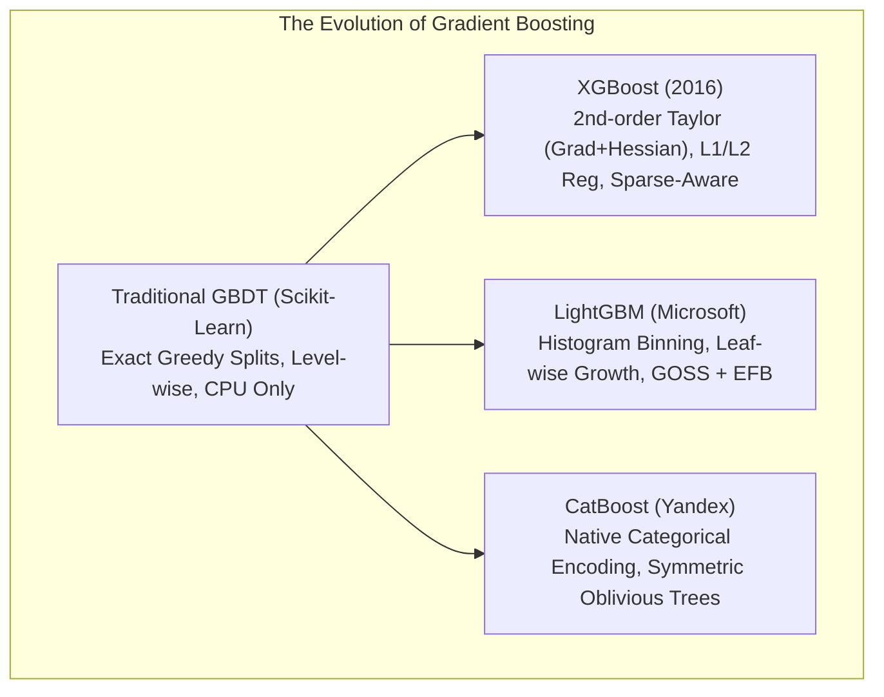

# Lecture 30.07: Other Modern Boosting Algorithms — XGBoost, LightGBM & CatBoost

[](#)
[](lecture_30_07.ipynb)
[](README_HINGLISH.md)
[](notes.pdf)
[](notes_hinglish.pdf)

---

## 📌 Topic Overview
Comparative architectural taxonomy of second-generation gradient boosting frameworks: XGBoost (exact/approximate quantile histograms, L1/L2 regularization, second-order Taylor expansion), LightGBM (histogram binning, GOSS, EFB, leaf-wise tree growth), and CatBoost (ordered target encoding for categorical features, oblivious symmetric trees).

---

### 🗺️ Visual Architecture Diagram



---

### 🛠️ Mathematical Mechanics & Theoretical Foundations
The regularized objective function minimized by XGBoost at stage $m$:

$$
\mathcal{L}^{(m)} \approx \sum_{i=1}^N \left[ g_i f_m(\mathbf{x}_i) + \frac{1}{2} h_i f_m^2(\mathbf{x}_i) \right] + \gamma T + \frac{1}{2} \lambda \sum_{j=1}^T w_j^2 + \alpha \sum_{j=1}^T |w_j|
$$

where $g_i = \partial_{\hat{y}^{(m-1)}} L(y_i, \hat{y}^{(m-1)})$ is the first-order gradient, $h_i = \partial^2_{\hat{y}^{(m-1)}} L(y_i, \hat{y}^{(m-1)})$ is the second-order Hessian, $T$ is the number of terminal leaves, and $w_j$ are leaf output weights.

---

### 💻 Python Production Implementation

```python
import numpy as np

def compare_boosting_frameworks_characteristics():
    """
    Returns a comprehensive structured dictionary of architectural
    differences between Gradient Boosting, XGBoost, LightGBM, and CatBoost.
    """
    frameworks = {
        "Scikit-Learn GBDT": {
            "developer": "Scikit-Learn Community",
            "split_mechanism": "Exact greedy continuous thresholding",
            "tree_growth": "Level-wise (depth-wise)",
            "regularization": "Shrinkage (learning_rate), subsample",
            "categorical_support": "Requires manual OneHot / Ordinal Encoding",
            "speed_benchmark": "Baseline (Slow on massive data)"
        },
        "XGBoost": {
            "developer": "Tianqi Chen / DMLC",
            "split_mechanism": "Exact greedy or approximate quantile histograms",
            "tree_growth": "Level-wise (depth-wise)",
            "regularization": "Built-in L1 (alpha) + L2 (lambda) penalties",
            "categorical_support": "Experimental (enable_categorical=True)",
            "speed_benchmark": "Fast, highly parallelized, GPU-accelerated"
        },
        "LightGBM": {
            "developer": "Microsoft",
            "split_mechanism": "Histogram binning (256 discrete bins)",
            "tree_growth": "Leaf-wise (best-first) with max_depth cap",
            "regularization": "min_data_in_leaf, L1/L2 penalties",
            "categorical_support": "Native categorical split search",
            "speed_benchmark": "Ultra-fast (15-20x faster than traditional GBDT)"
        },
        "CatBoost": {
            "developer": "Yandex",
            "split_mechanism": "Quantized ordered categorical targets",
            "tree_growth": "Symmetric Oblivious Decision Trees",
            "regularization": "L2 regularization, random permutations",
            "categorical_support": "State-of-the-art native categorical handling",
            "speed_benchmark": "Fast training, fastest production inference"
        }
    }
    return frameworks

# ----------------- Driver Execution & Testing -----------------
if __name__ == "__main__":
    comp = compare_boosting_frameworks_characteristics()
    print("=" * 70)
    print("--- MODERN BOOSTING FRAMEWORKS TAXONOMY & ARCHITECTURES ---")
    for name, attrs in comp.items():
        print(f"\n[{name}]")
        for k, v in attrs.items():
            print(f"  {k:22s}: {v}")
    print("=" * 70)
```

---

### 🔑 Critical Architectural Takeaways
1. **Sequential Bias Minimization**: Unlike bagging which stabilizes variance, boosting models sequentially reduce bias by focusing on residuals and hard examples.
2. **Shrinkage Regularization**: Setting learning_rate < 1.0 enforces small gradient descent steps, preventing the ensemble from memorizing noise.
3. **Weak Learners Principle**: Keeping base decision trees shallow (max_depth=1 to 3) ensures individual estimators remain high-bias weak learners.
