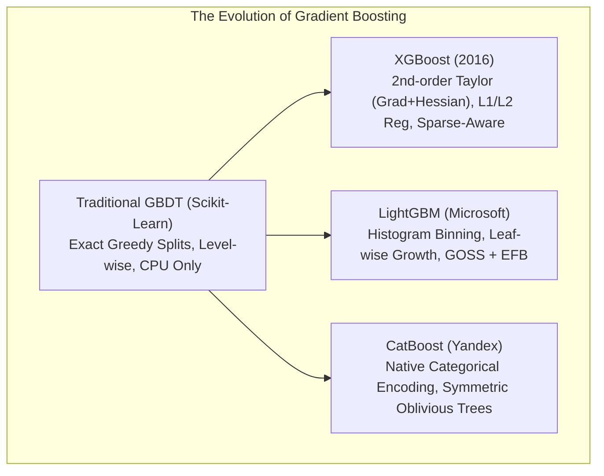

# Lecture 30.07: Modern Boosting Algorithms — XGBoost, LightGBM Aur CatBoost Ka Deep Comparison [Hinglish]

[](#)
[](lecture_30_07.ipynb)
[](README.md)
[](notes.pdf)
[](notes_hinglish.pdf)

---

## 📌 Topic Overview
Comparative architectural taxonomy of second-generation gradient boosting frameworks: XGBoost (exact/approximate quantile histograms, L1/L2 regularization, second-order Taylor expansion), LightGBM (histogram binning, GOSS, EFB, leaf-wise tree growth), and CatBoost (ordered target encoding for categorical features, oblivious symmetric trees).

---

### 📋 Is Topic Mein Hum Kya Seekhenge?
- Traditional Gradient Boosting ki limitations aur modern algorithms ki zaroorat.
- XGBoost (Extreme Gradient Boosting): 2nd-order Taylor expansion (Gradient + Hessian) aur hardware optimization.
- LightGBM (Microsoft): Histogram binning aur Leaf-wise (best-first) tree growth se 15x-20x speed.
- CatBoost (Yandex): Categorical features ka automatic encoding aur symmetric oblivious trees.
- Industrial selection guide: Kab XGBoost, kab LightGBM aur kab CatBoost choose karein.

---

### 🔍 Har Ek Point Ka Simple & Detailed Explanation
**Traditional GBDT Ki Problem**: Standard Scikit-Learn Gradient Boosting badhiya kaam karta hai, lekin jab dataset mein 10 lakh rows ya hazaron features hote hain, toh yeh bohot slow ho jata hai aur memory consume karta hai.

**XGBoost (Extreme Gradient Boosting)**:

- Tianqi Chen ne develop kiya tha (2014-2016).
- Loss function ko evaluate karne ke liye 2nd-order derivative (Gradient $g_i$ + Hessian $h_i$) use karta hai.
- Built-in L1 (Lasso) aur L2 (Ridge) regularization trees ke overgrowth ko rokta hai.
- Missing values ko automatically handle karta hai (optimal default direction seekhta hai).

**LightGBM (Light Gradient Boosting Machine)**:

- Microsoft ne banaya tha. Bohot kam memory aur ultra-fast computation deta hai.
- **Histogram-based**: Continuous values ko 256 bins mein convert kar deta hai, jisse split search bohot tez ho jaata hai.
- **Leaf-wise Growth**: Baaki algorithms poori layer ko barabar grow karte hain (level-wise), lekin LightGBM sirf us single leaf ko split karta hai jo loss sabse zyada ghatati hai!
- **Dhyan Dein**: Chhote datasets ($< 10,000$ rows) par yeh overfit kar sakta hai.

**CatBoost (Categorical Boosting)**:

- Russian tech giant Yandex ne develop kiya.
- **Categorical Data King**: Categorical columns ko bina manual One-Hot-Encoding ke directly target statistics se encode karta hai.
- **Oblivious Trees**: Trees bilkul symmetric hoti hain jisse test inference time par zero lag hota hai.

---

### 📊 Visual Flowchart / Diagram



---

### 🛠️ Mathematical Formulations
The regularized objective function minimized by XGBoost at stage $m$:

$$
\mathcal{L}^{(m)} \approx \sum_{i=1}^N \left[ g_i f_m(\mathbf{x}_i) + \frac{1}{2} h_i f_m^2(\mathbf{x}_i) \right] + \gamma T + \frac{1}{2} \lambda \sum_{j=1}^T w_j^2 + \alpha \sum_{j=1}^T |w_j|
$$

where $g_i = \partial_{\hat{y}^{(m-1)}} L(y_i, \hat{y}^{(m-1)})$ is the first-order gradient, $h_i = \partial^2_{\hat{y}^{(m-1)}} L(y_i, \hat{y}^{(m-1)})$ is the second-order Hessian, $T$ is the number of terminal leaves, and $w_j$ are leaf output weights.

---

### 💻 Python Code Implementation

```python
import numpy as np

def compare_boosting_frameworks_characteristics():
    """
    Returns a comprehensive structured dictionary of architectural
    differences between Gradient Boosting, XGBoost, LightGBM, and CatBoost.
    """
    frameworks = {
        "Scikit-Learn GBDT": {
            "developer": "Scikit-Learn Community",
            "split_mechanism": "Exact greedy continuous thresholding",
            "tree_growth": "Level-wise (depth-wise)",
            "regularization": "Shrinkage (learning_rate), subsample",
            "categorical_support": "Requires manual OneHot / Ordinal Encoding",
            "speed_benchmark": "Baseline (Slow on massive data)"
        },
        "XGBoost": {
            "developer": "Tianqi Chen / DMLC",
            "split_mechanism": "Exact greedy or approximate quantile histograms",
            "tree_growth": "Level-wise (depth-wise)",
            "regularization": "Built-in L1 (alpha) + L2 (lambda) penalties",
            "categorical_support": "Experimental (enable_categorical=True)",
            "speed_benchmark": "Fast, highly parallelized, GPU-accelerated"
        },
        "LightGBM": {
            "developer": "Microsoft",
            "split_mechanism": "Histogram binning (256 discrete bins)",
            "tree_growth": "Leaf-wise (best-first) with max_depth cap",
            "regularization": "min_data_in_leaf, L1/L2 penalties",
            "categorical_support": "Native categorical split search",
            "speed_benchmark": "Ultra-fast (15-20x faster than traditional GBDT)"
        },
        "CatBoost": {
            "developer": "Yandex",
            "split_mechanism": "Quantized ordered categorical targets",
            "tree_growth": "Symmetric Oblivious Decision Trees",
            "regularization": "L2 regularization, random permutations",
            "categorical_support": "State-of-the-art native categorical handling",
            "speed_benchmark": "Fast training, fastest production inference"
        }
    }
    return frameworks

# ----------------- Driver Execution & Testing -----------------
if __name__ == "__main__":
    comp = compare_boosting_frameworks_characteristics()
    print("=" * 70)
    print("--- MODERN BOOSTING FRAMEWORKS TAXONOMY & ARCHITECTURES ---")
    for name, attrs in comp.items():
        print(f"\n[{name}]")
        for k, v in attrs.items():
            print(f"  {k:22s}: {v}")
    print("=" * 70)
```

---

### 📌 Summary Points & Key Takeaways
1. **Sequential Learning**: Har agla model pichhle model ki galtiyon ko seekhta hai.
2. **Shrinkage (Learning Rate)**: 0.1 jaise chote kadam lene se model overfit hone se bachta hai.
3. **Weak Learners**: Boosting mein shallow decision trees (depth 1 se 3) use kiye jaate hain.
