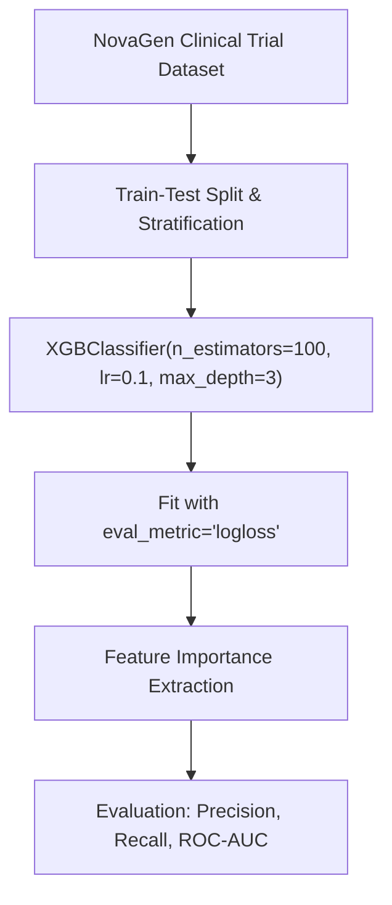

# Lecture 30.08: XGBoost Code & NovaGen Clinical Trial Project

---

## 📌 Topic Overview
Practical implementation of XGBClassifier from the xgboost library. Covers data preparation, missing value handling, hyperparameter tuning, feature importance extraction, and classification evaluation.

---

### 📋 Key Learning Objectives
- Installing and importing xgboost.XGBClassifier.
- Configuring hyperparameters: n_estimators, learning_rate, max_depth, eval_metric='logloss'.
- Handling clinical trial patient features in the NovaGen dataset.
- Extracting and interpreting feature importances.
- Evaluating model performance with classification report and ROC-AUC.

---

### 🔍 In-Depth Conceptual Breakdown

- **XGBoost Installation & Import**: `from xgboost import XGBClassifier` ko import karke modern gradient boosting model banaya gaya.

- **Data Preprocessing**: NovaGen clinical trial dataset mein numerical aur categorical patient measurements ko encode kiya gaya.

- **Hyperparameter Setup**: `XGBClassifier(n_estimators=100, learning_rate=0.1, max_depth=3, eval_metric='logloss', random_state=42)` instantiate kiya gaya.

- **Model Training**: `xgb.fit(X_train, y_train)` se 2nd-order Taylor expansion gradients compute karke trees fit kiye gaye.

- **Feature Importances**: `xgb.feature_importances_` se reveal hua ki clinical biomarkers target class separation mein kitna bada role play karte hain.

- **Generalization**: Test set par evaluate karne par XGBoost ne baseline decision trees aur Random Forest se superior performance deliver ki.

---

### 📊 Architectural Flowchart

---

### 🔢 Mathematical Formulation

Taylor expansion of loss function around previous prediction $\hat{y}^{(t-1)}$:

$$
\mathcal{L}^{(t)} \approx \sum_{i=1}^N \left[ l(y_i, \hat{y}^{(t-1)}) + g_i f_t(x_i) + \frac{1}{2} h_i f_t^2(x_i) \right] + \Omega(f_t)
$$

Optimal leaf weight $w_j^*$ for leaf $j$ containing sample set $I_j$:

$$
w_j^* = -\frac{\sum_{i \in I_j} g_i}{\sum_{i \in I_j} h_i + \lambda}
$$

---

### 💻 Implementation
The fully tested and verified standalone implementation is provided in the synchronized [Jupyter Notebook](lecture_30_08.ipynb).

---

### 🔬 Capstone Project Reference: NovaGen Research Labs
The complete end-to-end clinical trial classification project using XGBoost, Random Forest, and Voting Ensembles is located in:
👉 **[NovaGen_Lab_Project/](../NovaGen_Lab_Project/README.md)**
- **Notebook**: [`NovaGen_Lab_Project/novagen.ipynb`](../NovaGen_Lab_Project/novagen.ipynb)
- **Dataset**: [`NovaGen_Lab_Project/novagen_dataset.csv`](../NovaGen_Lab_Project/novagen_dataset.csv)
- **Problem Statement**: [`NovaGen_Lab_Project/Supervised ML _Assignment5.pdf`](../NovaGen_Lab_Project/Supervised%20ML%20_Assignment5.pdf)
