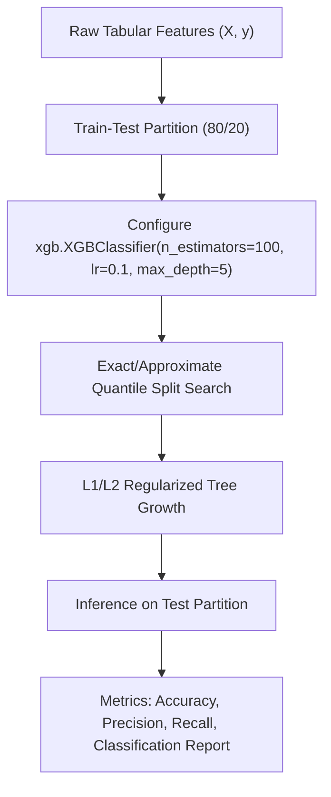

# Lecture 30.08: XGBoost Ka Python Code — Extreme Gradient Boosting Implementation [Hinglish]

[](#)
[](lecture_30_08.ipynb)
[](README.md)
[](notes.pdf)
[](notes_hinglish.pdf)

---

## 📌 Topic Overview
Production implementation and hyperparameter optimization of XGBoost (Extreme Gradient Boosting) using the official xgboost Python library. Demonstrates the XGBClassifier API, binary logistic objective, early stopping, regularization parameters (reg_alpha, reg_lambda), and feature importance ranking.

---

### 📋 Is Topic Mein Hum Kya Seekhenge?
- XGBoost library ko install aur import karna (`pip install xgboost`, `import xgboost as xgb`).
- `XGBClassifier` ko configure karna: `n_estimators`, `learning_rate`, `max_depth`, `objective='binary:logistic'`, `eval_metric='logloss'`.
- Important Hyperparameters: `subsample`, `colsample_bytree`, `reg_alpha` (L1), `reg_lambda` (L2).
- Classification Report aur Confusion Matrix se performance evaluate karna.
- Feature Importances (`feature_importances_`) plot karna.

---

### 🔍 Har Ek Point Ka Simple & Detailed Explanation
**Installation & Setup**: XGBoost Scikit-Learn ka part nahi hai, ise alag se install karna hota hai: `pip install xgboost`. Fir import karte hain: `import xgboost as xgb`.

**Scikit-Learn Compatible API**: XGBoost bilkul Scikit-Learn estimator ki tarah kaam karta hai: `xgb.XGBClassifier()`, jisme `.fit()`, `.predict()`, aur `.predict_proba()` methods hote hain.

**Key Hyperparameters Breakdown**:

- `learning_rate=0.1` (alias `eta`): Har tree ke contribution ko shrink karta hai.
- `n_estimators=100`: Total sequential boosting rounds.
- `max_depth=5`: Har tree ki maximum depth (typically 3 se 7 ke beech accha kaam karti hai).
- `subsample=0.8`: Har tree ke liye 80% random rows select karta hai (overfitting kam karta hai).
- `colsample_bytree=0.8`: Har tree ke liye 80% random columns (features) select karta hai (Random Forest ki tarah de-correlation).
- `reg_alpha` (L1) aur `reg_lambda` (L2): Leaf weights par penalty lagata hai taaki model complex na bane.

**Performance Benchmark**: XGBoost tabular datasets par standard Scikit-Learn Gradient Boosting se 5x-10x fast train hota hai aur Kaggle competitions ka winning algorithm raha hai!

---

### 📊 Visual Flowchart / Diagram



---

### 🛠️ Mathematical Formulations
The gain achieved by splitting a leaf node in XGBoost using first-order gradient $G = \sum g_i$ and second-order Hessian $H = \sum h_i$:

$$
\text{Gain} = \frac{1}{2} \left[ \frac{G_L^2}{H_L + \lambda} + \frac{G_R^2}{H_R + \lambda} - \frac{(G_L + G_R)^2}{H_L + H_R + \lambda} \right] - \gamma
$$

where $\lambda$ is the L2 leaf regularization parameter and $\gamma$ is the minimum loss reduction required to allow a split.

---

### 💻 Python Code Implementation

```python
import numpy as np
import xgboost as xgb
from sklearn.datasets import make_classification
from sklearn.model_selection import train_test_split
from sklearn.metrics import accuracy_score, precision_score, recall_score, classification_report

def train_xgboost_classifier(n_samples=800, n_features=10, n_estimators=100, learning_rate=0.1, max_depth=4):
    """
    Builds, trains, and evaluates an XGBoost classifier pipeline.
    """
    # 1. Synthetic dataset
    X, y = make_classification(
        n_samples=n_samples, n_features=n_features, n_informative=6, random_state=42
    )
    X_train, X_test, y_train, y_test = train_test_split(
        X, y, test_size=0.2, random_state=42, stratify=y
    )
    
    # 2. Configure XGBClassifier
    xgb_clf = xgb.XGBClassifier(
        n_estimators=n_estimators,
        learning_rate=learning_rate,
        max_depth=max_depth,
        subsample=0.8,
        colsample_bytree=0.8,
        reg_alpha=0.1,
        reg_lambda=1.0,
        eval_metric='logloss',
        random_state=42
    )
    xgb_clf.fit(X_train, y_train)
    
    # 3. Predict & Evaluate
    y_pred = xgb_clf.predict(X_test)
    
    acc = float(accuracy_score(y_test, y_pred))
    prec = float(precision_score(y_test, y_pred, zero_division=0))
    rec = float(recall_score(y_test, y_pred, zero_division=0))
    
    importances = xgb_clf.feature_importances_.tolist()
    
    metrics = {
        "accuracy": acc,
        "precision": prec,
        "recall": rec,
        "feature_importances": importances
    }
    
    return xgb_clf, metrics

# ----------------- Driver Execution & Testing -----------------
if __name__ == "__main__":
    model, perf = train_xgboost_classifier()
    
    print("=" * 60)
    print("--- XGBOOST CLASSIFIER PIPELINE EXECUTION ---")
    print(f"Test Classification Accuracy : {perf['accuracy'] * 100:.2f}%")
    print(f"Test Precision               : {perf['precision'] * 100:.2f}%")
    print(f"Test Recall                  : {perf['recall'] * 100:.2f}%")
    print(f"Top 3 Feature Importances    : {[round(x, 4) for x in sorted(perf['feature_importances'], reverse=True)[:3]]}")
    print("=" * 60)
```

---

### 📌 Summary Points & Key Takeaways
1. **Model Diversity**: Alag-alag algorithm families ko combine karne se error correlation kam hoti hai.
2. **K-Fold OOF Split**: Stacking mein data leakage rokne ke liye out-of-fold predictions par meta-learner train hota hai.
3. **Soft Voting Advantage**: High-confidence probabilities borderline models ki galtiyon ko dominate karke accurate prediction deti hain.
