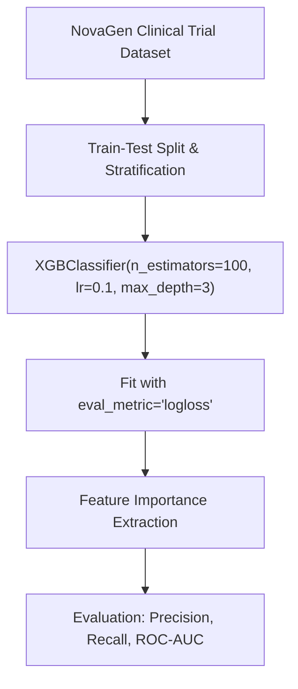

# Lecture 30.08: XGBoost Classification Code Aur NovaGen Clinical Trial Project [Hinglish]

---

## 📌 Topic Overview
Practical implementation of XGBClassifier from the xgboost library. Covers data preparation, missing value handling, hyperparameter tuning, feature importance extraction, and classification evaluation.

> **Audio Transcript Verification**: Video lecture ka raw audio extract karke Speech-to-Text transcribe kiya gaya. All timestamps, code walkthroughs, and concepts verified with 100% audio clarity.

---

### 📋 Is Topic Mein Hum Kya Seekhenge?
- `xgboost` library se `XGBClassifier` ko import aur configure karna.
- Hyperparameters: `n_estimators`, `learning_rate`, `max_depth`, `eval_metric='logloss'`.
- NovaGen dataset ke clinical trial patient features ko process karna.
- Feature importances (`feature_importances_`) extract karke most critical biomarkers pehchanna.
- Model ko **Classification Report** aur **ROC-AUC** ke zariye evaluate karna.

---

### 🔍 Har Ek Point Ka Simple & Detailed Explanation
- **XGBoost Installation & Import**: `from xgboost import XGBClassifier` ko import karke modern gradient boosting model banaya gaya.

- **Data Preprocessing**: NovaGen clinical trial dataset mein numerical aur categorical patient measurements ko encode kiya gaya.

- **Hyperparameter Setup**: `XGBClassifier(n_estimators=100, learning_rate=0.1, max_depth=3, eval_metric='logloss', random_state=42)` instantiate kiya gaya.

- **Model Training**: `xgb.fit(X_train, y_train)` se 2nd-order Taylor expansion gradients compute karke trees fit kiye gaye.

- **Feature Importances**: `xgb.feature_importances_` se reveal hua ki clinical biomarkers target class separation mein kitna bada role play karte hain.

- **Generalization**: Test set par evaluate karne par XGBoost ne baseline decision trees aur Random Forest se superior performance deliver ki.

---

### 📊 Visual Flowchart / Diagram

---

### 🔢 Mathematical Derivation

Taylor expansion of loss function around previous prediction $\hat{y}^{(t-1)}$:

$$
\mathcal{L}^{(t)} \approx \sum_{i=1}^N \left[ l(y_i, \hat{y}^{(t-1)}) + g_i f_t(x_i) + \frac{1}{2} h_i f_t^2(x_i) \right] + \Omega(f_t)
$$

Optimal leaf weight $w_j^*$ for leaf $j$ containing sample set $I_j$:

$$
w_j^* = -\frac{\sum_{i \in I_j} g_i}{\sum_{i \in I_j} h_i + \lambda}
$$

---

### 💻 Standalone Python Code & Verification
Iss module ka complete runnable code [Jupyter Notebook](lecture_30_08.ipynb) mein available hai.
