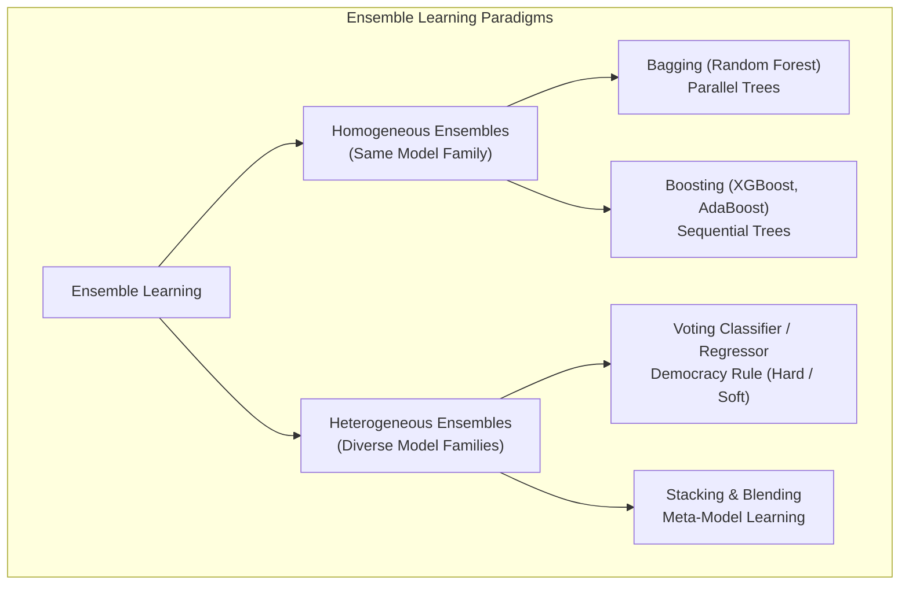

# Lecture 30.09: Homogeneous vs Heterogeneous Ensembles — Algorithmic Diversity

[](#)
[](lecture_30_09.ipynb)
[](README_HINGLISH.md)
[](notes.pdf)
[](notes_hinglish.pdf)

---

## 📌 Topic Overview
Deep conceptual taxonomy distinguishing Homogeneous Ensembles (Bagging/Random Forests, Gradient Boosting using the same base model architecture) from Heterogeneous Ensembles (Voting, Stacking combining diverse model paradigms like Logistic Regression, SVM, KNN, and Trees). Analyzes the mathematical necessity of error uncorrelatedness to achieve maximum variance reduction.

---

### 🗺️ Visual Architecture Diagram



---

### 🛠️ Mathematical Mechanics & Theoretical Foundations
For an ensemble of $M$ estimators each with variance $\sigma^2$ and pairwise error correlation $\rho$:

$$
\text{Var}\left( \frac{1}{M}\sum_{m=1}^M \hat{f}_m \right) = \rho \sigma^2 + \frac{1 - \rho}{M} \sigma^2
$$

In a **Homogeneous Ensemble** (e.g. Random Forest), $\rho > 0$ because all estimators are trees.
In a **Heterogeneous Ensemble**, combining radically different model families drives correlation $\rho \to 0$, causing ensemble variance to collapse directly toward $\frac{\sigma^2}{M}$!

---

### 💻 Python Production Implementation

```python
def evaluate_ensemble_diversity_correlation():
    """
    Demonstrates the mathematical effect of model error correlation rho
    on the aggregated ensemble variance.
    """
    base_variance = 1.0  # Normalized base model error variance
    M_models = 5
    
    correlations = [0.8, 0.5, 0.2, 0.0]  # From high (homogeneous) to low (heterogeneous)
    results = {}
    
    for rho in correlations:
        # Variance formula: rho * sigma^2 + ((1 - rho) / M) * sigma^2
        ensemble_var = rho * base_variance + ((1.0 - rho) / M_models) * base_variance
        results[rho] = ensemble_var
        
    return results

# ----------------- Driver Execution & Testing -----------------
if __name__ == "__main__":
    res = evaluate_ensemble_diversity_correlation()
    print("=" * 65)
    print("--- HOMOGENEOUS VS HETEROGENEOUS ENSEMBLE VARIANCE REDUCTION ---")
    for rho, var in res.items():
        paradigm = "Highly Homogeneous" if rho >= 0.8 else ("Moderate Homogeneous" if rho >= 0.5 else ("Heterogeneous" if rho >= 0.2 else "Ideal Uncorrelated Heterogeneous"))
        print(f"Correlation rho = {rho:.1f} ({paradigm:32s}) -> Ensemble Variance: {var:.4f}")
    print("=" * 65)
```

---

### 🔑 Critical Architectural Takeaways
1. **Multi-Family Generalization**: Combining diverse inductive biases (linear, tree-based, margin-based, metric-based) cancels out individual model blindspots.
2. **Leakage Protection via OOF**: Cross-validated out-of-fold predictions ensure the Level-1 meta-model optimizes strictly on unseen generalization behaviors.
3. **Calibrated Confidence Weights**: Soft voting and meta-learning outperform simple hard voting by incorporating prediction probability confidences.
