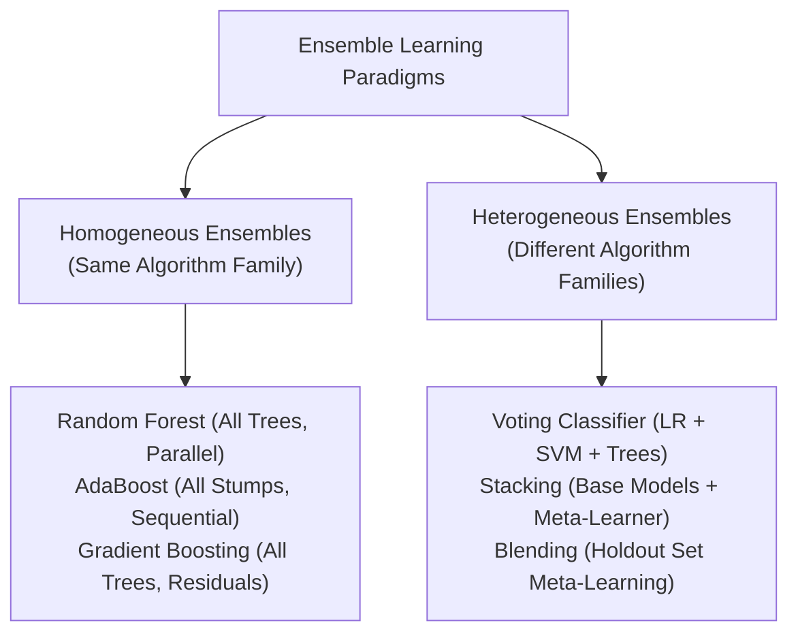

# Lecture 30.09: Ensembling Paradigms — Homogeneous vs Heterogeneous

---

## 📌 Topic Overview
Fundamental comparison of ensemble paradigms. Homogeneous ensembles aggregate multiple replicas of the same model family (e.g., all Decision Trees in Random Forest or Boosting). Heterogeneous ensembles combine completely different model architectures (e.g., Logistic Regression + SVM + Decision Trees).

---

### 📋 Key Learning Objectives
- Definition of Homogeneous Ensembles: Single base model family replicas (Bagging, Random Forest, AdaBoost, Gradient Boosting).
- Definition of Heterogeneous Ensembles: Combining diverse model families with distinct inductive biases.
- Why Heterogeneity Matters: Reducing systemic structural error by combining diverse hypothesis spaces.
- Roadmap to Heterogeneous Ensembles: Introduction to Voting, Stacking, and Blending.

---

### 🔍 In-Depth Conceptual Breakdown

- **Homogeneous Ensembles (Same Model Family)**: Abhi tak humne supervised learning mein jo ensembles dekhe (jaise **Random Forest**, **Gradient Boosting**, **AdaBoost**), wo sab homogeneous the. Unme saare base learners **Decision Trees** hi hote hain.

- **Heterogeneous Ensembles (Different Model Families)**: Isme hum alag-alag type ke algorithms ko combine karte hain — jaise ek **Logistic Regression**, ek **Support Vector Machine (SVM)**, aur ek **Decision Tree**. Teeno models ka sochna aur decision lena alag hota hai.

- **Kyu Heterogeneous Ensembles Banate Hain?**: Har algorithm ka mathematical assumption alag hota hai (linear model linear boundary dekhta hai, tree non-linear rectangular splits karta hai, SVM margin maximize karta hai). Jab alag nature ke models ek sath vote karte hain, toh error rate drastically drop hota hai.

- **Teen Primary Heterogeneous Techniques**:

-   1. **Voting (Majority / Averaging)**: Sabhi models se direct vote ya probability average lena.

-   2. **Stacking (Meta-Learning)**: Ek model ke uper doosra model (Meta-Model) bitha kar sikhana.

-   3. **Blending (Holdout Meta-Set)**: Stacking ka fast validation-split based variant.

---

### 📊 Architectural Flowchart

---

### 🔢 Mathematical Formulation

Variance reduction in an ensemble of $M$ diverse estimators with pairwise correlation $\rho$:

$$
\text{Var}\left( \frac{1}{M}\sum_{m=1}^M f_m(x) \right) = \rho \sigma^2 + \frac{1 - \rho}{M} \sigma^2
$$

Heterogeneous ensembles minimize the cross-correlation $\rho \to 0$, maximizing variance reduction.

---

### 📌 Note on Code
This is a pure conceptual, mathematical, and blackboard theory lecture. In accordance with course guidelines, no synthetic code is appended.

