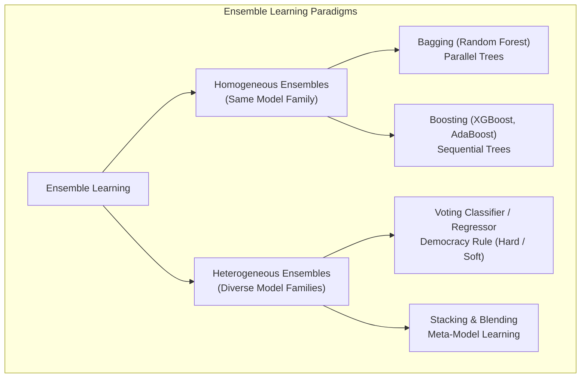

# Lecture 30.09: Homogeneous vs Heterogeneous Ensembles — Diversity Ka Funda [Hinglish]

[](#)
[](lecture_30_09.ipynb)
[](README.md)
[](notes.pdf)
[](notes_hinglish.pdf)

---

## 📌 Topic Overview
Deep conceptual taxonomy distinguishing Homogeneous Ensembles (Bagging/Random Forests, Gradient Boosting using the same base model architecture) from Heterogeneous Ensembles (Voting, Stacking combining diverse model paradigms like Logistic Regression, SVM, KNN, and Trees). Analyzes the mathematical necessity of error uncorrelatedness to achieve maximum variance reduction.

---

### 📋 Is Topic Mein Hum Kya Seekhenge?
- Homogeneous Ensembles kya hote hain: Ek hi type ke models (jaise saare Decision Trees).
- Heterogeneous Ensembles kya hote hain: Alag-alag families ke models (Logistic + KNN + SVM + Trees).
- Inductive Bias Diversity: Har model algorithm data ko alag nazarie se kyu dekhta hai.
- Combining Mechanisms: Homogeneous ke liye Bagging & Boosting; Heterogeneous ke liye Voting & Stacking.
- Error Uncorrelatedness: Jab alag models alag galtiyan karte hain, toh ensemble error zero ki taraf kyu jata hai.

---

### 🔍 Har Ek Point Ka Simple & Detailed Explanation
**Homogeneous Ensembles**: 'Homo' ka matlab SAME. Jab ensemble ke saare base models ek hi algorithm family ke hote hain. Jaise **Random Forest** (saare Decision Trees via Bagging), ya **Gradient Boosting / AdaBoost** (saare Decision Trees via Boosting). Inme diversity data ko randomly sample karke laayi jaati hai.

**Heterogeneous Ensembles**: 'Hetero' ka matlab DIFFERENT. Jab ensemble mein alag-alag algorithms ko ek sath team banakar use kiya jata hai. Jaise: **Logistic Regression + Naive Bayes + KNN + SVM + Decision Tree**.

**Har Algorithm Ka Nazaria Alag Hota Hai**:

- **Logistic Regression**: Linear boundary dhundta hai.
- **KNN**: Data points ke beech distance aur local neighborhoods dekhta hai.
- **Naive Bayes**: Probabilities aur conditional independence assume karta hai.
- **Decision Tree**: Axis-aligned box partitions banata hai.
- **SVM**: Support vectors se maximum margin boundary banata hai.

**Kyu Heterogeneous Ensembles Powerful Hain?**: Agar ek sample par Decision Tree galat ho gaya, toh ho sakta hai SVM aur Logistic Regression sahi ho! Majority vote ya meta-learning se final answer accurate nikalta hai.

---

### 📊 Visual Flowchart / Diagram



---

### 🛠️ Mathematical Formulations
For an ensemble of $M$ estimators each with variance $\sigma^2$ and pairwise error correlation $\rho$:

$$
\text{Var}\left( \frac{1}{M}\sum_{m=1}^M \hat{f}_m \right) = \rho \sigma^2 + \frac{1 - \rho}{M} \sigma^2
$$

In a **Homogeneous Ensemble** (e.g. Random Forest), $\rho > 0$ because all estimators are trees.
In a **Heterogeneous Ensemble**, combining radically different model families drives correlation $\rho \to 0$, causing ensemble variance to collapse directly toward $\frac{\sigma^2}{M}$!

---

### 💻 Python Code Implementation

```python
def evaluate_ensemble_diversity_correlation():
    """
    Demonstrates the mathematical effect of model error correlation rho
    on the aggregated ensemble variance.
    """
    base_variance = 1.0  # Normalized base model error variance
    M_models = 5
    
    correlations = [0.8, 0.5, 0.2, 0.0]  # From high (homogeneous) to low (heterogeneous)
    results = {}
    
    for rho in correlations:
        # Variance formula: rho * sigma^2 + ((1 - rho) / M) * sigma^2
        ensemble_var = rho * base_variance + ((1.0 - rho) / M_models) * base_variance
        results[rho] = ensemble_var
        
    return results

# ----------------- Driver Execution & Testing -----------------
if __name__ == "__main__":
    res = evaluate_ensemble_diversity_correlation()
    print("=" * 65)
    print("--- HOMOGENEOUS VS HETEROGENEOUS ENSEMBLE VARIANCE REDUCTION ---")
    for rho, var in res.items():
        paradigm = "Highly Homogeneous" if rho >= 0.8 else ("Moderate Homogeneous" if rho >= 0.5 else ("Heterogeneous" if rho >= 0.2 else "Ideal Uncorrelated Heterogeneous"))
        print(f"Correlation rho = {rho:.1f} ({paradigm:32s}) -> Ensemble Variance: {var:.4f}")
    print("=" * 65)
```

---

### 📌 Summary Points & Key Takeaways
1. **Model Diversity**: Alag-alag algorithm families ko combine karne se error correlation kam hoti hai.
2. **K-Fold OOF Split**: Stacking mein data leakage rokne ke liye out-of-fold predictions par meta-learner train hota hai.
3. **Soft Voting Advantage**: High-confidence probabilities borderline models ki galtiyon ko dominate karke accurate prediction deti hain.
