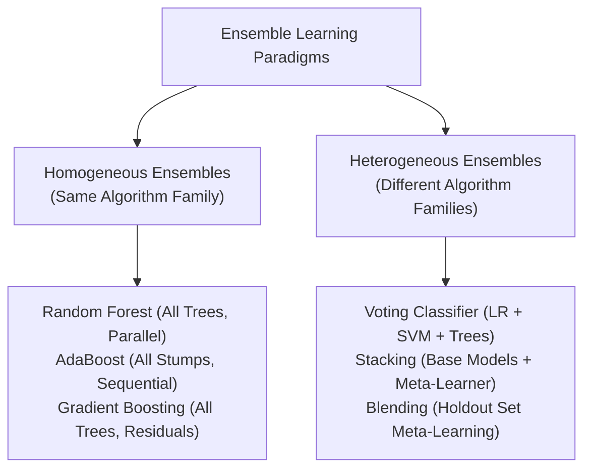

# Lecture 30.09: Ensembling Paradigms — Homogeneous Aur Heterogeneous Ensembles Ka Farak [Hinglish]

---

## 📌 Topic Overview
Fundamental comparison of ensemble paradigms. Homogeneous ensembles aggregate multiple replicas of the same model family (e.g., all Decision Trees in Random Forest or Boosting). Heterogeneous ensembles combine completely different model architectures (e.g., Logistic Regression + SVM + Decision Trees).

---

### 📋 Is Topic Mein Hum Kya Seekhenge?
- **Homogeneous Ensembles** kya hote hain: Ek hi type ke algorithm ke multiple models (jaise Random Forest mein saare Decision Trees, AdaBoost mein saare Stumps).
- **Heterogeneous Ensembles** kya hote hain: Alag-alag family ke models ko aapas mein jodna (jaise Logistic Regression + SVM + Decision Tree).
- Heterogeneous Ensembles kyu powerful hain: Alag algorithms ki decision boundaries alag hoti hain, isliye unka combination individual weakness ko cover kar leta hai.
- Roadmap: Aage ke lectures mein **Voting**, **Stacking**, aur **Blending** seekhenge.

---

### 🔍 Har Ek Point Ka Simple & Detailed Explanation
- **Homogeneous Ensembles (Same Model Family)**: Abhi tak humne supervised learning mein jo ensembles dekhe (jaise **Random Forest**, **Gradient Boosting**, **AdaBoost**), wo sab homogeneous the. Unme saare base learners **Decision Trees** hi hote hain.

- **Heterogeneous Ensembles (Different Model Families)**: Isme hum alag-alag type ke algorithms ko combine karte hain — jaise ek **Logistic Regression**, ek **Support Vector Machine (SVM)**, aur ek **Decision Tree**. Teeno models ka sochna aur decision lena alag hota hai.

- **Kyu Heterogeneous Ensembles Banate Hain?**: Har algorithm ka mathematical assumption alag hota hai (linear model linear boundary dekhta hai, tree non-linear rectangular splits karta hai, SVM margin maximize karta hai). Jab alag nature ke models ek sath vote karte hain, toh error rate drastically drop hota hai.

- **Teen Primary Heterogeneous Techniques**:

-   1. **Voting (Majority / Averaging)**: Sabhi models se direct vote ya probability average lena.

-   2. **Stacking (Meta-Learning)**: Ek model ke uper doosra model (Meta-Model) bitha kar sikhana.

-   3. **Blending (Holdout Meta-Set)**: Stacking ka fast validation-split based variant.

---

### 📊 Visual Flowchart / Diagram

---

### 🔢 Mathematical Derivation

Variance reduction in an ensemble of $M$ diverse estimators with pairwise correlation $\rho$:

$$
\text{Var}\left( \frac{1}{M}\sum_{m=1}^M f_m(x) \right) = \rho \sigma^2 + \frac{1 - \rho}{M} \sigma^2
$$

Heterogeneous ensembles minimize the cross-correlation $\rho \to 0$, maximizing variance reduction.

---

### 📌 Note on Code
Yeh pure conceptual, mathematical, aur blackboard theory lecture hai. Ma'am ne is lecture mein code nahi likha hai, isliye rule ke mutabiq isme koi extra synthetic code add nahi kiya gaya hai.

