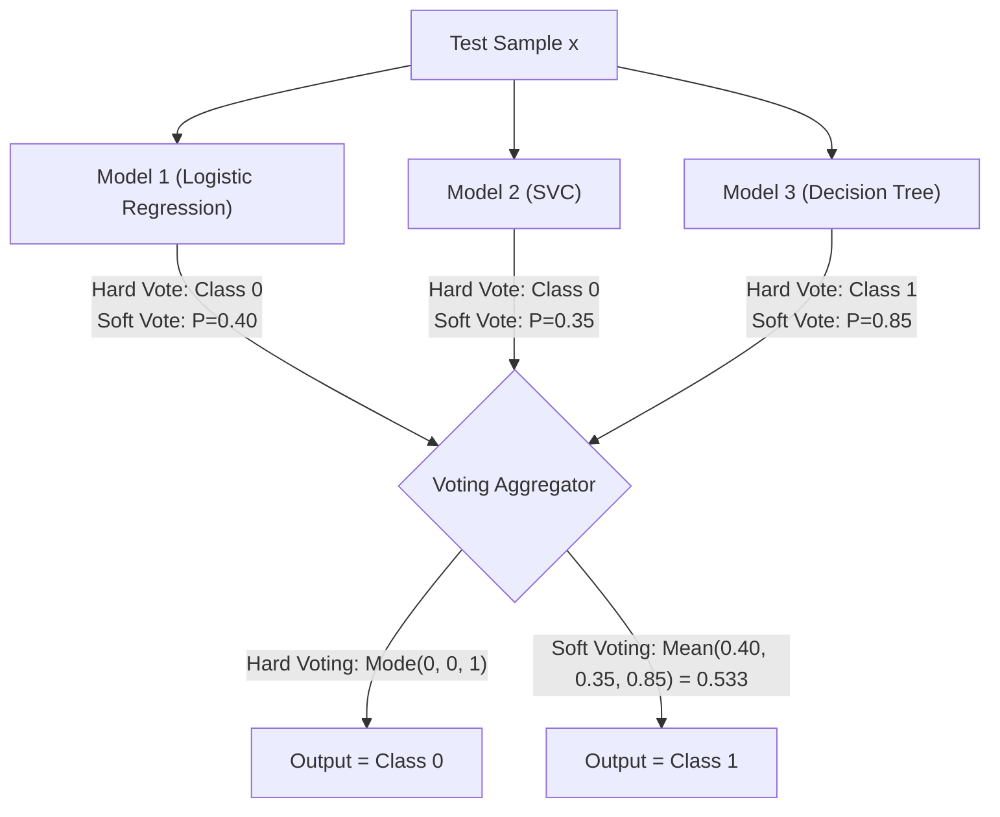

# Lecture 30.10: Voting Classifier & Regressor (Logic) — Hard vs Soft Voting Mechanics

[](#)
[](lecture_30_10.ipynb)
[](README_HINGLISH.md)
[](notes.pdf)
[](notes_hinglish.pdf)

---

## 📌 Topic Overview
Conceptual and algorithmic mechanics of Voting Classifiers and Voting Regressors. Contrasts Hard Voting (majority plurality rule based on discrete class labels) with Soft Voting (argmax over average predicted class probabilities). Explains why Soft Voting consistently outperforms Hard Voting by incorporating model prediction confidences.

---

### 🗺️ Visual Architecture Diagram



---

### 🛠️ Mathematical Mechanics & Theoretical Foundations
For hard voting across $K$ base classifiers with discrete predictions $h_k(\mathbf{x}) \in \{0, 1\}$:

$$
\hat{y}_{\text{hard}} = \text{mode}\{h_1(\mathbf{x}), h_2(\mathbf{x}), \dots, h_K(\mathbf{x})\} = \arg\max_{c} \sum_{k=1}^K \mathbb{I}(h_k(\mathbf{x}) = c)
$$

For soft voting with predicted class probabilities $P_k(y = c | \mathbf{x})$:

$$
\hat{y}_{\text{soft}} = \arg\max_{c} \frac{1}{K} \sum_{k=1}^K P_k(y = c | \mathbf{x})
$$

---

### 💻 Python Production Implementation

```python
import numpy as np

def demonstrate_hard_vs_soft_voting():
    """
    Demonstrates the concrete scenario where Soft Voting outperforms Hard Voting
    by incorporating model prediction confidence probabilities.
    """
    # Probabilities of Class 1 from 3 heterogeneous models
    # Model 1 is highly confident; Models 2 & 3 are marginal (barely below 0.5)
    model_probabilities = np.array([0.90, 0.48, 0.45])
    
    # 1. Hard Voting: threshold each at 0.5
    hard_votes = (model_probabilities >= 0.5).astype(int)
    counts = np.bincount(hard_votes, minlength=2)
    hard_prediction = int(np.argmax(counts))
    
    # 2. Soft Voting: mean probability
    mean_probability = float(np.mean(model_probabilities))
    soft_prediction = int(mean_probability >= 0.5)
    
    return {
        "individual_probabilities": model_probabilities.tolist(),
        "hard_votes": hard_votes.tolist(),
        "hard_prediction": hard_prediction,
        "mean_probability": mean_probability,
        "soft_prediction": soft_prediction
    }

# ----------------- Driver Execution & Testing -----------------
if __name__ == "__main__":
    res = demonstrate_hard_vs_soft_voting()
    print("=" * 60)
    print("--- HARD VS SOFT VOTING MECHANICS COMPARISON ---")
    print(f"Model Probabilities P(y=1) : {res['individual_probabilities']}")
    print(f"Discrete Hard Votes         : {res['hard_votes']} (Class 0: 2, Class 1: 1)")
    print(f"-> Hard Voting Prediction   : Class {res['hard_prediction']}")
    print(f"Average Ensemble Probability: {res['mean_probability']:.4f}")
    print(f"-> Soft Voting Prediction   : Class {res['soft_prediction']}")
    print("=" * 60)
```

---

### 🔑 Critical Architectural Takeaways
1. **Multi-Family Generalization**: Combining diverse inductive biases (linear, tree-based, margin-based, metric-based) cancels out individual model blindspots.
2. **Leakage Protection via OOF**: Cross-validated out-of-fold predictions ensure the Level-1 meta-model optimizes strictly on unseen generalization behaviors.
3. **Calibrated Confidence Weights**: Soft voting and meta-learning outperform simple hard voting by incorporating prediction probability confidences.
